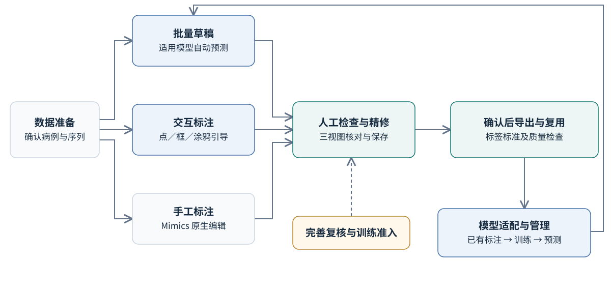
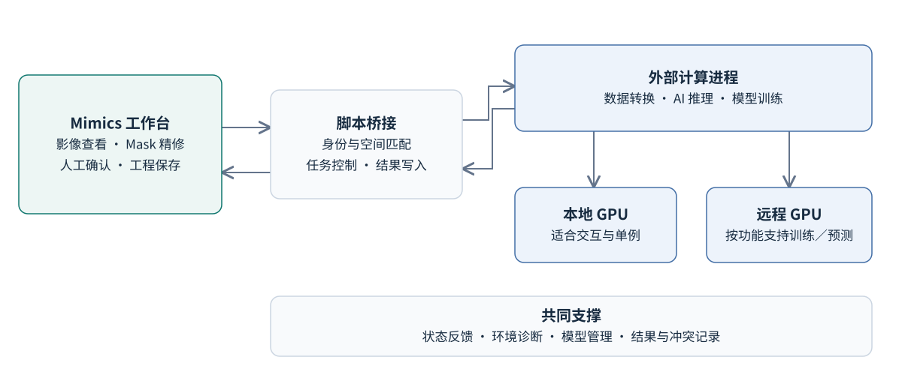
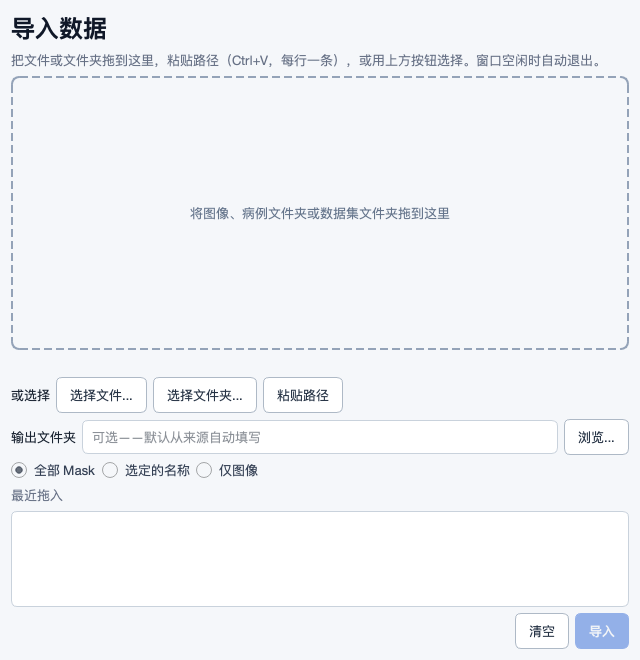
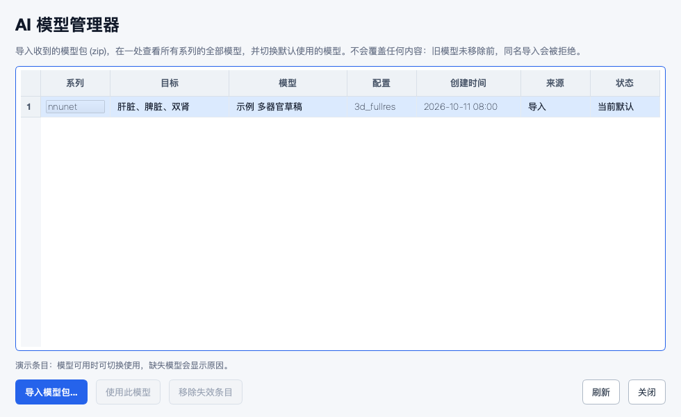

# Mimics 医学影像标注扩展项目汇报

## 汇报摘要

本项目围绕医学影像标注中的三类重复工作开展开发：**把不同来源的数据变成可标注工程、借助 AI 生成和修正分割草稿、将人工确认的标注整理为可复用的数据和模型**。Mimics 继续承担影像查看、精细编辑与人工确认；扩展工具补充格式转换、交互分割、批量处理及模型训练能力。

目前已形成覆盖数据导入、AI 辅助标注、人工修正、结果导出和模型迭代的主要能力，并有公开 CT 数据上的运行与效果记录。**下一步重点是稳住真实工作流、证明实际节省的标注时间，再有选择地扩展功能。** 多人使用、不同设备与数据来源下的稳定性，以及全身器官、小器官和病灶的实际效果仍需扩大验证，现阶段不承诺所有数据均可自动分割。

## 一 设计方案

### 从标注者的真实工作出发

工具面向全身器官、局部结构等医学影像标注任务，保留批量草稿、从空白开始交互标注、精细手工修正及利用已有标注训练模型的路径。目前效果证据集中在部分 CT 器官。设计目标是方便、稳定、高效、易学，并使关键状态和错误原因清楚可见。

| 真实场景 | 工具提供的帮助 | 标注者负责的环节 |
|---|---|---|
| 数据分散，格式和目录结构各异 | 识别数据、转换格式、导入图像和已有掩码，生成 Mimics 工程 | 确认病例、序列和图像方向，决定导入哪些标签 |
| 已有适用模型，需要批量制作草稿 | 单例或批量预测，减少重复启动与搬运文件 | 逐例检查，修正漏分、误分及边界 |
| 缺少适用模型，需要交互标注 | 用点、框或涂鸦引导 AI，辅助生成目标结构 | 选择目标、补充提示，并在 Mimics 中精修 |
| 已积累标注，希望适配本单位任务 | 从已有标签准备训练数据，训练、评估并管理模型 | 确定标签标准、训练病例与模型适用范围 |
| 病例较多，需要安排标注顺序 | 按模型分歧辅助挑选值得优先检查的病例 | 决定标注优先级，显式确认复核完成 |

*图 1 同一套工具兼容批量草稿、交互标注和精细手工三条路径。虚线表示仍需完善的人工复核状态与训练准入约束。[编辑图稿](project_brief_assets/workflow.drawio) · [编辑 Mermaid 源码](project_brief_assets/workflow.mmd)*

### 与 Mimics 的分工

采用外挂式架构，通过 Mimics 脚本接口联动，保留使用者熟悉的三视图、Mask 编辑和三维查看方式。耗时的转换、训练和推理尽量在外部进程完成；模型结果经过空间匹配和目标检查后回到 Mimics。图像缓冲区读取、结果写入等仍依赖宿主接口，大体积数据下的响应需要持续优化。

*图 2 本地 GPU 与远程 GPU 是按功能配置的计算选项；不同 AI 功能的远程支持范围有所区别。[编辑图稿](project_brief_assets/architecture.drawio) · [编辑 Mermaid 源码](project_brief_assets/architecture.mmd)*

### AI 能力各有适用位置

| 能力 | 在标注工作中的位置 | 使用边界 |
|---|---|---|
| nnInteractive | 三维交互分割；支持官方模型及任务微调模型 | 依赖提示质量、目标结构与模型适配，不保证一次提示即可完成 |
| ScribblePrompt | 二维切片上的点、框与涂鸦辅助分割 | 适合局部切片辅助，不能直接替代完整三维器官标注 |
| nnU-Net | 训练任务模型，进行多类别单例或批量预测 | 需要合格的标签与训练数据；不会自动获得全部器官的模型 |
| FlexiCT | 利用 CT 预训练表示开展少样本适配，支持多标签扩展 | 当前效果记录以有限 CT 器官为主，不外推到任意模态或病灶 |
| 主动学习辅助 | 用两个模型的分歧辅助安排优先检查顺序 | 分歧是检查线索，不能作为医学正确性或标注完成的证明 |

这些能力基于公开研究和开源实现开展集成与适配。项目价值在于让算法进入标注者已有的 Mimics 工作流，并把数据、模型、任务反馈和人工确认连接起来。

## 二 阶段性成果

### 数据与标注流转已具备主要链路

已提供拖拽、浏览和粘贴路径的统一导入入口，支持 NIfTI、DICOM、MHD/MHA 等数据路径；可导入已有掩码、选择需要的标签、导出标注，并查看任务状态、停止任务和撤销最近导入。不同格式和目录布局有各自限制，例如混合 DICOM 序列和多帧数据目前采取拒绝处理的保护策略，需要先整理为支持的输入。

### AI 草稿与模型迭代已有实际成果

四类 AI 能力已接入工具。既往特定 Windows 与 GPU 环境中，仓库记录了公开 CT 数据上的导入、交互分割、任务微调、多器官预测和远程训练结果：肝脏、脾脏与双肾等任务已有较好的分割草稿；FlexiCT 的肝脏少样本及肝脏加脾脏多标签适配已有效果记录。这些记录说明部分场景的能力，不代表当前版本的所有配置均已通过实机验证。困难器官、小器官仍有较大差异，不能把大器官结果推广为全身器官整体水平。

已有小规模留出病例中，部分大器官的 Dice 约为 **0.92–0.99**。Dice 表示预测与参考标注的空间重合程度，**不等于病例正确率，也不等于人工修改量或节省时间**；交互提示的实验构造与真实使用仍有差别，效率收益需由实际标注过程确认。相关结果可追溯至[真实数据记录](history/2026-09-30_ai_real_data_validation.md)。

### 使用与支持能力逐步完善

已整理数据、AI、审阅与管理菜单，常用的模型管理和撤销导入放回对应工作流；结构识别与窗宽窗位辅助帮助定位和检查标注。外部窗口采用共享视觉样式，主要文案中文化，并增加后台加载、任务反馈和小屏适配。环境安装与修复、模型包导入、远程计算配置、系统健康查看和诊断包收集也已形成入口，减少使用者直接操作脚本与配置文件的负担。

*图 3 当前代码生成的导入界面，集中提供数据选择、导入选项与任务反馈。*

*图 4 当前代码生成的模型管理界面，在同一窗口查看模型系列、目标、来源与可用状态。截图中的模型为演示条目。两张截图均在隔离环境中渲染，不包含患者数据，不代表 Windows 宿主验收。*

### 阶段判断

项目已具备面向实际任务试用和持续改进的基础。数据保护、病例身份、错误恢复和界面响应已有多轮改进，但仍有待复核事项。**当前成果是主要能力已形成、部分场景已有实际效果；全面生产成熟度和可量化提效仍是下一阶段目标。**

## 三 后续计划

按依赖和实际价值安排推进顺序，不以增加算法数量作为主要目标。

| 顺序 | 推进内容 | 希望形成的成果 |
|---|---|---|
| 优先一 稳定工作流 | 核对导入、预测、人工修正、保存和导出的完整链路；完善病例身份、结果覆盖保护、撤销与失败恢复 | 标注者清楚结果属于哪例、存在哪里、如何恢复，减少重复劳动与误操作 |
| 优先二 验证使用价值 | 选取有代表性的全身器官、局部器官和困难结构任务，比较实际操作时间、修正负担和结果质量；覆盖常见设备与数据来源 | 明确哪些任务值得用 AI、哪些适合交互或手工，以及推荐的使用配置 |
| 优先三 打磨日常体验 | 统一输出位置与状态含义，改善小屏、高 DPI、长病例名和跨窗口操作；补充首次使用引导 | 让初次使用者能独立完成任务，关键动作可见，等待与失败有明确下一步 |
| 按需扩展 标注提效 | 优先评估病例工作清单、定位待修区域、AI 草稿与人工修改对比、标签命名规范和导出过期提醒 | 把精力引向真正需要检查和修正的区域，而非反复找文件与核对状态 |

主动学习后续需明确“打开过”“AI 已叠加”“人工已完成”的区别，并验证排序是否减少标注成本。模型续训也需区分恢复中断训练与使用新标注再次训练，避免使用者误解模型更新能力。

## 四 风险分析

| 主要风险 | 对使用的影响 | 应对方向 |
|---|---|---|
| 数据与标签不匹配 | 错病例、错序列或空间错位可能产生看似合理的错误标注 | 优先检查身份和空间匹配；含歧义输入明确拒绝，并提供整理指引 |
| 人工成果被覆盖或丢失 | 后台结果、撤销和重复导出可能影响已完成工作 | 继续收紧目标版本和对象归属检查，保留冲突结果与明确的恢复路径 |
| AI 适用范围有限 | 小器官、病灶及不同扫描条件下草稿质量波动，修正成本可能较高 | 按任务建立使用边界；保持人工复核，并用实际修正负担评价模型 |
| 环境与计算资源差异 | Mimics 版本、显卡驱动、CUDA 环境、显存与远程资源影响运行；首次加载模型和图像可能较长 | 明确支持组合和降级方式，完善预检与故障提示；区分首次准备与连续交互的等待，长任务保持可追踪 |
| 状态和操作体验尚有缺口 | 误把叠加视为完成、找不到输出或小屏按钮不可达，会导致漏标和重复操作 | 统一状态、路径和主要动作，按真实流程完成可用性复核 |
| 研究数据与权重使用边界 | 向实际患者数据或其他用途扩展时，传输范围、模型许可及使用条件需明确 | 在批准范围内使用数据和计算资源，分别核对代码与权重许可，避免把研究验证视为临床可用证明 |
| 长期维护成本 | AI 依赖更新、文档与代码不同步可能增加接手和排障难度 | 固定可复现环境与模型版本，保留问题记录和操作指南，控制新增维护面 |

## 五 需要的支持

建议业务方提供代表性病例与标签标准，协调标注人员参与试用；技术支持确认常用 Mimics 版本、工作站配置和可用计算资源，相关负责人明确数据使用范围。以“人工复核后质量可靠、实际操作省时、失败可恢复”为下一阶段验收目标；依据试用结果再决定扩大使用和新增功能的优先级。

---

**图稿与依据**：非截图图形均附 `.drawio`、`.svg` 和 Mermaid 源文件，文字、节点及连线可修改。[图稿说明](project_brief_assets/README.md)提供编辑方法与截图来源。实现依据见[功能入口](mimics_entry_guide.md)、[工作流说明](scripting_library_workflows.md)和[架构说明](MIMICS_PROJECT_ARCHITECTURE_CN.md)。研究与接口来源见 [Materialise 自动化能力](https://www.materialise.com/en/healthcare/mimics/accelerate-workflow-automation)、[nnInteractive](https://github.com/MIC-DKFZ/nnInteractive)、[ScribblePrompt](https://github.com/halleewong/ScribblePrompt)、[FlexiCT](https://github.com/ricklisz/FlexiCT)、[nnU-Net](https://github.com/MIC-DKFZ/nnUNet)。
