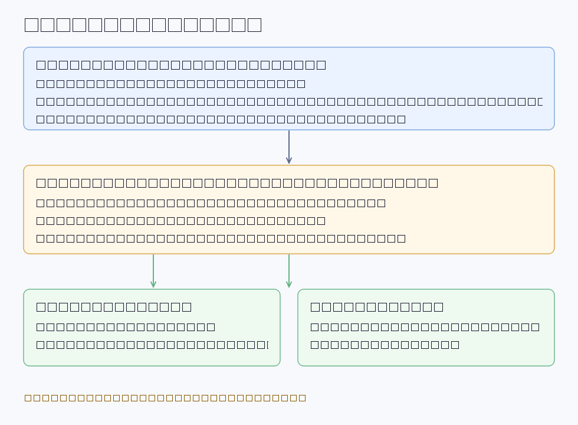
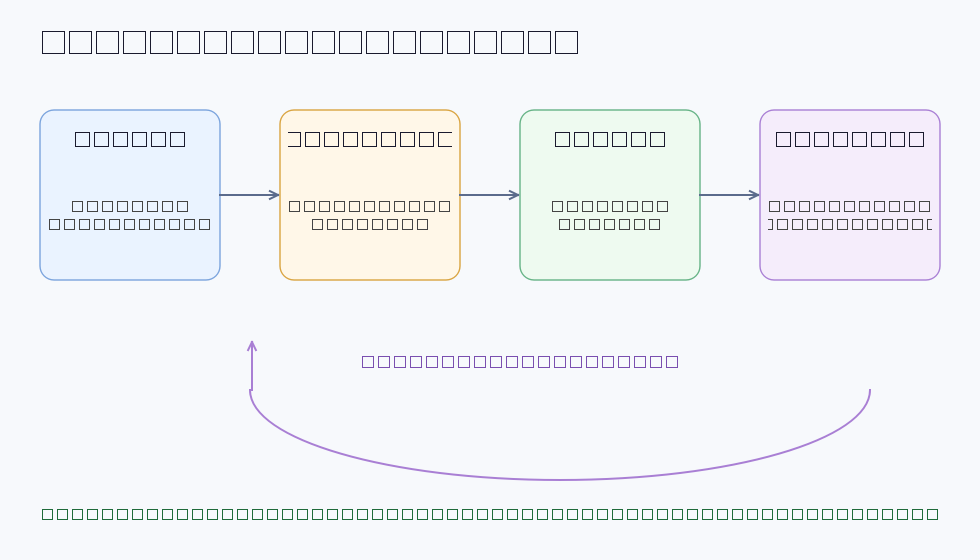
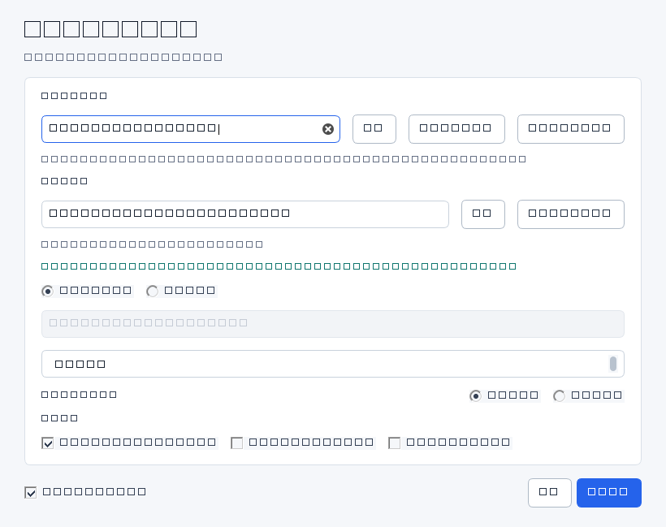
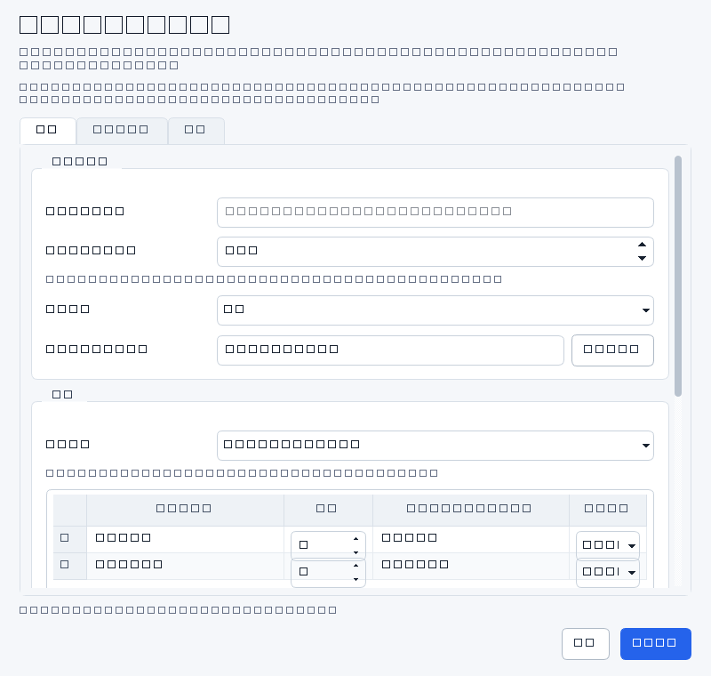
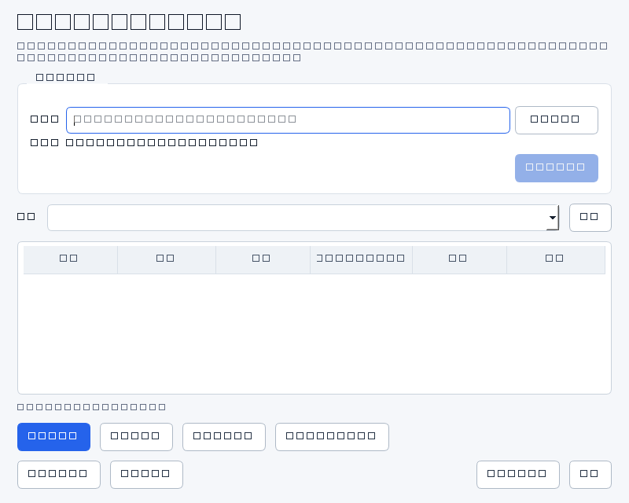

# Mimics AI 标注工具开发项目汇报

**汇报日期**：2026-10-11
**项目周期**：2026 年 7 月启动，9 月下旬进入密集迭代交付，至今 494 次提交、79 轮记录在案的迭代
**投入**：1 名开发（AI 辅助编程）
**当前状态**：核心功能全部交付，全量质量门禁 31/31 通过；1 名标注者（项目负责人）已在真实数据上日常使用，批量生产验证待开展

---

## 一、设计方案

### 项目定位

为医学影像标注软件 Materialise Mimics 建设一套**外挂式 AI 标注能力**：不改造 Mimics 本体，通过其脚本接口，把数据导入导出、AI 交互分割、模型训练与批量推理等重活接到外部计算环境上。目标是让标注者**从"逐层手画"升级为"点一下、AI 出初稿、人工校对"**。

### 总体架构（三层）

1. **功能入口层**（Mimics 内菜单）：数据、AI、审阅、管理四大菜单共 28 个入口，覆盖日常标注全流程。
2. **桥接层**：Mimics 自带的旧版 Python 只做轻调度；图像转换、几何校验等重计算全部放到外部现代 Python 环境执行，**保证 Mimics 界面全程不卡顿**（本项目第一铁律）。
3. **训练/推理层**：本地 GPU 与远程 GPU 服务器双后端。

### 四个 AI 引擎的分工

| 引擎 | 定位 |
|------|------|
| nnInteractive | 点选式交互分割：标注者点一下器官，AI 即出初稿 |
| FlexiCT | 少样本自训：仅 8 例标注即可训出本单位数据的专属模型 |
| nnU-Net | 多器官批量自动分割（研究级通用引擎） |
| ScribblePrompt | 涂鸦式交互分割（辅助手段） |

### 四条核心能力线

| 能力线 | 内容 |
|--------|------|
| **数据流转** | 拖拽式导入（单文件/整数据集/含中文空格路径）、掩码注入与导出、任务状态总览与逐任务停止、误导入一键撤销 |
| **交互式 AI 标注** | 官方模型与自训模型的点选交互分割（见上表） |
| **模型训练** | FlexiCT / nnU-Net 训练，本地或远程一键发起，进度曲线实时可查 |
| **主动学习闭环** | 双模型分歧排序未标注池 + 不确定度可视化，把"先标哪例"变成数据驱动 |

---

## 二、阶段性成果

### 1. 功能交付：四条能力线全部闭环

实际界面（均为真实工具窗口截图）：

| 拖拽导入窗口 | Mask 导出窗口 |
|---|---|
|  |  |

| nnU-Net 训练发起窗口 | 主动学习审阅窗口 |
|---|---|
|  |  |

- **导入**：从原始 CT 数据到 Mimics 可标注工程，拖入即转，支持 NIfTI/MHA/DICOM 等主流格式与 TotalSegmentator 数据集布局；
- **AI 标注**：交互分割日常可用；自训模型已在真实数据上验证——留出验证病例（未参与训练的病例）Dice 肝脏 0.97 / 脾脏 0.94–0.99（即 AI 初稿与专家标注重合度约 94%–99%，人工只需微调边界）；
- **训练**：远程训练全链路（数据上传→容器构建→训练→结果回收）打通，8 项审计修复全部实测通过；
- **闭环**：主动学习排序窗口上线，标注→训练→排序→优先标注的循环跑通。

### 2. 稳定性：从"事故频发"到"门禁全绿"

- 79 轮迭代全部有台账记录（台账即问题清单：每个问题记录来龙去脉、修复提交号与验证证据，任何结论可回溯）；
- 累计修复 P0 级问题 9 个（数据丢失/崩溃/无法启动类），全部留有防回归测试；
- 最新全量门禁 **31/31 套件、621 例测试通过**（2026-10-10，含功能、训练收敛性、交叉工作流、压力测试），测试结果记录可随时调阅；
- 10 月以来标注者报告的全部阻塞问题（导入失败、宿主崩溃、界面卡顿）已逐个根因关闭。

### 3. 易用性：标注者视角的持续打磨

- 全部界面文案中文化；常用操作点击深度压缩到 2 层；
- 管理菜单按"环境/健康"分组，模型管理移入 AI 菜单，日常操作不再进管理菜单；
- 错误提示全部给出中文"建议操作"（修复环境/检查网络盘/重试路径），而非抛英文报错；
- 拖拽窗口支持中文、空格、网络盘路径全链路。

### 4. 使用现状（截至汇报日）

1 名标注者（项目负责人）自 10 月上旬起在日常工作中真实使用全部核心流程，期间报告的问题即上面已关闭的阻塞项。**批量多人、多病种的正式生产验证尚未开始**——这是后续计划第一项。

### 5. 可维护性资产

- 三级回归门禁（冒烟 1 分钟 / 快速 10 分钟 / 全量 30 分钟），每轮改动过门禁才算完成；事故修复即沉淀自动化测试，防止复发；
- 三本台账（问题待办 / 复杂度预算 / 轮次报告）支持新成员接手；
- 一键打包分发（便携包）与诊断收集（脱敏压缩包），降低部署与支持成本。

---

## 三、后续计划

| # | 事项 | 预计时间 | 说明 |
|---|------|----------|------|
| 1 | **真实标注生产验证** | 1–2 周 | 由标注者对真实数据做批量标注，系统评估 AI 初稿在本单位数据上的分割精度，收集单例标注耗时、首次上手时间 |
| 2 | **产品指标体系落地** | 与第 1 项同步 | 量化"AI 辅助 vs 纯手工"的效率增益，形成可对外引用的数据 |
| 3 | **训练-标注闭环实战** | 2–3 周 | 用主动学习排序驱动一批真实标注任务，验证其对整体进度的实际加速 |
| 4 | **按需打磨** | 持续 | 台账中若干 P2 级易用性条目，随真实使用反馈按价值排序处理 |

（以上时间为单人投入下的估计；若获得下述支持，可相应提前。）

---

## 四、风险分析

| 风险 | 影响 | 应对 |
|------|------|------|
| **本单位数据上的分割精度未系统评估**（高） | 目前的精度数据来自公开数据集；本院扫描仪、目标病种的数据上表现待验证。若初稿质量差，校对耗时可能接近手画，动摇核心价值 | 已列为后续计划第 1 项，最先补齐；FlexiCT 少样本机制（8 例即可自训）本身就是针对此风险的手段 |
| **数据安全与合规**（高） | 目前仅使用公开研究数据集（TotalSegmentator），尚无患者数据；未来接入本院数据时，远程服务器传输、审批流程需合规评估 | 现有远程链路仅使用项目专属目录、任务结束即清理；接入院内数据前将走数据安全审批，未批不传 |
| **远程服务器为共享资源**（中） | 训练高峰期排队，影响交付节奏 | 已有"先查后用、用完即清"流程；长任务错峰；极端情况切本地 GPU |
| **单人依赖**（中） | 核心开发集中在一人，存在人员风险 | 台账 + 门禁已将过程知识文档化，接手成本已主动压低；**建议培养 1 名备份人员**（见下节） |
| **Mimics 版本升级**（低） | 脚本接口变更可能破坏入口层 | 外挂式架构使影响面限于桥接层；接口接触点有自动化兼容性检测 |

---

## 五、需要的支持与决策

1. **备份人员**：建议指定 1 名工程师以"接手台账 + 跑通三级门禁"为标准做阶段性交接，预计需其投入 1–2 周熟悉期，之后本项目具备双人可维护能力。
2. **标注团队协调**：后续计划第 1、3 项需要 1–2 名标注者配合开展真实数据验证，请协助安排与时间窗口。
3. **服务器资源**：若主动学习闭环实战（第 3 项）期间共享服务器排队严重，需决策是错峰使用还是申请专用资源。
4. **合规预沟通**：接入本院患者数据前，请明确数据安全审批的责任部门与流程，以便提前准备脱敏方案。

---

## 六、结语

本项目以 1 名开发 + AI 辅助编程的投入，完成了从架构到全功能交付，并建立了"每轮迭代有台账、每个修复有测试、每份声明有证据"的工程纪律。工具已支撑单人真实使用，下一步的重点是把"能用"证明为"好用、省时间"——用本单位真实标注数据量化效率增益，并补齐精度与合规两块拼图。
