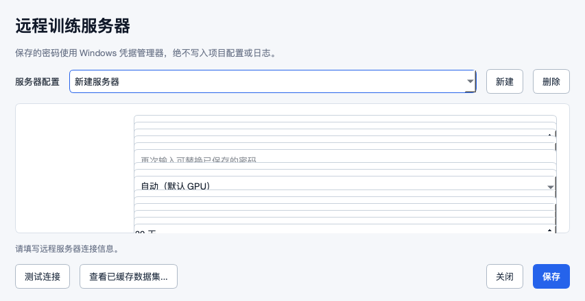
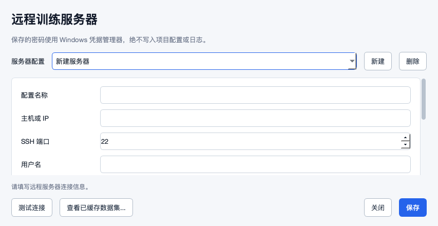
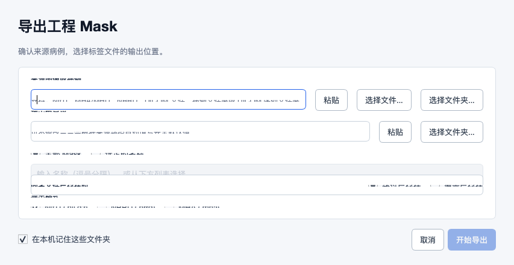
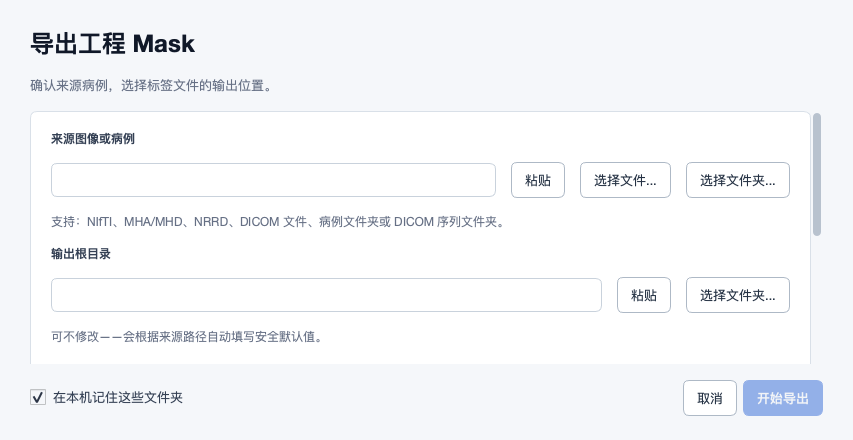
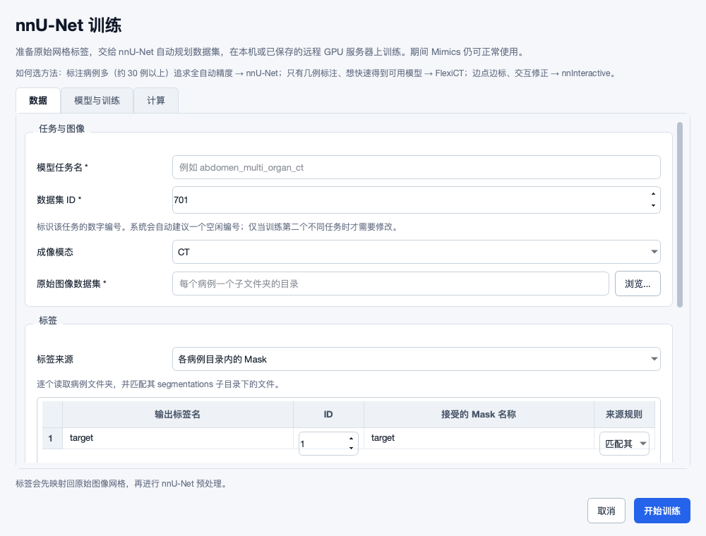
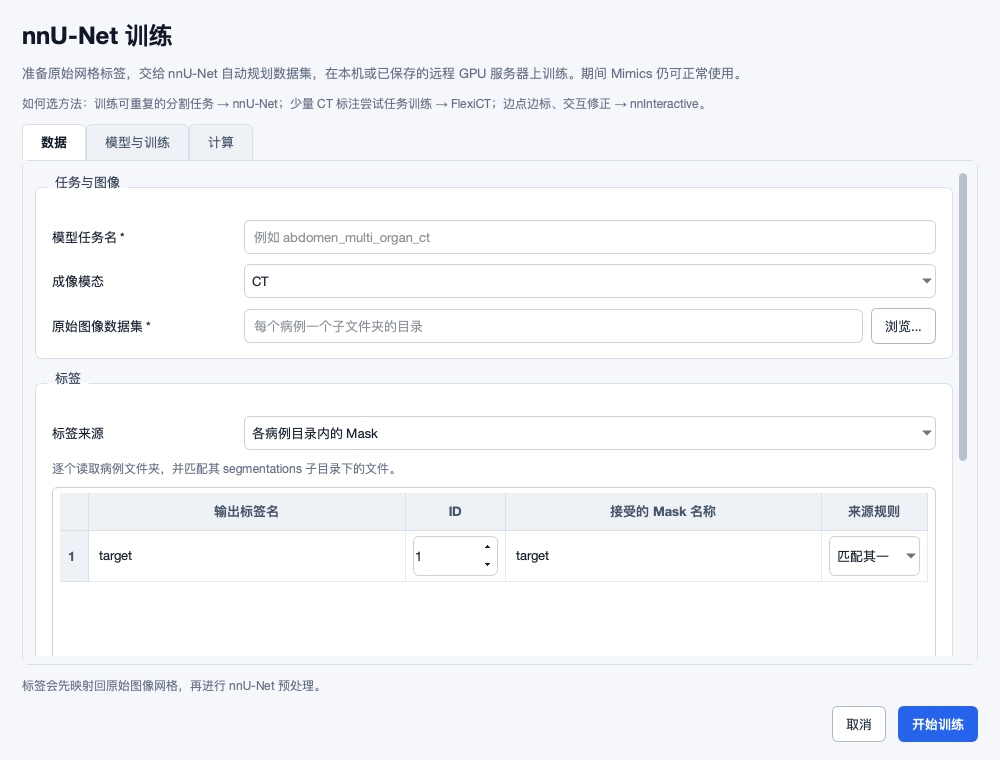
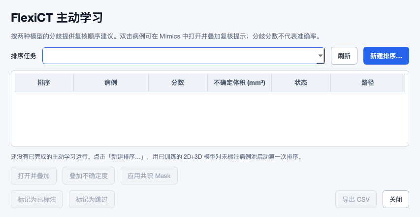
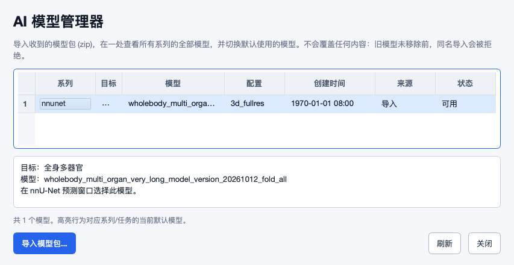
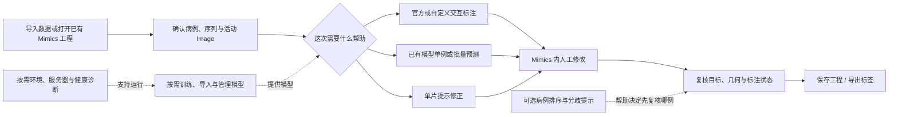

# 2026-10-12 标注者 UI、入口与操作闭环审查

这轮确认当前 UI 仍有实际布局和交互问题，不能仅凭“窗口能打开”认定好用或精美。已修复长表单重叠、来源规则文字截断、指定名称导入语义错误、FlexiCT 非空模型列表报错等问题；保留确有用途的功能入口，合并重复操作并折叠专业参数。仍有 20 项设计/使用风险需要后续处理或目标机验收。

**定位问题请先看第 2 节的截图、第 3 节的修复表和第 6 节的开发卡。** 本文是开发与测试交接材料；不替代 [领导汇报](../project_brief_2026-10-11.md) 和 [上一轮数据安全/工作流审查](2026-10-11-revalidation.md)。

## 1. 审查边界与结论依据

- 基线：`a8c8ea67ab0c65eec66d0268e9f61ec6617bcc24`，开始本轮时与远程同步；修复源码：`5d8a811a82cdd4934c1e6671a50a2f74bd6ee0c9`（包括 `e01501d`、`ae737f0` 及表格尺寸补充修复）。
- 逐一检查 **28 个 Scripting Library 入口、20 个外部 UI 模块及远程缓存子窗口**。静态清单包含 246 处控件声明、196 处信号绑定，见 [入口/控件/回调清单](2026-10-12-ui-evidence/control-and-entry-inventory.json)。这些是源码声明数量，不是业务功能数，也不等于每个回调都完成了真实设备端到端测试。
- 实际构造 Qt 窗口、渲染正常尺寸和 853×440 逻辑像素的紧凑尺寸；遍历标签页，展开高级表单并滚动至末端；补充长模型名、非空列表、失败、远程未知状态和禁用状态。增加 125% 字体尺寸压力检查。截图使用真实控件及**合成病例/临时目录**，没有患者数据。
- 入口测试执行真实入口脚本、加载真实运行模块，在产生副作用的处理函数边界替换调用；另测主要方法内动作分派。证明入口与动作连通，**没有证明真实 GPU 推理、模型训练、SSH、Mimics 图像/Mask 写入全部成功**。
- 环境为 macOS、Python 3.12、PySide6/Qt 6.12 离屏渲染。目标 Windows、Mimics 具体版本、中文字体、屏幕缩放和 CUDA/GPU 组合仍未知。原生 Mimics question_box、系统文件选择器、QInputDialog 及部分异常确认框主要进行了源码路径审查，外观和焦点行为仍需目标机验证。
- 当前记录了可验证缺陷及剩余风险，不作“所有潜在 bug 已找全”或“所有 UI 完美”的承诺。上一轮的几何、撤回、并发和结果覆盖问题不能因这次 UI 变清楚而视为解决。

## 2. 问题在哪里：实际前后对照

### 2.1 远程服务器设置：原来整页被压缩，现在内容滚动、操作固定

原来小屏时字段高度不足，标签和输入框交叠。只限制窗口尺寸会使问题更明显。修复后保留正常字段高度，把容器、命名空间、校验和缓存参数放入“高级运行设置”；保存、测试和关闭始终在底部。

| 修复前 | 修复后 |
|---|---|
|  |  |

### 2.2 导出：标签和输入框不再压在一起

来源、输出、Mask 和格式选项保留；滚动内容不会把“开始导出”一起推到不可达位置。这里原有的空名称/空格式校验已经存在，本轮没有把它当作新 bug。

| 修复前 | 修复后 |
|---|---|
|  |  |

### 2.3 nnU-Net 标签表：短选项不应被截断

“匹配其一”和“合并全部”决定标签来源规则，属于必须完整显示的短操作文字。带 ComboBox 的表格单元格没有普通文字可供自动列宽计算，本轮为其补充尺寸提示和行高；数据集编号移到高级区，任务名错误提示不再共占网格行。

| 修复前 | 修复后 |
|---|---|
|  |  |

### 2.4 主动学习与模型管理：减少猜测和重复路径

主动学习默认显示病例结果，一处新建/收起表单。所选病例的操作才启用；“叠加”仍不应表示完成标注，见 UI14。模型管理选中后提供全文，nnU-Net 不显示不适用的设置默认动作。

| 主动学习默认视图 | 模型全文与适用动作 |
|---|---|
|  |  |

版本页的 [放大字体按钮完整显示](2026-10-12-ui-evidence/after-model-action-font125.png) 记录了纵向裁切修复。

版本页的 [放大字体按钮完整显示](2026-10-12-ui-evidence/after-model-action-font125.png) 记录了纵向裁切修复。

训练进度页的 [前](2026-10-12-ui-evidence/before-interactive-progress.png) / [后](2026-10-12-ui-evidence/after-interactive-progress.png) 也有内容压缩与禁用样式修复；[新建排序](2026-10-12-ui-evidence/after-active-learning-create.png) 和 [高级服务器设置](2026-10-12-ui-evidence/after-remote-expanded.png) 可直接查看。

**关于“文字超过按钮”：** 基线标准字体测量未发现 QPushButton 文字横向超出内容区；确认的是来源规则 ComboBox 截断、表单内勾选/单选文字的纵向挤压、模型版本页按钮被单元格裁切，以及误导的禁用样式。修复后的标准字体及 125% 字体压力渲染均未发现被测按钮/组合框文字越界。这个结果不覆盖未提供的 Windows 字体与所有更小屏幕组合，不能用来否定用户曾经看到的现象。

## 3. 本轮实际修复

P1 表示可能阻断操作或改变数据选择语义；P2 表示理解、效率和视觉一致性问题。

| 编号 | 问题 | 具体位置 | 改了什么、为什么 | 如何验证 |
|---|---|---|---|---|
| UI01 / P1 | 小屏表单被压缩：标签与输入重叠 | 导出、远程配置、进度、配置页、预测/批量、导入等 | 保持内容最小尺寸，使用滚动区域；主要动作留在底部。窗口尺寸限制不能替代内容滚动。 | 实际小屏图、滚动末端、主要动作可见测试 |
| UI02 / P2 | 标签表“匹配其一”显示不全，行内控件拥挤 | nnU-Net 数据页 | 带控件的单元格补尺寸提示，行高依据 ComboBox/SpinBox 计算，来源规则语义不变。 | 比较 ComboBox 实际可用区域与字体宽度，覆盖两个选项 |
| UI03 / P2 | 非法任务名提示与数据集编号占同一行 | nnU-Net 数据页 | 提示独占网格行，数据集编号移到高级训练设置，继续自动建议编号。 | 检查父布局和网格位置，展开后编号仍可操作 |
| UI04 / P2 | 重复新建排序流程；新建表单占据默认视图 | 主动学习 | 保留一个内联表单；新建/收起在固定任务选择行，默认展示结果；收起保留输入。 | 真实按钮点击、无第二模态框、收起再开仍保留输入 |
| UI05 / P2 | 无病例选择时仍显示可用的病例操作 | 主动学习 | 初始化禁用；只有选中病例才启用叠加、共识、标记；CSV 以有结果为条件。 | 加载空状态、仅有结果、选择/取消选择四种状态 |
| UI06 / P2 | “使用此模型”让人误以为切换当前会话 | 模型管理 | 改为“设为默认模型”，说明只影响后续选择；nnU-Net 在预测窗口选模型，该默认动作隐藏。 | 切换不同方法的模型行检查文案、可见性、启用状态 |
| UI07 / P2 | 模型 ID 被省略后无法辨认；错误原因覆盖身份提示 | 管理器和三个预测列表 | 管理器给可复制全文区；预测列表各列显示全文提示，失效原因与原文同时保留。 | 长模型 ID 与失效模型的实际列表测试 |
| UI08 / P1 | FlexiCT 有模型时预测选择窗口报错 | FlexiCT 预测 `_apply_models` | 方法内正确绑定 QtWidgets；原来仅在构造函数内定义，填入第一行模型即 NameError。 | 旧提交非空模型探针复现，新提交真实 Qt 列表回归通过 |
| UI09 / P2 | 全为失效模型时仍提示已推荐模型 | FlexiCT 预测 | 单独处理全部不可用状态，说明修复/重新导入，开始按钮保持禁用。 | 全部模型不可用与含可用模型分别检查 |
| UI10 / P2 | 禁用停止按钮仍是危险操作的红色 | 公共主题/训练进度 | 危险按钮补显式 disabled 样式，按钮禁用语义和视觉一致。 | 抓取真实控件背景验证灰色，并检查相关进度状态图 |
| UI11 / P2 | 修复反馈落到最后一项；键盘重新检查不生效 | 环境指引 | 反馈标签作为回调默认参数捕获；重新检查使用专用结果值和循环。 | 两项不同修复反馈、无鼠标悬停的重新检查 |
| UI12 / P2 | 专业参数暴露过多、方法效果文案过度承诺 | 远程/训练/配置 | 折叠运行细节，使用短高级标题与功能中文配置标签；删除样本量直接保证效果的表述。 | 字段值保留测试、远程既有 134 项检查、实际渲染 |
| UI13 / P1 | 按名称导入的勾选可能无效；空选变全部 | 导入数据 | 候选仅在指定名称模式显示；空选阻止提交；批量扫描复用原扫描收集名称。字符串协议中的保留词/逗号明确拒绝，仍可选择全部或重命名。 | 单例/批量实际点击到提交载荷；空选和保留名称均不发任务 |
| UI34 / P2 | 版本表可编辑但不保存；按钮行高固定 | 交互模型中心版本页 | 展示表只读，全文提示；动作行高取按钮尺寸、上下边距和单元格内边距；紧凑窗口保留列表最小高度和滚动，保证版本与启用动作可达。 | 有模型版本测试和实际渲染 |
| UI35 / P2 | 缓存说明混淆归档与预处理保留规则 | 远程设置/缓存列表 | 明确预处理缓存的高级期限；归档 30 天在后续任务启动时清理，非持续定时器。缓存指纹补全文提示。 | 沿控制器实际清理代码核对，子对话框实测和回归 |

保留现有配置键、默认值、训练/预测请求格式与 28 个注册脚本路径。没有因简化界面而删除模型训练、批量预测、补 Mask、结果恢复或管理员故障恢复能力。指定名称协议的特殊名称仍是临时限制，见 UI24；这次增加明确拒绝，未假称后端已完整支持。

## 4. 从真实标注流程判断入口，而非按方法堆按钮

一般标注者的主线应是“确认当前影像 → 得到/修正 Mask → 复核 → 保存/导出”；训练、服务器和环境配置按需进入。工程保存、标签导出、模型默认设置、当前会话模型切换、停止单任务和停止后台服务是不同动作，不能用相似按钮名混在一起。



图稿是可编辑 Mermaid 源码。保持 Mimics 作为影像查看和人工编辑主体，外部 UI 负责准备、后台计算、模型选择与状态反馈。为去除菜单而另做一个大型标注平台没有必要；优先减少跨窗口寻找结果和重复确认。

### 4.1 28 个入口的去向与保留理由

以下每项都通过实际入口分派检查；“保留”表示用途成立，不表示该功能在所有 Mimics 版本/GPU 环境已经端到端验收。运行模块与动作的原始代码行见 JSON 清单。

| Scripting Library 路径 | 标注者目的 | 实际运行模块/动作 | 入口判断 |
|---|---|---|---|
| `01_Data/01_Import_Data.py` | 导入图像/病例/数据集 | `import_drop_mimics.main` / `—` | 常用；保留。文件、拖放和粘贴共用一条识别流程 |
| `01_Data/02_Import_Masks.py` | 已有工程补充分割 | `mask_import.main` / `—` | 常用；保留。与创建新工程的导入不同 |
| `01_Data/03_Export_Masks.py` | 导出当前工程标签 | `mimics_export.quick_export_main` / `—` | 常用；保留。不能用保存 .mcs 代替标签导出 |
| `01_Data/04_Task_Status.py` | 导入导出任务进度/停止 | `batch_status_mimics.main` / `—` | 上下文入口；保留，完成后应能直接到结果位置 |
| `01_Data/05_Undo_Last_Import.py` | 撤回上次外部分割导入 | `import_undo_mimics.main` / `—` | 恢复入口；保留，但手工修改保护仍未完成，见 UI15 |
| `02_AI/00_Manage_AI_Models.py` | 跨方法导入模型包和查看默认模型 | `model_manager_mimics.main` / `—` | 管理入口；保留。默认选择与当前标注会话必须区分 |
| `02_AI/Annotate_With_ScribblePrompt.py` | 提示驱动的单片修正 | `interactive_algorithms_mimics.main` / `ACTION_SCRIBBLEPROMPT` | 可选辅助；保留，并强调作用平面/切片 |
| `02_AI/FlexiCT/01_Train_Model.py` | FlexiCT CT 任务训练 | `flexict_mimics.main` / `BUTTON_TRAIN` | 高级；保留，方法选择不应承诺几例必然得到可用模型 |
| `02_AI/FlexiCT/02_Predict_Current_Case.py` | FlexiCT 当前病例预测 | `flexict_mimics.main` / `BUTTON_PREDICT` | 常用；保留，有模型状态崩溃已修复 |
| `02_AI/FlexiCT/03_Active_Learning_Review.py` | 病例排序与分歧提示复核 | `flexict_mimics.main` / `BUTTON_ACTIVE_LEARNING` | 可选；保留，同一页新建和复核，完成状态仍有语义问题 |
| `02_AI/FlexiCT/04_Show_Status_and_Stop.py` | FlexiCT 任务状态和停止 | `flexict_mimics.main` / `BUTTON_STATUS` | 上下文入口；保留，服务停止与单任务停止不同 |
| `02_AI/nnInteractive/01_Annotate_Official_Model.py` | 直接使用官方交互模型 | `nninteractive_mimics.main` / `—` | 常用；保留，首次环境缺失应给明确修复路径 |
| `02_AI/nnInteractive/02_Annotate_Custom_Model.py` | 选择已有自定义模型再开始标注 | `nninteractive_finetune_mimics.main` / `ACTION_ANNOTATE` | 常用；保留。模型选择不是训练入口 |
| `02_AI/nnInteractive/03_Train_and_Manage_Custom_Models.py` | 交互模型训练、进度与版本 | `nninteractive_finetune_mimics.main` / `ACTION_MANAGE` | 高级工作流；保留，合并在一个模型中心合理 |
| `02_AI/nnUNet/01_Train_Model.py` | nnU-Net 数据准备与训练 | `nnunet_mimics.main` / `BUTTON_TRAIN` | 高级；保留，数据映射优先，高级参数折叠 |
| `02_AI/nnUNet/02_Predict_Current_Case.py` | nnU-Net 当前病例预测 | `nnunet_mimics.main` / `BUTTON_PREDICT` | 常用；保留。所选 Mask 提供排序提示，不限制输出标签 |
| `02_AI/nnUNet/03_Show_Status_Models.py` | nnU-Net 作业状态与模型 | `nnunet_mimics.main` / `BUTTON_STATUS` | 上下文入口；保留，不能由通用模型列表替代停止/日志 |
| `02_AI/nnUNet/04_Batch_Predict_Dataset.py` | nnU-Net 批量病例预测 | `nnunet_mimics.main` / `BUTTON_BATCH_PREDICT` | 常用批量；保留，与单例选源和结果应用方式不同 |
| `03_Review/01_Identify_Mask_At_Cursor.py` | 重叠器官区域确认当前 Mask | `mask_identifier.main` / `—` | 常用复核；保留，应反馈未命中/多重命中 |
| `03_Review/02_Window_From_Selected_Mask.py` | 按所选器官调整窗宽窗位 | `window_level_mimics.main` / `auto` | 常用；保留。与手选预设是两种不同的操作 |
| `03_Review/03_Window_Level.py` | 手选预设、撤销、编辑预设 | `window_level_mimics.main` / `choose` | 常用；保留。撤销和编辑继续在该入口内，无需另加菜单 |
| `99_Admin/01_Clear_Cache.py` | 清理本工具缓存 | `mimics_stop_background.clear_cache_main` / `—` | 管理员恢复；保留，避免与任务停止混在标注主路径 |
| `99_Admin/Environment/01_Setup_Repair_Environment.py` | 安装/修复依赖环境 | `setup_environment.main` / `—` | 管理员首次配置；保留，普通标注者不应反复操作 |
| `99_Admin/Environment/02_Environment_Guidance.py` | 检查依赖、模型和路径问题 | `env_guidance_mimics.main` / `—` | 故障引导；保留。重新检查应支持键盘激活 |
| `99_Admin/Environment/03_Edit_Configs.py` | 高级参数配置 | `config_editor_mimics.main` / `—` | 管理员；保留，中文功能标签降低配置文件识别成本 |
| `99_Admin/Health/01_System_Health.py` | 查看本机服务/任务健康状态 | `system_health_mimics.main` / `—` | 管理员/故障时；保留，查看应优先于清理 |
| `99_Admin/Health/02_Stop_All_Owned_Services.py` | 停止工具拥有的本机后台服务 | `mimics_stop_background.main` / `—` | 管理员紧急恢复；保留，不等于停止所有远程容器 |
| `99_Admin/Health/03_Collect_Diagnostics.py` | 收集故障诊断材料 | `collect_diagnostics_mimics.main` / `—` | 管理员/支持；保留，应说明保存位置和诊断范围 |

**本轮合并的是重复操作路径，不是不同业务职责。** 主动学习的第二份新建弹窗已退出 UI 路径；窗宽窗位撤销/编辑继续嵌在已有选择入口。通用模型管理与方法内任务状态并非完全重复，贸然删除会让查看日志、停止单任务或选择版本失去入口。

### 4.2 每个外部窗口的主要控件与操作判断

| 窗口 | 源码模块 | 主要控件/动作 | 本轮判断及后续边界 |
|---|---|---|---|
| 导入数据 | `import_drop_window.py` | 来源、输出、全部/指定/仅图像、外置 Mask、近期日志、导入/清空 | 路径方式共用识别；长内容滚动；指定名称空选不再导入全部；批量提供名称候选。单例/批量实际提交载荷已验证。 |
| 补充 Mask | `mask_file_picker_ui.py` | 多文件选择、列表、确认/取消 | 窗口按屏幕限制尺寸；Mask 注入仍由 Mimics 侧完成，不在外部 UI 线程调 API。目标机需验证跨工程焦点与结果归属。 |
| 导出 Mask | `io_path_setup_ui.py` | 来源、输出、名称、格式、进度、停止、记忆路径 | 表单和进度分别滚动，提交动作留在底部；名称空选和格式空选原本有校验，本轮保留。 |
| 数据任务状态 | `batch_status_viewer.py` | 任务列表、刷新、停止、日志 | 既有异步刷新和停止路由保留；停止要选任务，不能和管理员停止所有服务混同。 |
| nnU-Net 训练 | `nnunet_training_setup_ui.py` | 数据/模型训练/计算三个标签页、来源规则、训练提交 | 修复来源规则文字截断和任务名提示共用网格行；数据集编号移入高级参数；英文任务编号限制仍存在。 |
| nnU-Net 单例预测 | `nnunet_prediction_setup_ui.py` | 当前病例、模型、TTA、计算位置、开始/取消 | 长内容滚动；完整模型名称和不可用原因提供提示。当前 Mask 仅给推荐排序，仍预测全部模型标签。 |
| nnU-Net 批量预测 | `nnunet_batch_predict_ui.py` | 数据目录、模型、模态、TTA、CPU、后端、开始 | 固定提交动作和状态；无模型/不可用模型/重复提交保护保留。批量跳过项要继续改善事前与逐例反馈。 |
| nnU-Net 状态 | `nnunet_status_viewer.py` | 作业、状态、停止、日志、模型 | 状态入口与通用模型管理职责不同，应保留；失效模型仍需明确恢复路线。 |
| FlexiCT 训练 | `flexict_training_setup_ui.py` | 数据、拆分、重叠策略、2D/3D/模型对、继续训练 | 删除“2–10例即可”的效果承诺；选择模型对的提示使用界面实际中文名称。拆分一致性问题仍待修复。 |
| FlexiCT 单例预测 | `flexict_prediction_setup_ui.py` | 当前病例、模型、计算位置、开始/取消 | 修复非空列表 QtWidgets NameError；长内容滚动；全部模型不可用时不再声称已推荐；增加完整名称提示。 |
| FlexiCT 主动学习 | `flexict_active_learning_ui.py` | 排序任务、新建、病例表、打开叠加、共识、标记、CSV | 一份内联新建表单；任务选择和收起动作固定；病例动作随选择启用；分数含义更明确。叠加即已标注的问题仍开放。 |
| FlexiCT 状态 | `flexict_status_viewer.py` | 任务、曲线、停止/本机放弃远程等待、日志 | 远程未知状态的放弃与确认停止必须区别；现有原生确认流程保留，目标机仍需验证。 |
| 交互模型中心 | `nninteractive_task_model_center.py` | 目标、训练设置、进度、模型版本、暂停/继续/停止、导入导出 | 进度页滚动、动作固定；版本页保留列表高度并滚动；版本表只读并有全文提示；行高按按钮尺寸计算；禁用停止使用灰色。 |
| 自定义交互模型选择 | `nninteractive_task_model_chooser.py` | 目标、模型、显示其他版本、记忆选择、开始标注 | 按屏幕限制尺寸；“使用此模型标注”确实返回选择并进入标注，与管理器设置默认不同。长名称键盘辨认仍需加强。 |
| 通用 AI 模型管理器 | `model_manager_ui.py` | 列表、导入、设默认、移除失效条目、刷新 | 设置默认文案准确；不适用的 nnU-Net 默认动作隐藏；选中模型的全文可读可复制，保留后台加载。 |
| 窗宽窗位预设编辑 | `window_level_editor_ui.py` | 预设列表、添加删除、名称/HU/别名、保存 | 在手选窗宽窗位内进入，无额外菜单；窗口限制尺寸。HU 的可用范围和非 CT 提示在目标机验收。 |
| 高级配置 | `config_editor_ui.py` | 五类配置标签、编辑、保存/恢复 | 每个标签页滚动，功能中文命名，文件名留在提示中；管理员参数仍不适合放到普通标注主路径。 |
| 远程服务器设置 | `remote_compute_ui.py` | 服务器、SSH/认证/GPU、保存/测试/缓存、高级设置 | 主表单自然高度滚动；容器、命名空间、校验与预处理缓存设置折叠；值和持久化字段不变。 |
| 环境指引 | `env_guidance.py` | 问题卡、修复、重新检查、关闭 | 每项修复更新自己的反馈；重新检查按明确对话框结果执行，支持键盘，不靠鼠标位置或递归。 |
| 系统健康 | `system_health_panel.py` | 健康摘要、进程/任务、刷新、清理、停止服务 | 刷新成为优先动作；停止明确指本机后台服务。管理员停止所有自有服务仍需清楚展示影响范围。 |
| 远程数据集缓存列表（子窗口） | `remote_compute_ui.py` | 指纹、大小、最近使用、账号/共享、关闭 | 增加全文提示和尺寸限制；归档的 30 天策略与高级预处理缓存期限分别说明；查询不发起任务。 |

## 5. “功能可用”与“体验精美”的验收区别

| 维度 | 功能可用的底线 | 好用、精美的进一步要求 |
|---|---|---|
| 文本与布局 | 信息不丢、按钮可达、表单不重叠 | 短操作文字完整；合理留白；长路径有清楚的全文方式 |
| 状态 | 能启动、失败、停止并返回结果 | 用户始终知道在加载/校验/计算/等待应用哪一步，错误旁有下一步 |
| 入口 | 路由对应功能，能力保留 | 按“我现在要做什么”找到入口，完成后能走到下一个动作 |
| 数据修改 | 写入对象正确、失败不破坏成果 | 事前可看清当前病例/目标，事后能定位结果，撤回边界清楚 |
| 模型 | 可识别可用版本，失效不能运行 | 名称完整，推荐原因易懂，默认设置和会话切换一致解释 |
| 高级设置 | 专业用户可修改并保存 | 默认不占满主视图；非默认值有摘要，不因折叠变成隐藏陷阱 |
| 可访问性 | 键盘基本操作能完成 | Tab 顺序、焦点提示、读屏名、对比度与颜色冗余统一验收 |
| 性能 | 扫描与计算不阻塞窗口/Mimics | 加载及时提示；刷新不过度闪烁、不抢焦点；异常关闭可恢复 |

现有蓝色主动作、浅底卡片和中文标题可作为一致风格的基础；**不能把统一主题文件等同于精美完成**。本轮先修复影响使用的布局、状态和文案，整体字级/间距/图标/错误规范见 UI27。

## 6. 仍需开发或目标机验证的 20 张卡

下面同时列出确认行为、设计缺口和待验证项。不要把设计建议记作已复现 bug，也不要把“待 Windows 验证”标为已完成。带 F 编号的项目继承上一轮证据，本轮没有修改其底层逻辑。

### UI14 · P1 · 主动学习叠加后会被计为已标注

证据级别：已确认行为 / F05。

影响：查看辅助带并不等于完成器官修正。进度和下一轮训练可能误用尚未确认的病例。

开发建议：将查看、已修改、已复核、跳过分开；叠加只更新查看状态；明确确认才进入可训练集合。对旧状态制定兼容解释，不能直接把所有旧已标注当已复核。

验收：打开叠加后已标注数不变；人工确认后才增加；中断、保存失败和再次打开均一致。

### UI15 · P1 · 撤回导入仍缺少用户手工修改保护

证据级别：已确认行为 / F18,F19。

影响：用户常在导入后继续编辑同一 Mask；身份相同不代表内容未改变。

开发建议：撤回前比较导入回执中的体素摘要与当前内容；变化项默认保留并解释；旧回执无法证明归属时禁止自动删除。给撤回预览。

验收：导入→手改→撤回，手改内容保留；多 Mask 只撤回可证明未修改项；旧同名 Mask 不自动删。

### UI16 · P1 · 多序列、时相、不等距 DICOM 的来源确认不足

证据级别：已确认风险 / F01。

影响：全身、多期增强和不同重建核场景不能靠“第一个文件/目录”猜来源；几何失败时用户应先知道。

开发建议：识别后展示序列、时相、重建、层数/间距摘要；歧义先选源；重复/不等距序列明确拒绝或经验证重建。使用轻量预检而非新建复杂患者系统。

验收：两期增强、薄厚层混合、重复 SOP/切片、不等距序列；未确认不提交，选错可返回更换。

### UI17 · P1 · 结果路径冲突与原子保存不能只靠 UI 确认

证据级别：已确认行为 / F43,F28。

影响：本地和远程预测覆盖、临时文件冲突、保存检查到替换之间的竞争，可能损坏既有成果。

开发建议：每次任务独立临时文件，先完成几何/内容校验再原子发布；存在同名成果先提供另存/版本；并发保护与回滚由后端实现，UI 显示明确结果路径。

验收：两任务同一输出、已有结果、空间不足、校验失败、保存期间外部修改；原成果完整且用户知道结果是否发布。

### UI18 · P1 · 结果应用方式记忆后的当前模式不易发现

证据级别：设计缺口，来源可查。

影响：ScribblePrompt 的 `_SESSION_RESULT_MODE` 记忆更新/副本选择；后续用户可能忘记是覆盖还是副本。其他方法也需要一致解释。

开发建议：在持续会话反馈中显示“当前结果写入方式”；给修改入口；覆盖与保留副本使用一致文案；涉及较新手改内容仍保留保护确认。

验收：首次选副本，第二轮能看清并切换；新病例/工程与旧模式的边界有说明；手改后不能静默覆盖。

### UI19 · P2 · 中文目标名称与 nnU-Net 英文任务编号混在一起

证据级别：已确认限制。

影响：从中文 Mask 自动填充任务名后会被英文安全标识检查拒绝。当前只修复了提示布局。

开发建议：分离给人看的目标名称与后台安全编号；编号自动生成并可高级编辑；中文器官和多语言名称保留到标签映射与清单。不要只扩大正则而破坏 nnU-Net 路径规则。

验收：中文目标、同名任务、长名称和改名不改变已训练模型归属；旧任务继续可加载。

### UI20 · P2 · 模型选择的全文与选择依据仍不一致

证据级别：设计缺口。

影响：管理器可复制全文，但交互选择器、版本页主要靠提示；模型验证 AUC/Dice 也不能直接当当前患者准确率。

开发建议：各选择器统一提供选中模型摘要：目标、模态、版本、来源、验证范围、是否未验证。保证键盘也能读全文；显示推荐原因，不能承诺当前病例正确。

验收：长 ID 同前缀的两模型能分辨；未验证模型可明确识别；切换模型后摘要同步。

### UI21 · P2 · 三个方法的状态/模型入口看起来重复

证据级别：设计缺口。

影响：通用模型导入、交互训练版本管理、方法内任务停止确有不同职责；直接删除会断工作流。

开发建议：保留入口职责，通过任务结束页直接跳到预测/模型详情；建立一致“查看任务/选择模型/导入模型”的命名。先加导航关联，再评估是否合并。

验收：新人从导入模型到当前病例预测不进训练；训练结束到使用模型无需猜目录；停止能定位单任务。

### UI22 · P2 · Mimics 原生弹窗、快捷键和焦点切换

证据级别：待目标机验证。

影响：外部 Qt 与 Mimics 原生窗口两套系统；标注中焦点被抢或快捷键冲突都会影响效率。

开发建议：为开始、结束、失败、等待制定焦点规则；只在确需交互时激活窗口；共享快捷键表并核对 Mimics 冲突，避免直接注入不受支持的 UI 钩子。

验收：在 Mimics 连续画笔修正时后台进度不抢焦点；Esc 取消当前选择，不能误停后台作业；Ctrl+V 粘贴与画笔快捷键不冲突。

### UI23 · P1 · Windows 字体、DPI 和跨屏布局仍未验收

证据级别：待目标机验证。

影响：本轮是 macOS Qt 离屏真实控件，字体和原生窗口并不等同 Windows。已验证的紧凑区域为 853×440 逻辑像素，不保证更小区域。

开发建议：在目标机建立 100/125/150/200% 和跨屏验收；更小区域必要时换行标题和动作区或分步表单；不要仅缩字或降低最小尺寸。

验收：1280×720 与 1920×1080，各缩放检查按钮文字、标签、底部动作、滚动末端、组合框、弹窗；跨屏后重查。

### UI24 · P2 · 批量指定名称的逐例缺失与特殊名字反馈

证据级别：已确认边界 + 设计缺口。

影响：当前批量可选名称的并集，不等于每例都有所有所选 Mask；字符串参数尚无法无歧义表达逗号与保留词名称。

开发建议：提交前/结果页列出缺失标签的病例及预期处理；将选择协议升级为 JSON 字符串数组后再开放特殊名称；保留全部和仅图像两种便捷模式。

验收：A例有肝、B例无肝；不应含糊地显示全部完成；名称为 all 或含逗号可精确传递后再取消临时限制。

### UI25 · P2 · 错误信息常混合技术术语和下一步

证据级别：设计缺口。

影响：pair/auto/任务阶段/目录错误让标注者不知道改哪里；单个 QLabel 的错误可能被下一次刷新覆盖。

开发建议：固定错误摘要与可执行下一步；详细日志按需展开；数据、模型、环境、网络问题指向各自设置，正常刷新不能覆盖失败结论。

验收：离线盘、无模型、显存不足、远程断线分别给明确动作；关闭重开仍能看到失败原因。

### UI26 · P2 · 快捷键与可访问性缺少整体验收

证据级别：设计缺口。

影响：有粘贴、表格选择和部分 AccessibleName；不能据此认为每个控件的 Tab 顺序、读屏名、颜色对比均合格。

开发建议：先补表单 Label buddy、可访问名称、焦点可视状态；状态同时有文字，不只用颜色；建立短的快捷键说明，避免增加多套冲突快捷键。

验收：不使用鼠标完成选源、选择模型、提交、查看失败；色觉模拟仍可识别状态；焦点顺序不钻进隐藏高级内容。

### UI27 · P2 · 精美度仍未形成整套规范

证据级别：设计缺口。

影响：现有浅底、蓝色主动作、卡片和中文层级已基本统一；密集技术说明、长路径、原生弹窗与 Qt 的外观差异仍明显。

开发建议：记录字体 fallback、标题/正文/辅助字级、4/8 间距、表单对齐、图标含义、主/次/危险/禁用样式。保持医学图像为主，避免把高饱和装饰或动画带进标注视野。

验收：正常、空、加载、错误、选中、禁用六种状态同一规范；任何短操作文字不能被省略，路径允许省略但可读全文。

### UI28 · P2 · 导出、撤回、日志的结果位置不够可发现

证据级别：设计缺口 / F30。

影响：自定义输出、默认 mask_exports 与回执搜索路径存在边界，用户可能找不到自己刚导出的文件或撤回依据。

开发建议：任务结果页显示精确目录、所输出/跳过名称和回执；回执检索涵盖实际输出位置。复用现有日志和任务记录，避免新建大型工作台。

验收：默认输出、自定义路径、来源搬迁均能定位；失败不出现误导的“已导出”。

### UI29 · P2 · 隐藏高级参数后缺少非默认摘要

证据级别：设计缺口。

影响：已保存服务器的命名空间、校验或缓存策略可能与默认不同；折叠不能让这些变化变得不可知。

开发建议：在计算选择旁显示服务器、GPU、关键非默认选项摘要；高级标题提示已修改数量；保存/切换服务器时同步。不要把所有参数重新铺回主页面。

验收：导入一个使用非默认容器/校验策略的配置，未展开仍知道有特殊设置；保存不重置隐藏值。

### UI30 · P2 · 训练/验证拆分与失败恢复未形成用户可读闭环

证据级别：已确认行为 / F16,F44。

影响：FlexiCT 的最终拆分可能与界面所选不同，整组病例迁移后可能训练集为空；用户界面看起来能提交并不保证请求合理。

开发建议：以最终拆分为提交契约；显示各组数量及变动原因；空训练/验证先阻止；继续训练回显恢复来源。UI 与流水线共同修复。

验收：整组移动、手动锁定拆分、重复扫描、继续训练；最终清单与界面一致，不能把原验证组静默放入训练。

### UI31 · P2 · 主动学习状态可能被并发写回覆盖

证据级别：已确认风险 / F45。

影响：标记与 Mimics 监控同时写同一状态文件，用户看到状态改变不代表最终保留。

开发建议：对现有 JSON 状态做版本检查/重试或单写入口；本轮不引入数据库；UI 仅在确认写入后展示完成，并显示失败。

验收：同时叠加与标记、两个窗口、重复点击，状态不丢失；本机与 Mimics 展示最终一致。

### UI32 · P2 · 安装、缓存、停止所有服务的影响范围

证据级别：待目标机验证。

影响：管理员恢复动作需要具体说明本机/远程、任务/服务、可重建缓存/成果；改一个按钮名不足以证明全部边界。

开发建议：动作前展示现有目标与范围摘要；结束反馈停止确认/仍可能运行。使用已有进程归属与状态，不引入企业权限系统。

验收：健康窗口与独立停止入口显示一致范围；远程未知容器不能被报告为已停止；诊断导出可定位并按现有规则脱敏。

### UI33 · P2 · 多器官与多工程下的状态上下文

证据级别：待目标机验证。

影响：当前病例、所选 Mask、待应用结果、后台任务可能来自不同来源；仅显示窗口标题无法避免跨工程误操作。

开发建议：持续显示病例/序列/活动 Image/目标 Mask 摘要；应用前重校验上下文；多个后台任务完成后明确哪个结果属于哪个工程。保留 Mimics 作为编辑主体。

验收：A病例发推理→切B→A完成；B无改动，用户收到明确提示；同名器官、多Image和同名病例也不串用。

## 7. 测试交接与证据使用

### 7.1 自动验证

| 检查 | 结果 | 能证明什么 / 不能证明什么 |
|---|---|---|
| `tests/test_ui_workflow_regressions.py` | 18 项通过 | 28 入口真实分派、主要方法动作、实际 Qt 控件、名称选择提交、非空模型、禁用样式等；副作用边界使用 mock，不运行设备/推理 |
| `tests/test_gui_smoke.py` | 80 项通过 | 原有窗口、状态和交互回归；包含修订后的病例选择启用与提示断言 |
| `tests/test_remote_training.py` | 134 项通过 | 远程配置及控制器的原有离线检查；不等于真实 SSH/GPU 全链路通过 |
| `tests/test_ui_quality.py` | 4 项通过 | 主题相关既有检查；不替代审美验收 |
| `TestNNInteractiveTaskDiagnostics` | 7 项通过 | 自定义模型过滤与失败诊断的既有回归 |
| 入口、导入窗口、环境指引原有联合检查 | 57 项中 56 通过，1 项失败 | 失败是旧“检测搬家路径”测试使用 POSIX 路径，而实现仅识别 Windows 盘符/UNC。旧提交单项复跑同样失败，未为刷绿修改迁移逻辑 |
| 标准字体 / 125% 字体渲染 | 各 150 张状态截图，异常 0、被测按钮/组合框文字越界 0 | 真实离屏控件尺寸与截图；不替代 Windows 原生字体/屏幕 DPI |

已有联合检查失败详见 [当前日志](2026-10-12-ui-evidence/runtime-regression.log.txt) 和 [旧提交同项日志](2026-10-12-ui-evidence/baseline-env-fixture.log.txt)。针对环境指引本轮修复另有两项 UI 操作回归通过。测试矩阵没有包含全部 Torch/GPU 任务或真实 Mimics API 写入，请勿写成“全量测试通过”。

### 7.2 目标机必须走的真实使用场景

| 场景 | 必须看到的结果 |
|---|---|
| 新人首次启动，环境/模型未准备 | 能知道缺什么、去哪里修复；不用看 Python 栈；安装不把 Mimics 界面卡住 |
| 拖一例、拖多例、粘贴中文/空格路径 | 来源显示准确；候选 Mask 对应当前来源；清空后不残留上例选择 |
| 单例与批量按名称导入 | 空选不提交；所选名称精确传递；缺失名称逐例提示，不把无标签病例含糊计为完整 |
| DICOM 多期/多序列与多 Image | 选源明确；当前活动 Image/序列可确认；几何不可靠时先停止而不是生成错位成果 |
| 全身多器官预测与局部修正 | 清楚知道预测全部输出标签；可保留手工 Mask；新结果的类别、名称与颜色可识别 |
| 官方/自定义交互模型连续标注 | 初次选模型后当前模型可见；切目标/病例时上下文更新；背景刷新不抢画笔焦点 |
| 单片提示修正 | 平面/切片和前景/背景提示清楚；取消不改 Mask；结果写入模式可发现 |
| 主动学习查看、修改、确认、跳过 | 看提示不等于已标注；共识是草稿；人工确认决定完成状态；保存失败不标完成 |
| 导入模型包与设置默认 | nnU-Net 到预测页选模型；设置默认不让人误以为当前会话已切换；长版本可区分 |
| 训练数据和继续训练 | 页面拆分与最终清单一致；验证/训练空集先提示；恢复来源能追溯 |
| 远程断线和停止 | 显示状态未知；本机放弃等待与确认远程停止不同；不会误导 GPU 已释放 |
| 后台推理时切工程、重开窗口 | 结果回到发起病例，当前工程不受影响；操作状态与任务记录一致 |
| 导出、另存、覆盖与撤回 | 结果路径明确；覆盖冲突保护；失败保持旧成果；手工修改后撤回不删改过的 Mask |
| 无鼠标与高 DPI 跨屏 | Tab/Enter/Space/Esc 可完成主要动作；短文字完整；滚动到底能用动作；跨屏仍可达 |

### 7.3 可复现材料

- [渲染与尺寸脚本](2026-10-12-ui-evidence/render_ui_audit.py)：使用真实窗口类，合成临时状态；不启动导入、训练、推理、修复和 SSH。
- [入口与所有已提取回调](2026-10-12-ui-evidence/control-and-entry-inventory.json)：开发可按源码行继续逐回调深查。
- [机器可读问题卡](2026-10-12-ui-review.json)：35 项记录，其中 15 项本轮修复、20 项开放；与旧 46 项 F 清单分开，避免重写历史完成状态。
- [验证摘要](2026-10-12-ui-evidence/summary.json)、`metrics-before.json`、`metrics-after.json`、`metrics-font125.json` 和日志：明确字体、尺寸、错误和限制。
- [文件哈希清单](2026-10-12-ui-evidence/manifest.json)：源码与本轮证据可核验；旧审查的源码哈希继续代表当时提交，不能用来校验这次新源码。

复现命令（从仓库根目录，使用已安装依赖的 Python；不要把本机临时解释器路径复制到 Windows 部署配置）：

```bash
QT_QPA_PLATFORM=offscreen python tests/test_ui_workflow_regressions.py
QT_QPA_PLATFORM=offscreen python docs/reviews/2026-10-12-ui-evidence/render_ui_audit.py --out /tmp/mimics-ui-review
QT_QPA_PLATFORM=offscreen python docs/reviews/2026-10-12-ui-evidence/render_ui_audit.py --font-scale 1.25 --out /tmp/mimics-ui-review-font125
```

Windows PowerShell 应先设置 `$env:QT_QPA_PLATFORM='offscreen'` 再执行 Python；真实目标机视觉验收要取消该离屏设置并从 Mimics 的对应入口启动。`--repo` 可以指向已检出的旧提交目录，用同一脚本对照。基线的 FlexiCT 非空列表异常是产品缺陷，不是测试期望；修复后必须消失。离屏渲染脚本不是生产环境依赖。
