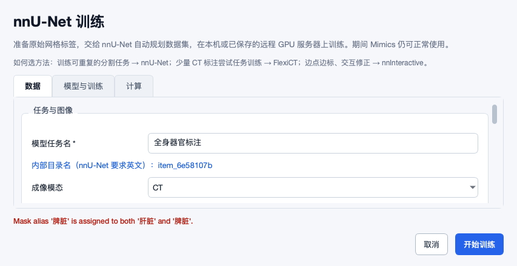
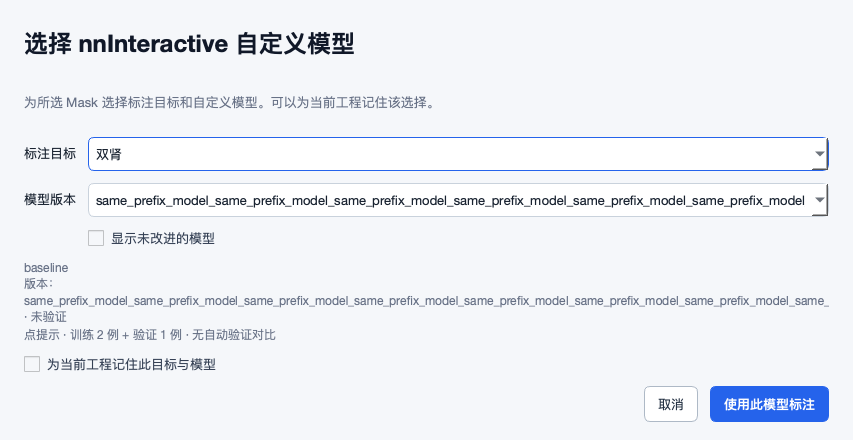
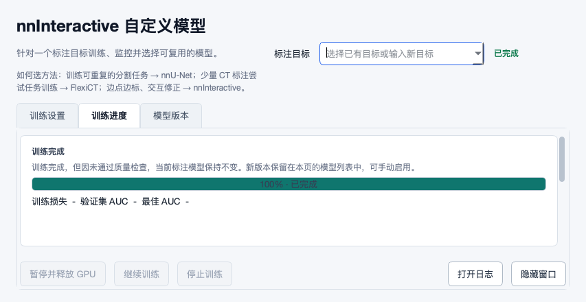
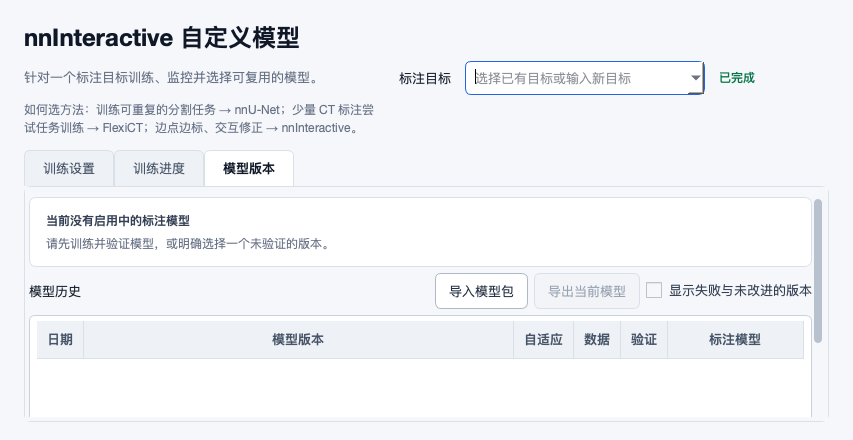
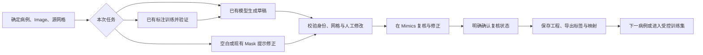

# 远程更新复核与全工作流审查

_2026-10-13 · 面向产品、标注者、开发与测试 · 业务源码基线 `96448ae`_

## 📌 结论与范围

远程更新方向总体合理，但还不能据此认定旧问题已经全部关闭。已 fast-forward 拉取 **24 个提交**，从 `92a2600` 更新到 `96448aee155f2009624b5a93fc08e64e31b41c6e`，涉及 42 个文件。主要变化是 11 张旧 UI 问题卡的修补、对应测试与报告截图；本轮没有修改业务代码、业务配置或真实病例。

本轮记录 **17 项需要处理的问题**，包括新增缺陷、局部修复未闭环和重新复现的遗留风险。最优先的是结果发布保护、人工修改保护、物理网格、患者分组与最终验证集契约；随后处理实际有效模式、批量预检、回执与 UI 导航。数量不表示已经穷尽所有缺陷，也不将每个旧问题重新计数。

检查覆盖 28 个脚本库入口、20 个主要 UI 源模块及缓存子窗口。入口调用实际运行时处理器、方法内分发及多个真实 Qt 操作已验证；重副作用在边界替换。默认字体与 1.25 倍字号各渲染 150 个状态，包含正常、小窗口、展开、表格选择和部分错误状态；本次未发现这些测量场景的按钮文字超出内容区域。另加 7 张针对长版本号、错误、完成导航和不完整批量输入的真实 Qt 截图，发现了基础截图遗漏的问题。**字号放大不等于 Windows DPI 验收**。

环境为 macOS、Python 3.12.14、PySide6 6.12.0 的隔离审查环境；产品外部运行环境设计为 Windows/Python 3.13，宿主侧为 `runtime_py35`。17 组主要回归共记录 958 次测试执行：932 通过、3 跳过、22 执行错误、1 断言失败。套件间可能重叠，不能当作 958 个不同测试或“全量通过”。20 个错误为缺 torch，另 2 个涉及未安装的微调集成包/依赖；1 个失败是旧 POSIX 路径迁移 fixture，与本次远程改动无关。另作一次导入路径诊断重跑，不重复计入。详见[测试记录](2026-10-13-evidence/regression-results.json)。

已知使用条件是 Windows、有 Mimics Scripting 许可、有 GPU 且 CUDA 环境可能不同；具体 Mimics 版本、Windows/DPI、驱动/GPU 型号及安装版 API 文档未提供。没有本机真实 Mimics、GPU 权重推理或远程 SSH 端到端验证。已查阅 Materialise 公共资料与各方法官方代码；公共资料说明支持脚本自动化，但不足以证明具体 API 签名和对象生命周期兼容所有版本。[Materialise 自动化说明](https://www.materialise.com/en/healthcare/mimics/accelerate-workflow-automation)。

**阅读入口：** 开发与测试先读下方 R01–R17；逐入口范围见第 4 节，未验证设计边界见第 5 节。结构化记录见[本轮 JSON](2026-10-13-revalidation.json)，复现方法见[证据说明](2026-10-13-evidence/README.md)。旧报告继续作为历史，不用新的字符串测试或状态说明覆盖旧证据。

## 🔎 本次远程改动是否准确合理

| 旧卡 | 本轮结论 | 依据与剩余问题 |
|---|---|---|
| UI14 | 新 viewed 写入有效；历史状态语义待迁移 | 叠加不再新增 annotated；旧 annotated 无法证明已复核，不能批量自动改状态。 |
| UI18 | ScribblePrompt 改动有效；nnInteractive 仍错示 | R11：当前状态优先于全局记忆；目标机手改保护未验收。 |
| UI19 | 中文任务基本可用；内部 ID/中文标签仍有缺陷 | R01/R06：幂等、截断和标签语义不完整。 |
| UI20 | 全文字符串与未验证提示有了；实际可读性未通过 | R12：长 ID 尾部仍裁切，键盘全文读取缺失。 |
| UI21 | 增加了下一步文案；实际导航仍有死路 | R13：目标在其他标签页且被默认过滤。 |
| UI24 | 部分缺失提示有效；完全无 Mask 的病例漏检 | R02：用真实扫描结果/真实提交复现。 |
| UI25 | 已知提交错误翻译有效；并非所有异常闭环 | R06 英文冲突仍出现；运行中、持久失败和恢复路径继续验收。 |
| UI28 | 能读启动状态的自选目录；完成后字段丢失 | R03：worker 状态覆盖导致回执失踪。 |
| UI29 | 部分非默认项提示有效；关键隐藏字段漏报 | R05：镜像、工作目录不在摘要。 |
| UI30 | 空训练/验证阻止有效；最终拆分契约未闭环 | R07/R08：旧验证重写和远程患者分组丢失。 |
| UI31 | 互斥合并能保护写回；主线程等待违反目标 | R04：真实锁下約两秒等待，失败不补写 viewed。 |

三项可以保留的设计决定：叠加只表示查看、不能表示完成标注；中文显示名称与后台目录编号分开；用轻量 JSON 互斥保护两个写者。这些解决的是正确问题。新反例表明，实施仍需穿过真实的数据生成、状态转换和调用顺序，才满足原验收条件。

前一轮 UI01–UI13、UI34–UI35 的基础布局、选择 gating、可读模型管理器、只读版本表、禁用危险按钮样式等，本次相关测试及常规渲染没有发现回归，保留其本机通过结论。UI15/16/17 仍对应本轮数据保护问题；UI22/23/26/27/32/33 仍需原生交互、DPI、可访问性、视觉规范、影响范围和上下文验收。UI25 的部分提交异常翻译不应扩大成运行时失败恢复已完成。旧 F28 的“检查到最终发布之间仍可能遇到人工保存”也不能因 `os.replace` 原子而关闭，本轮没有新的原生竞态实验。

## 🧩 问题位置与开发测试卡

P0 表示先处理会破坏已有结果的发布边界；P1 表示影响数据正确性、人工成果或核心场景，P2 表示边界可靠性/体验。它们是建议处理顺序，不代表已分派。A 表示当前生产函数/Qt 在隔离环境的实际复现；涉及原生副作用的桩会注明，不能据此宣称真实医疗场景已受损。

| 编号 | 优先级 | 问题 | 旧卡关联 |
|---|---|---|---|
| [R01](#r01) | P2 | 任务标识二次归一化会丢掉区分摘要 | UI19, F22 |
| [R02](#r02) | P1 | 批量导入预检漏掉完全没有 Mask 的病例 | UI24 |
| [R03](#r03) | P2 | 导入 worker 改写状态后，自定义目录回执再次失踪 | UI28, F30 |
| [R04](#r04) | P2 | 主动学习写锁在 Mimics 主线程等待约两秒 | UI31, F45 |
| [R05](#r05) | P2 | 折叠的远程设置摘要漏掉容器镜像与工作目录 | UI29 |
| [R06](#r06) | P1 | 中文多器官名称仍被误判成同一个标签或别名 | UI19, UI25 |
| [R07](#r07) | P1 | FlexiCT 最后重写拆分仍把旧验证病例放入训练 | UI30, F16 |
| [R08](#r08) | P1 | 远程 FlexiCT 打包/重建病例丢掉患者分组 | F16, UI30 |
| [R09](#r09) | P1 | 非等距和重复位置 DICOM 仍被制造成规则网格 | UI16, F01 |
| [R10](#r10) | P0 | 预测结果发布仍先覆盖旧文件，再考虑有效性 | UI17, F43 |
| [R11](#r11) | P1 | nnInteractive 显示的写入方式可能与当前会话实际方式相反 | UI18 |
| [R12](#r12) | P2 | 交互模型选择器的长版本号仍不可见、不可键盘复制 | UI20 |
| [R13](#r13) | P2 | 训练结束导航指向另一个标签页中默认隐藏的版本 | UI21 |
| [R14](#r14) | P1 | 目录签名缓存会把被原位更新的影像当成旧数据 | 新增 |
| [R15](#r15) | P1 | 主动学习只核对体素形状，没有核对两个预测的物理网格 | F01, F20 |
| [R16](#r16) | P2 | 保留名 background 会覆盖 nnU-Net 的零背景定义 | 新增 |
| [R17](#r17) | P1 | 撤销导入仍会删除导入后被人工修正的 Mask | UI15, F18, F19 |

### R01 · 任务标识二次归一化会丢掉区分摘要（P2）

**位置：** [tools/nnunet_common.py:37](https://github.com/ShijianRuan/MIMICS_SCRIPTS/blob/96448aee155f2009624b5a93fc08e64e31b41c6e/tools/nnunet_common.py#L37)、[tools/nnunet_common.py:43](https://github.com/ShijianRuan/MIMICS_SCRIPTS/blob/96448aee155f2009624b5a93fc08e64e31b41c6e/tools/nnunet_common.py#L43)、[tools/nnunet_jobs.py:74](https://github.com/ShijianRuan/MIMICS_SCRIPTS/blob/96448aee155f2009624b5a93fc08e64e31b41c6e/tools/nnunet_jobs.py#L74)。

**真实场景与结果：** 标注者输入两个同前缀的长任务名，GUI 创建请求后再交给作业管理器；模型、缓存目录还会继续处理该标识。 96 个 a 加“肝脏”或“肾脏”，首次得到两个不同的 105 字符 ID；create_job 落盘后均变成相同的 96 个 a。纯 ASCII 超长名字也碰撞。短中文名称的新增摘要方向是正确的。

**原因与影响：** safe_identifier 截断到 96 字符，stable_task_identifier 在截断后追加摘要；再次处理已生成的 ASCII 标识时又截断，且超长 ASCII 输入不追加摘要。 不同任务可能归入同一个模型或缓存目录，用户看到的名称仍不同；局部单次调用测试不能保证全链路唯一性。

**怎么改：** 在长度预算内预留摘要空间；任何有损规范化（截断、替换、去除）都要检测。明确“显示名称”和“已生成内部 ID”的类型边界，规范化必须幂等；后续目录函数不可再次破坏有效 ID。注册时发现 ID 与原始名称不一致应拒绝或要求迁移，保持已有英文任务可加载。

**验收：**

- 中文短名称、97 字符 ASCII、96 字符前缀加不同中文尾部均不串任务。
- GUI→create_job→本地/远程请求→模型注册→缓存路径，ID 完全一致；二次 normalize_request 不变化。
- 旧英文任务加载、改显示名称、同名重建、重启后仍能定位同一任务。

**证据：** A：当前生产函数的隔离复现；[observations.json](2026-10-13-evidence/observations.json) 中 `task_id_roundtrip`, `ascii_task_collision`。

### R02 · 批量导入预检漏掉完全没有 Mask 的病例（P1）

**位置：** [tools/io_path_setup_ui.py:310](https://github.com/ShijianRuan/MIMICS_SCRIPTS/blob/96448aee155f2009624b5a93fc08e64e31b41c6e/tools/io_path_setup_ui.py#L310)、[tools/io_path_setup_ui.py:389](https://github.com/ShijianRuan/MIMICS_SCRIPTS/blob/96448aee155f2009624b5a93fc08e64e31b41c6e/tools/io_path_setup_ui.py#L389)、[tools/import_drop_window.py:174](https://github.com/ShijianRuan/MIMICS_SCRIPTS/blob/96448aee155f2009624b5a93fc08e64e31b41c6e/tools/import_drop_window.py#L174)、[tools/single_case_import_worker.py:83](https://github.com/ShijianRuan/MIMICS_SCRIPTS/blob/96448aee155f2009624b5a93fc08e64e31b41c6e/tools/single_case_import_worker.py#L83)。

**真实场景与结果：** 同一数据集 CaseA 有 Liver、CaseB 没有 segmentations、CaseC 有 Spleen；用户按名称选择导入。 真实扫描结果有 3 例，case_mask_names 却只有 A/C。选 Liver 只警告 C；选 Liver 与 Spleen 时完全不警告，实际 GUI 已走到提交边界。CaseB 会成为仅图像病例。界面按大小写精确比较，worker 则忽略大小写，另有误报。

**原因与影响：** 病例映射只在发现 Mask 时创建项；警告只遍历已有映射。预检与执行的名称匹配规则不同。当前提示只检测“所选集合一个也没有”，不能呈现多器官部分缺失。 标注者以为已完整导入多器官标签，后续复核或训练才发现缺失；也可能被不必要的警告打断。

**怎么改：** 扫描到每个可导入病例即初始化空列表；预检与 worker 共用名称规范化规则。预览逐例的将导入标签、缺失标签、仅图像与拒绝原因，明确部分缺失策略。复用现有表格/摘要，默认取消异常确认；不要通过额外泛化入口解决。

**验收：**

- 上述三例选择 Liver 时明确显示 B/C；选择 Liver+Spleen 时仍显示 B，且呈现 A/C 的部分缺失。
- 不同大小写与前后空白，预检结果和实际 worker 一致。
- 批量、单病例、显式多文件三条路径都验证；用户取消不得创建作业，允许仅图像后结果页也必须保留该事实。

**证据：** A：当前生产函数的隔离复现；[observations.json](2026-10-13-evidence/observations.json) 中 `maskless_case_warning`, `mask_case_sensitive_ui`。

### R03 · 导入 worker 改写状态后，自定义目录回执再次失踪（P2）

**位置：** [tools/single_case_import_worker.py:42](https://github.com/ShijianRuan/MIMICS_SCRIPTS/blob/96448aee155f2009624b5a93fc08e64e31b41c6e/tools/single_case_import_worker.py#L42)、[runtime_py35/import_undo_mimics.py:73](https://github.com/ShijianRuan/MIMICS_SCRIPTS/blob/96448aee155f2009624b5a93fc08e64e31b41c6e/runtime_py35/import_undo_mimics.py#L73)。

**真实场景与结果：** 用户导入到自定义输出目录，成功后立即点击“撤销上次导入”。 启动状态含 output_path 时能找到目录；真实 _write_status 写入 completed/output_mcs 后，output_path 消失，_recent_drop_output_dirs 返回不了该目录。回执文件存在但 find_latest_receipt 返回空。

**原因与影响：** 新检索入口读取 bootstrap 的 output_path；worker 的状态更新整份替换 JSON，实际完成记录只保留 output_mcs。新增单测使用手写 completed+output_path，跳过真实生命周期。 “撤销”存在但刚完成的任务无法撤销；显示搜索范围也不能恢复丢失的定位信息。

**怎么改：** 固定任务上下文（源、输出目录、最终工程、回执路径）在全部状态转换中保留；或从 output_mcs 推导并兼容旧记录/选择文件。目录去重后再截取最近条目，涵盖默认 mask_exports 和自定义路径。结果页直接提供回执位置及对应工程，重 I/O 不在 Mimics 回调内遍历。

**验收：**

- 真实 bootstrap→worker preparing/running/completed/failed 全部状态写入后，回执检索仍正确。
- 默认目录、自定义本地/UNC、重复目录、多任务、重启、移动源目录分别测试。
- 撤销定位失败给可复制目录和下一步，不能显示“成功”或误用另一个任务的回执。

**证据：** A：当前生产函数的隔离复现；[observations.json](2026-10-13-evidence/observations.json) 中 `receipt_after_worker_update`。

### R04 · 主动学习写锁在 Mimics 主线程等待约两秒（P2）

**位置：** [runtime_py35/flexict_mimics.py:1484](https://github.com/ShijianRuan/MIMICS_SCRIPTS/blob/96448aee155f2009624b5a93fc08e64e31b41c6e/runtime_py35/flexict_mimics.py#L1484)、[runtime_py35/flexict_mimics.py:1567](https://github.com/ShijianRuan/MIMICS_SCRIPTS/blob/96448aee155f2009624b5a93fc08e64e31b41c6e/runtime_py35/flexict_mimics.py#L1567)、[runtime_py35/flexict_mimics.py:1929](https://github.com/ShijianRuan/MIMICS_SCRIPTS/blob/96448aee155f2009624b5a93fc08e64e31b41c6e/runtime_py35/flexict_mimics.py#L1929)、[tools/flexict_active_learning_ui.py:142](https://github.com/ShijianRuan/MIMICS_SCRIPTS/blob/96448aee155f2009624b5a93fc08e64e31b41c6e/tools/flexict_active_learning_ui.py#L142)。

**真实场景与结果：** 外部复核窗口持有状态锁，Mimics 刚应用分歧叠加并写入 viewed。 持有真实 OS 文件锁时，_al_mark_viewed 回调约 2.0 秒后返回，viewed 写入被跳过；并非注释和销项说明中的“best-effort、不阻塞 GUI”。锁内重读合并确实改善丢更新。

**原因与影响：** 默认 wait_seconds=2.0，通过循环 time.sleep(0.02) 等待；该调用由 _al_finish_conversion 同步发起。外部窗口 set_case_state 也同步等待。 切片滚动、提示操作和宿主交互会短暂停住；最终状态又可能少一条查看记录。网络盘的 open/read/write 延迟还未测。

**怎么改：** Mimics 内采用不等待的尝试，失败交给后续定时 tick/外部写者重试；重 I/O 在外部进程。外部 UI 后台执行状态写入，并在成功回执后更新行状态。保留轻量 JSON 与跨进程互斥，无需数据库。

**验收：**

- 持锁期间 Mimics 标记回调没有 sleep/轮询，能及时返回，延迟事件在解锁后补写。
- 独立进程、两个窗口、并发不同病例、重复点击、进程退出和磁盘只读，不丢显式 annotated/skipped。
- Windows msvcrt 与实际 UNC 目标机验证；UI 未持久化前不得显示标记成功。

**证据：** A：当前生产函数的隔离复现；[observations.json](2026-10-13-evidence/observations.json) 中 `mimics_guard_contention`。

### R05 · 折叠的远程设置摘要漏掉容器镜像与工作目录（P2）

**位置：** [tools/remote_compute_ui.py:47](https://github.com/ShijianRuan/MIMICS_SCRIPTS/blob/96448aee155f2009624b5a93fc08e64e31b41c6e/tools/remote_compute_ui.py#L47)、[tools/remote_compute_ui.py:254](https://github.com/ShijianRuan/MIMICS_SCRIPTS/blob/96448aee155f2009624b5a93fc08e64e31b41c6e/tools/remote_compute_ui.py#L254)、[tools/remote_compute_ui.py:390](https://github.com/ShijianRuan/MIMICS_SCRIPTS/blob/96448aee155f2009624b5a93fc08e64e31b41c6e/tools/remote_compute_ui.py#L390)。

**真实场景与结果：** 管理员载入非默认镜像或远程工作目录，标注者沿用该服务器开展任务。 仅 runtime_image/remote_root 非默认时 _non_default_summary 返回空，折叠标题仍为“高级运行设置”，用户不能从摘要知道计算环境与存储位置已变化。

**原因与影响：** 摘要枚举没有包含这两个实际隐藏控件；保存/字段编辑后的摘要更新还应统一，不能只在加载时更新。 同一个服务器显示名可能指向不同运行环境或输出位置，排错、缓存复用及结果定位困难。

**怎么改：** 用同一份高级字段定义生成默认值比较和摘要；覆盖 runtime_image、remote_root 及已有校验/缓存项。切换、新建、编辑和保存后同步摘要；常规页只显示关键环境身份与变更数量，全文可展开/复制。

**验收：**

- 仅改镜像、仅改目录、两项都改、载入旧配置，折叠状态均提示非默认值。
- 编辑后即更新；保存、切换服务器、重开后值与摘要不矛盾。
- 长镜像与 UNC/远程目录能读全文，不能把所有参数重新摊开挤压主操作。

**证据：** A：当前生产函数的隔离复现；[observations.json](2026-10-13-evidence/observations.json) 中 `hidden_remote_identity`。

### R06 · 中文多器官名称仍被误判成同一个标签或别名（P1）

**位置：** [tools/nnunet_common.py:533](https://github.com/ShijianRuan/MIMICS_SCRIPTS/blob/96448aee155f2009624b5a93fc08e64e31b41c6e/tools/nnunet_common.py#L533)、[tools/nnunet_common.py:546](https://github.com/ShijianRuan/MIMICS_SCRIPTS/blob/96448aee155f2009624b5a93fc08e64e31b41c6e/tools/nnunet_common.py#L546)。

**真实场景与结果：** 标注者直接选择 Mimics 的“肝脏”“脾脏”作为 nnU-Net 的两个训练标签；任务名称也用中文。 任务名改动已允许中文，但 normalize_labels 将两个标签都归一化成 item，报 Mask alias ... assigned to both；真实训练设置窗口显示红色英文异常，无法提交。

**原因与影响：** 用于路径安全的 ASCII slug 被同时用于人类标签/别名的语义唯一性检查；显示命名与文件命名未分开。friendly_error 没有覆盖这个异常。 通用工具的常见中文多器官标注流程被阻断；用户被迫改名，容易损伤标签映射和既有工程习惯。

**怎么改：** 标签语义比较采用明确的 Unicode 规范化、strip/casefold；文件安全名另用 numeric label ID/无碰撞内部键。保留原名与 aliases 到清单和导出映射；真实重复名/交叉别名要按语义报中文错误并指向对应行。

**验收：**

- 中文、英文加中文别名、混合语言、长名称均可提交且映射不串器官。
- 跨标签共享真实别名时拒绝，行内说明两个冲突目标；同一标签内重复别名只去重。
- MCS 选标签→准备训练→dataset.json→预测回写/导出使用相同映射，不只是验证 request 文本。

**证据：** A：当前生产函数的隔离复现；[observations.json](2026-10-13-evidence/observations.json) 中 `chinese_multi_organ_labels`。

### R07 · FlexiCT 最后重写拆分仍把旧验证病例放入训练（P1）

**位置：** [tools/flexict_pipeline.py:397](https://github.com/ShijianRuan/MIMICS_SCRIPTS/blob/96448aee155f2009624b5a93fc08e64e31b41c6e/tools/flexict_pipeline.py#L397)、[tools/flexict_pipeline.py:540](https://github.com/ShijianRuan/MIMICS_SCRIPTS/blob/96448aee155f2009624b5a93fc08e64e31b41c6e/tools/flexict_pipeline.py#L540)、[tools/flexict_pipeline.py:453](https://github.com/ShijianRuan/MIMICS_SCRIPTS/blob/96448aee155f2009624b5a93fc08e64e31b41c6e/tools/flexict_pipeline.py#L453)。

**真实场景与结果：** 用户增加新病例或继续同一任务训练，希望保留上一版验证集合进行可比评估。 真实准备流程先保留旧验证 c0，随后 _write_flexict_splits 改成 val=c3、train 含 c0。新增空集合拒绝有效，但并未修正最终拆分与已有验证契约。

**原因与影响：** 共享原始数据准备与 FlexiCT 最终拆分有两个权威写者，后者重新抽样并覆盖前者；冻结验证集合没有贯穿最终出口。 模型优劣对比不再可比；原验证病例进入训练可使后续验证结论失真。标注者看见可提交无法得知最终换了病例。

**怎么改：** 最终拆分只生成一次，明确区分新建、增加病例、继续训练与用户主动重新划分。保留旧验证键/患者组并验证互斥；本地/远程实际 trainer 读取同一份冻结清单。UI 提交前显示最终组数量与变化原因，若需重分必须显式选择。

**验收：**

- 新建、新增病例、重排扫描顺序、继续训练，冻结 c0 不得静默进入 train。
- 显式改验证选择、整组扩展、旧病例删除各有确定规则；最终 splits_final.json 与 UI 预览一致。
- 检查实际调用顺序和 trainer 读取文件，不能仅测 _split_train_val 单函数。

**证据：** A：当前生产函数的隔离复现；[observations.json](2026-10-13-evidence/observations.json) 中 `frozen_validation_after_retrain`。

### R08 · 远程 FlexiCT 打包/重建病例丢掉患者分组（P1）

**位置：** [tools/remote_training_controller.py:1565](https://github.com/ShijianRuan/MIMICS_SCRIPTS/blob/96448aee155f2009624b5a93fc08e64e31b41c6e/tools/remote_training_controller.py#L1565)、[tools/remote_training_controller.py:1618](https://github.com/ShijianRuan/MIMICS_SCRIPTS/blob/96448aee155f2009624b5a93fc08e64e31b41c6e/tools/remote_training_controller.py#L1618)、[tools/flexict_pipeline.py:902](https://github.com/ShijianRuan/MIMICS_SCRIPTS/blob/96448aee155f2009624b5a93fc08e64e31b41c6e/tools/flexict_pipeline.py#L902)、[tools/flexict_pipeline.py:470](https://github.com/ShijianRuan/MIMICS_SCRIPTS/blob/96448aee155f2009624b5a93fc08e64e31b41c6e/tools/flexict_pipeline.py#L470)。

**真实场景与结果：** 同一患者 A 有 c0/c1 两期影像，患者 B 有 c2/c3；选 c0 验证，任务改在远程 GPU 训练。 本地验证 c0/c1、训练 c2/c3；真实远程 prepared_cases 只携带 case_id/image/label/fingerprint。请求顶层 patient_groups 虽保留，prepared 分支与拆分未消费它，远程变成验证 c0、训练 c1/c2/c3，患者 A 跨两侧。

**原因与影响：** 患者分组信息在远程序列化和容器 rows 重建两处丢失；拆分只读取每行 patient_group。局部保留顶层字段不代表下游使用。 同患者多期/复查数据泄漏到训练和验证，验证结果可能乐观；本地与远程同一请求行为不同。

**怎么改：** 序列化时保留 patient_group，容器重建时恢复，并统一从请求映射补全/校验。优先直接携带已经确定的最终拆分及摘要，拒绝组跨侧或分组信息不一致。病例身份、原网格与标签映射也作为同一 prepared-case 契约。

**验收：**

- 两患者四扫描本地与远程最终 split 相同，A 不跨两侧。
- 只含顶层映射、只含行字段、二者冲突、中文病例键、旧 prepared 请求均有明确兼容/拒绝规则。
- 完整 prepare→remote_request→容器 run_training→实际 splits 文件验证，不依赖手写 row fixture。

**证据：** A：当前生产函数的隔离复现；[observations.json](2026-10-13-evidence/observations.json) 中 `remote_patient_group_handoff`。

### R09 · 非等距和重复位置 DICOM 仍被制造成规则网格（P1）

**位置：** [mimics_bridge.py:1693](https://github.com/ShijianRuan/MIMICS_SCRIPTS/blob/96448aee155f2009624b5a93fc08e64e31b41c6e/mimics_bridge.py#L1693)、[mimics_bridge.py:1754](https://github.com/ShijianRuan/MIMICS_SCRIPTS/blob/96448aee155f2009624b5a93fc08e64e31b41c6e/mimics_bridge.py#L1754)。

**真实场景与结果：** 数据来自补扫、拼接、归档覆盖或重复导出；同一个 Series 内层面位置不均匀或重复。 模拟真实 DICOM header 输入 z=[0,1,3]，函数给出规则 z=[0,1.5,3]；输入 [0,1,1] 给出 [0,1,2]，两者都不拒绝。使用真实头解析/几何函数，dcmread 是受控边界，未声称真实影像已错位。

**原因与影响：** 用整体跨度/单一层距推断规则 affine，缺少逐层位置、方向、重复性和完整性检查。 导入、Mask 对齐、AI 输入和导出可能共用一份错误物理网格；后续 shape 一致也不能证明解剖位置正确。

**怎么改：** 按位置排序并验证方向一致、唯一层面及容差内等距，检查缺字段/混合维度/多帧。无法表示为规则体时先明确拒绝；如增加重采样，必须保留原始定位、变换与标签最近邻恢复，不能静默猜测。优先借助 Mimics 原生已正确载入影像并核对外部源映射。

**验收：**

- 规则、倒序、斜位、非等距、重复位置、缺失层、多序列、多帧、混合尺寸逐项验证。
- 原始 header→外部体→Mimics 所选 Image→Mask 导出，角点与已知标志位置一致。
- 无法安全转换时提交前给出具体系列/问题层与处理建议，原文件和工程不变。

**证据：** A：当前生产函数的隔离复现；[observations.json](2026-10-13-evidence/observations.json) 中 `dicom_irregular_geometry`。

### R10 · 预测结果发布仍先覆盖旧文件，再考虑有效性（P0）

**位置：** [tools/remote_training_controller.py:2849](https://github.com/ShijianRuan/MIMICS_SCRIPTS/blob/96448aee155f2009624b5a93fc08e64e31b41c6e/tools/remote_training_controller.py#L2849)、[tools/remote_training_controller.py:2868](https://github.com/ShijianRuan/MIMICS_SCRIPTS/blob/96448aee155f2009624b5a93fc08e64e31b41c6e/tools/remote_training_controller.py#L2868)、[tools/flexict_pipeline.py:1267](https://github.com/ShijianRuan/MIMICS_SCRIPTS/blob/96448aee155f2009624b5a93fc08e64e31b41c6e/tools/flexict_pipeline.py#L1267)、[tools/flexict_pipeline.py:1316](https://github.com/ShijianRuan/MIMICS_SCRIPTS/blob/96448aee155f2009624b5a93fc08e64e31b41c6e/tools/flexict_pipeline.py#L1316)。

**真实场景与结果：** 输出目录已有人工复核后的 prediction.nii.gz，用户重跑或下载远程预测；另一个任务可能也使用该目标。 真实远程发布函数用无效 NIfTI 的合成字节成功覆盖原结果，未要求确认/版本选择，未验证几何；固定 .remote-part 还可被并发任务共用。本地管线仍向最终路径写入后才验证。

**原因与影响：** 下载/预测与最终发布未分离，os.replace 只保证替换原子性，不保证旧内容保护或语义有效性；有多个远程完成出口需统一处理。 较新人工结果或可用预测被丢失；失败也可能留下无效最终文件。本项继承 F43 的最高优先级，仅为合成复现，没有证据表明真实病例已经受损。

**怎么改：** 每个 job 使用唯一 staging 文件；先校验格式、shape/affine、标签值、病例/输入指纹，再发布。目标已存在时默认生成新版本或由明确选择替换；在发布临界区复核目标版本，冲突保留两份。统一所有本地/远程路径，失败保留旧文件与可诊断临时结果。

**验收：**

- 已有结果、无效下载、几何错配、磁盘满、取消/重试、两任务同输出目标，旧文件内容保持可恢复。
- 用户授权替换后若原文件又被改动，拒绝静默覆盖并保留新旧结果。
- 最终状态仅在验证和发布完成后成功；验收函数真实写入顺序及多个完成分支。

**证据：** A：当前生产函数的隔离复现；[observations.json](2026-10-13-evidence/observations.json) 中 `remote_output_overwrite`。

### R11 · nnInteractive 显示的写入方式可能与当前会话实际方式相反（P1）

**位置：** [runtime_py35/nninteractive_mimics.py:1995](https://github.com/ShijianRuan/MIMICS_SCRIPTS/blob/96448aee155f2009624b5a93fc08e64e31b41c6e/runtime_py35/nninteractive_mimics.py#L1995)、[runtime_py35/nninteractive_mimics.py:2749](https://github.com/ShijianRuan/MIMICS_SCRIPTS/blob/96448aee155f2009624b5a93fc08e64e31b41c6e/runtime_py35/nninteractive_mimics.py#L2749)。

**真实场景与结果：** 之前选择生成副本，后来开启一个已定为 in_place 的当前会话或配置路径；标注者继续提交提示。 全局记忆 derived_copy、当前 state.write_mode=in_place 时，菜单说“创建可编辑副本”，目标选择函数实际复用当前 Mask。提示文案存在，但不代表其描述的就是有效方式。

**原因与影响：** 菜单读取全局 _SESSION_WRITE_MODE，实际应用优先读取当前 state；同一个语义有两个不同解析顺序。 标注者可能以为原 Mask 被保留，却将结果应用到现有 Mask；增加后续人工修改与恢复成本。此探针确认目标选择，不替代真实手改保护端到端验收。

**怎么改：** 显示与应用共用 effective write-mode/target 解析；区分“当前会话方式”和“下次会话默认”。明确当前目标名称、所在 Image 与副本行为；如提供切换，更新状态并再次显示有效方式。保持后续手工修正保护。

**验收：**

- 全局副本+当前原位、全局原位+当前副本、choose_on_first、新/已有/空白 Mask 和配置覆盖均显示与应用一致。
- 跨病例/工程、第二轮提示、撤销/重开后的记忆边界明确。
- 真实 Mimics 手改后不会因模式显示或切换而绕过保护；实际新增/复用的 Mask 与文案一致。

**证据：** A：当前生产函数的隔离复现；[observations.json](2026-10-13-evidence/observations.json) 中 `nninteractive_write_mode_caption`。

### R12 · 交互模型选择器的长版本号仍不可见、不可键盘复制（P2）

**位置：** [tools/nninteractive_task_model_chooser.py:84](https://github.com/ShijianRuan/MIMICS_SCRIPTS/blob/96448aee155f2009624b5a93fc08e64e31b41c6e/tools/nninteractive_task_model_chooser.py#L84)、[tools/nninteractive_task_model_chooser.py:158](https://github.com/ShijianRuan/MIMICS_SCRIPTS/blob/96448aee155f2009624b5a93fc08e64e31b41c6e/tools/nninteractive_task_model_chooser.py#L158)。

**真实场景与结果：** 两个模型有相同长前缀，关键区别在 version_A/version_B 的尾部；用户用小窗口或键盘选模型。 853×440 实际 Qt 截图中摘要尾部被裁掉；版本文本约 1154 像素，摘要只有 805 像素，minimumSizeHint 约 1573 像素。QLabel 的完整字符串存在但长 token 未换行，且未开启键盘选择。

**原因与影响：** QLabel.setWordWrap 不能保证长且无断点的版本 ID 在受限宽度内可读；新增测试只检查全文是否出现在字符串中。 不同版本仍无法凭界面分辨，复制身份反馈也困难；视觉修复尚未达到 UI20 的“全文可见、键盘可读”标准。

**怎么改：** 复用已实现的只读全文详情控件，采用 WrapAnywhere、可滚动并可选择/复制；列表用简短显示名+版本时间，详情保留完整 ID。保证正文与主按钮在最小屏幕中可达，不依赖 tooltip 或无限扩窗。

**验收：**

- 同长前缀不同尾部、超长无空格 ID、中文名称、125%/150% 字体，尾部能看到或滚动复制。
- 键盘可进入详情并复制全文；切换模型时内容同步。
- 按真实 contentRect/可见区域和截图验收，不能仅 assertIn(model_id, label.text())。

**证据：** A：实际 Qt 渲染与控件测量（非 Windows 原生截图）；[ui-observations.json](2026-10-13-evidence/ui-observations.json)。

### R13 · 训练结束导航指向另一个标签页中默认隐藏的版本（P2）

**位置：** [tools/nninteractive_task_model_center.py:1947](https://github.com/ShijianRuan/MIMICS_SCRIPTS/blob/96448aee155f2009624b5a93fc08e64e31b41c6e/tools/nninteractive_task_model_center.py#L1947)、[tools/nninteractive_task_model_center.py:2376](https://github.com/ShijianRuan/MIMICS_SCRIPTS/blob/96448aee155f2009624b5a93fc08e64e31b41c6e/tools/nninteractive_task_model_center.py#L2376)。

**真实场景与结果：** 训练完成但未超过当前模型，新版本 state=not_improved；标注者想查看失败原因或明确试用该版本。 当前“训练进度”页写“新版本保留在本页的模型列表中，可手动启用”；列表实际在“模型版本”页，默认 show_failed=False 会过滤 not_improved，实际表格 0 行。

**原因与影响：** 新增完成文案未核对当前标签页、模型过滤与可操作状态；“未通过质量检查”还需区分未改善、验证缺失和不兼容。 用户找不到刚完成的成果，容易重新训练或误以为模型丢失；入口保留本身合理，但导航闭环仍未完成。

**怎么改：** 完成卡给“查看这个版本”并直接切到版本页、显式展现/定位新版本；若仅用文案则准确说明标签页与“显示失败与未改进”开关。显示保留旧模型的具体原因；可用但未改善、未验证和损坏版本的动作不同。

**验收：**

- new_model_selected/current_model_retained/unverified/failed/incompatible 各终态都有准确下一步。
- 从完成页一次导航能定位对应版本；默认过滤不造成死路。
- 不可用版本不允许启用，可用未改善版本需明确知情选择，详情不把验证指标当当前患者准确率。

**证据：** A：实际 Qt 状态刷新与过滤；模型登记行是隔离 fixture；[ui-observations.json](2026-10-13-evidence/ui-observations.json)。

### R14 · 目录签名缓存会把被原位更新的影像当成旧数据（P1）

**位置：** [tools/nnunet_common.py:324](https://github.com/ShijianRuan/MIMICS_SCRIPTS/blob/96448aee155f2009624b5a93fc08e64e31b41c6e/tools/nnunet_common.py#L324)、[tools/nnunet_pipeline.py:646](https://github.com/ShijianRuan/MIMICS_SCRIPTS/blob/96448aee155f2009624b5a93fc08e64e31b41c6e/tools/nnunet_pipeline.py#L646)。

**真实场景与结果：** 采集目录未换名，某个 DICOM slice 被补扫/修复或同步工具原位更新，随后再次准备训练/预测数据。 修改子文件内容及大小后父目录 mtime 不变，path_signature 仍返回旧签名；关闭签名缓存后得到新签名。默认目录签名缓存最长 604800 秒。

**原因与影响：** 缓存用目录自身元信息作有效性依据，不能代表子文件内容/元信息没变化；下游 prepared cache 使用该签名判断可复用。 新数据可能继续使用旧转换结果，重新扫描/训练看起来成功却未消费用户修正的源影像。探针确认签名边界，未运行真实模型训练。

**怎么改：** 明确不可变数据契约；对于可变源扫描，重算子文件元信息 manifest 或使用可靠的数据版本。保留快速缓存但提供真实“重新验证源数据”入口，刷新必须穿透目录签名和下游 prepared cache；不得只重启 GUI。先采用轻量 manifest，避免每次无差别全文件内容哈希。

**验收：**

- 原位写同名子文件、大小相同/不同、嵌套目录变更、数据搬迁、UNC 同步后都按正确策略失效。
- 转换 image 的内容/指纹随源变更；本地缓存、远程归档、预处理缓存不因父目录 mtime 未变继续复用。
- 显式刷新显示重新检查范围；不可变模式清楚说明输入要求，用户取消保留旧成果。

**证据：** A：当前生产函数的隔离复现；[observations.json](2026-10-13-evidence/observations.json) 中 `in_place_directory_mutation`。

### R15 · 主动学习只核对体素形状，没有核对两个预测的物理网格（P1）

**位置：** [integrations/flexict-finetune/uncertainty/uncertainty.py:84](https://github.com/ShijianRuan/MIMICS_SCRIPTS/blob/96448aee155f2009624b5a93fc08e64e31b41c6e/integrations/flexict-finetune/uncertainty/uncertainty.py#L84)、[tools/flexict_pipeline.py:1503](https://github.com/ShijianRuan/MIMICS_SCRIPTS/blob/96448aee155f2009624b5a93fc08e64e31b41c6e/tools/flexict_pipeline.py#L1503)、[tools/flexict_pipeline.py:1609](https://github.com/ShijianRuan/MIMICS_SCRIPTS/blob/96448aee155f2009624b5a93fc08e64e31b41c6e/tools/flexict_pipeline.py#L1609)。

**真实场景与结果：** 2D/3D 两模型结果来自缓存或不同转换路径，数组形状相同，但其中一份平移/方向/间距错误。 两份 2×2×2 NIfTI，其中一份 x 平移 100 mm，load_masks 仍接受并以第一份 affine 返回。AL 文件夹预测出口未像单例预测那样逐个校验与输入的物理网格。

**原因与影响：** 分歧计算把同形状数组直接视为同网格；最后合成辅助带只保留一个 affine，之后 Mimics 检查该带也看不出第二份来源有误。 排序与辅助提示位置可能失真，标注者浪费时间检查错误区域；分歧本来也只能提示不一致，不能等同模型准确率。

**怎么改：** 每个模型预测与该病例输入分别验证 shape/affine、病例指纹、标签映射；一致后才比较。错配默认拒绝并指向失败模型/病例；若允许重采样，必须记录变换与明确策略。结果清单记录两模型身份及输入版本。

**验收：**

- 同形状平移、翻轴、spacing 不同、同网格异病例、过期预测、标签 ID 不同都在生成排名前拒绝或明确处理。
- 正常同网格模型正常计算；失败病例列为失败/跳过原因，不能伪装为已复核。
- 真实 Mimics 辅助带位置与输入一致，查看不自动标注，重复计算不污染人工 Mask。

**证据：** A：当前生产函数的隔离复现；[observations.json](2026-10-13-evidence/observations.json) 中 `uncertainty_affine_mismatch`。

### R16 · 保留名 background 会覆盖 nnU-Net 的零背景定义（P2）

**位置：** [tools/nnunet_common.py:496](https://github.com/ShijianRuan/MIMICS_SCRIPTS/blob/96448aee155f2009624b5a93fc08e64e31b41c6e/tools/nnunet_common.py#L496)、[tools/nnunet_pipeline.py:934](https://github.com/ShijianRuan/MIMICS_SCRIPTS/blob/96448aee155f2009624b5a93fc08e64e31b41c6e/tools/nnunet_pipeline.py#L934)。

**真实场景与结果：** 开放工具从 UI、配置或 CLI 导入自定义标签映射，其中一个输出标签叫 background 且 ID 为 1。 normalize_request 接受该标签，真实 dataset.json 最终是 {"background":1}，零背景项被覆盖。

**原因与影响：** 标签合法性只检查名称非空、ID 范围与连续性，没有保护 nnU-Net 元数据的保留名称。 准备看似成功但训练/数据完整性失败；异常需要用户理解框架格式。官方 nnU-Net 数据格式要求背景为 0。

**怎么改：** 在请求/标签编辑入口拒绝保留输出名，并解释它是背景保留项；语义名称和序列化格式区分。生成 dataset.json 前再次验证背景为 0、标签映射完整；非法请求不产生半成品注册记录。

**验收：**

- background 保留名被明确拒绝，普通器官、多标签映射仍保留零背景。
- 非法/非连续/重复 ID、仅背景标签、空数据、旧映射导入均给出清楚处理路径。
- 测试实际生成的 dataset.json 和 nnU-Net 完整性检查，而非只检查 normalize_request 返回值。

**证据：** A：当前生产函数的隔离复现；[observations.json](2026-10-13-evidence/observations.json) 中 `reserved_background_label`。

### R17 · 撤销导入仍会删除导入后被人工修正的 Mask（P1）

**位置：** [runtime_py35/import_undo_mimics.py:308](https://github.com/ShijianRuan/MIMICS_SCRIPTS/blob/96448aee155f2009624b5a93fc08e64e31b41c6e/runtime_py35/import_undo_mimics.py#L308)、[runtime_py35/import_undo_mimics.py:279](https://github.com/ShijianRuan/MIMICS_SCRIPTS/blob/96448aee155f2009624b5a93fc08e64e31b41c6e/runtime_py35/import_undo_mimics.py#L279)、[runtime_py35/import_undo_mimics.py:462](https://github.com/ShijianRuan/MIMICS_SCRIPTS/blob/96448aee155f2009624b5a93fc08e64e31b41c6e/runtime_py35/import_undo_mimics.py#L462)、[runtime_py35/import_undo_mimics.py:524](https://github.com/ShijianRuan/MIMICS_SCRIPTS/blob/96448aee155f2009624b5a93fc08e64e31b41c6e/runtime_py35/import_undo_mimics.py#L524)。

**真实场景与结果：** 用户导入外部肝脏 Mask 后移动少量前景体素进行修正，GUID/名称/数量保持不变；随后撤销导入。 实际 _session_diverged 返回 False，随后 _delete_owned_masks 调度删除该 Mask。探针以相同前景体积的编辑对象模拟手工修正，原生 delete/transaction 为边界桩；源码中删除发生在保存和 fingerprint 检查前。

**原因与影响：** 所有权证明不等于内容未改变。会话检查只看对象清单、GUID/token；事后工程文件 fingerprint 最多决定文件是否保留，已删的手工内容无法补救。v1 唯一同名也不足以证明所有权。 撤销可能把标注者已经修正的器官一并删除；仅保留工程文件不是可靠恢复。

**怎么改：** 在导入回执保留对象、所属 Image、导入内容指纹；删除前比较当前 Mask 内容（等体积位置变更也可识别）。有手改时默认保留或生成可恢复副本，并列出影响后再操作。旧 v1 缺少证明时关闭自动删除，提供明确手动/备份流程；异常不消费回执。

**验收：**

- 未保存和已保存的原 Mask 内容修正、等体积位移、增删对象、同名跨 Image、重新打开 GUID 漂移均保护人工工作。
- 真实 Mimics 中先编辑再撤销，人工内容能从明确恢复点找回；不能只看 .mcs 仍存在。
- 删除/保存/回执写入失败和重试不扩大删除范围；没有强身份证明的旧记录不自动删对象。

**证据：** A/B：当前检查与删除调度复现；原生 Mimics 删除和事务为边界桩；[observations.json](2026-10-13-evidence/observations.json) 中 `edited_owned_mask_undo`。

## 🧭 每个入口与完整标注工作流

实际脚本库入口与方法内路由测试通过，证明入口确实到达对应处理器。下表“检查依据”说明走查深度；不将分发通过解释为训练、宿主写入或恢复已端到端通过。当前源码控件/信号清单见[入口与控件清单](2026-10-13-evidence/control-and-entry-inventory.json)。

| 脚本库入口（相对 scripting_library） | 用户任务/入口取舍 | 当前检查依据与需要继续验收的环节 |
|---|---|---|
| 01_Data/01_Import_Data | 文件、病例/数据集、拖放和粘贴共用导入入口，保留 | 真实 GUI 提交/扫描、导入路由；R02/R09；多格式识别与工程保存需目标机 |
| 01_Data/02_Import_Masks | 在已有工程中补充分割，保留 | picker 渲染、几何/桥接回归；目标 Image、标签值/重名、应用失败回滚需原生验收 |
| 01_Data/03_Export_Masks | 标签交付，与保存工程不同，保留 | export 小窗/表格、医学几何及旧回归；多 Image 逐对象网格、覆盖/部分失败/映射需实机 |
| 01_Data/04_Task_Status | 导入导出逐例进度和停止，保留 | 任务查看器/逐行操作回归；结果链接、取消后逐例台账、重开恢复需实机 |
| 01_Data/05_Undo_Last_Import | 恢复入口，保留但收紧保护 | R03/R17；不能把“回执找到”当作“安全撤销” |
| 02_AI/00_Manage_AI_Models | 跨方法模型包导入、详情和默认值，保留 | 真实选择动作/布局/全文；包 roundtrip 的 19 项依赖 torch 未完成 |
| 02_AI/Annotate_With_ScribblePrompt | 切片提示修正，可选常用工具 | 提示/模式回归 21 通过、2 跳过；实际平面、切片、坐标与 checkpoint 推理需目标机 |
| 02_AI/FlexiCT/01_Train_Model | CT 自定义训练，高级入口 | 132 通过、1 缺 torch；R07/R08/R14，最终 split 与恢复来源要回显 |
| 02_AI/FlexiCT/02_Predict_Current_Case | 用已训练模型生成当前病例草稿 | 有模型/失效模型 UI 与管线回归；R10，模态、网格、手改保护实机 |
| 02_AI/FlexiCT/03_Active_Learning_Review | 新建排序与病例复核共页，可选 | 新建/选择 gating、状态回归；R04/R15、查看/复核/训练资格区别 |
| 02_AI/FlexiCT/04_Show_Status_and_Stop | 当前任务状态/停止，保留 | 状态 UI/暂停停止回归；不能混淆本地监控、远程容器与共享服务 |
| 02_AI/nnInteractive/01_Annotate_Official_Model | 从提示开始标注，常用 | 连续提示、异步目标/坐标/调用回归；R11，全体积性能与原生焦点未测 |
| 02_AI/nnInteractive/02_Annotate_Custom_Model | 选择已有模型直接标注，常用 | chooser 实际渲染；R12，不能要求先进入训练页才能使用已有模型 |
| 02_AI/nnInteractive/03_Train_and_Manage_Custom_Models | 训练/进度/版本集中管理，高级 | model center 实际状态和导航；R13，数据扫描/训练目标/验证与包兼容实机 |
| 02_AI/nnUNet/01_Train_Model | 多标签映射与训练，高级 | 107 项管线回归及实际提交；R01/R06/R14/R16；当前集成单通道边界需清晰 |
| 02_AI/nnUNet/02_Predict_Current_Case | 已有模型对当前 Image 预测，常用 | 预测 UI/模型可用性与映射回归；R10，多器官输出不应被当前所选 Mask 名误解 |
| 02_AI/nnUNet/03_Show_Status_Models | 单任务停止/日志/结果与方法模型，保留 | 状态页/选择回归；与通用包管理职责不同，完成页应能直达使用 |
| 02_AI/nnUNet/04_Batch_Predict_Dataset | 数据集预分割，批量入口 | 真实提交/CLI 扫描回归；R10/R14，逐例失败、重试和结果完整性实机 |
| 03_Review/01_Identify_Mask_At_Cursor | 多器官重叠区域辨认，保留 | 入口/对应运行时静态走查；空命中、多命中、隐藏 Mask、正确 Image 实机 |
| 03_Review/02_Window_From_Selected_Mask | 一步按器官调窗位，保留 | HU/GV、预设计算回归；无选中、未知名称、多 Image 与实际显示实机 |
| 03_Review/03_Window_Level | 选/编辑预设和撤回窗位，保留 | editor 渲染、预设回归；撤销作用范围、键盘和焦点实机 |
| 99_Admin/01_Clear_Cache | 恢复/维护，放管理员层 | 缓存说明/资源归属与回归；缓存类型、正在使用的数据和远程范围实机 |
| 99_Admin/Environment/01_Setup_Repair_Environment | 每机首次配置/修复，管理员层 | 分发名/配对安装与健康回归；不同驱动、离线、目录迁移、部分安装实机 |
| 99_Admin/Environment/02_Environment_Guidance | 故障检查与修复下一步 | 键盘重查、行内反馈通过；1 个旧 POSIX fixture 失败；实际 Windows 路径/修复结果实机 |
| 99_Admin/Environment/03_Edit_Configs | 参数维护，管理员层 | editor 渲染/校验与回归；改配置时已有作业与下一次作业的边界实机 |
| 99_Admin/Health/01_System_Health | 本机任务/服务健康，故障时使用 | 合成健康表与回归；真实进程归属、不可用环境、GPU 占用实机 |
| 99_Admin/Health/02_Stop_All_Owned_Services | 紧急恢复，管理员层 | 路由/资源归属测试；任务停止与共享服务停止区别，远程未知状态实机 |
| 99_Admin/Health/03_Collect_Diagnostics | 故障资料，管理员/支持层 | 收集与路径回归；打包耗时/范围/结果定位需目标机，不另建重复日志入口 |

入口总体有合理职责。当前没有证据支持直接删掉某个已有主入口：导入图像与补充 Mask、保存工程与导出标签、模型包管理与单任务停止、官方模型与自定义模型并不相同。更好的下一步是让常用动作可从当前任务结果直接进入，把训练和管理员动作保持在高级层，减少用户在多个菜单间寻找。

工具应同时支持三条主路径：已有模型预分割后精修、空白/提示开始标注、利用既有标注训练再应用；批量与单病例都应成立。下图是建议收紧的闭环，不是已经实现的新功能。

## 👥 从其他视角发现的设计边界

下表是需要决定/验收的设计边界，**不是新增已复现 bug**。关联旧报告的风险仍保持开放；本轮没有因为离线测试通过而消掉这些边界。

| 视角与真实场景 | 尚需明确或验证的点 | 建议的具体改法与验收 |
|---|---|---|
| 标注者：多 Image、两期扫描、开多个工程 | 任务结果属于哪一个病例/序列/Image/Mask；当前 GUI 焦点不等于启动时目标 | 所有结果卡显示病例/目标/输入版本；实际应用以固定目标身份证明为准。计算中切换 Image/工程/同名 Mask、关闭重开不得错回写；失配提供丢弃或明确重新应用 |
| 产品：预测完成、看过、修正过、复核完成 | 这些状态不是同义；旧 annotated 没有复核依据 | 新记录分清计算状态与用户确认；训练资格明确来源。旧状态标为历史声明并要求必要复核，不能全部自动改为 reviewed。显式已标注也不应隐含工程已保存 |
| 标注者：全身多器官、局部器官、术后异常 | 输出标签范围、缺失标签与重叠策略不能由当前单个 Mask 暗示 | 运行前呈现输出目标和保留/新增方式；复核时保留 Mimics 原生精修。测试标签并集/交叉、缺一器官、空前景、左右器官同名及异常解剖，避免把“没输出”直接当“没器官” |
| 架构/测试：成功、部分成功、取消、崩溃后重开 | 任务终态、逐例产物和重试是否一一对应 | 保留单个逐例 manifest，显示成功/跳过/失败与理由、实际路径；重试只处理明确选中的失败例。断网/磁盘满/进程杀死后不得把旧成功记录显示成本次结果，也不得悄悄重派重复作业 |
| 系统架构：多个 ID/状态/发布解析入口 | ID、prepared case、effective mode、最终 split 有多个权威，局部修复反复失配 | 收敛为少量共享纯函数/稳定数据契约；Py3.5 侧只用兼容字段，不从现代 tools 导入。兼容迁移与 schema 失败提示明确。以 R01/R03/R07/R08/R11 的真实跨模块测试替代重复局部断言 |
| UX：原生对话框与外部 Qt 窗口交替 | 焦点、热键、默认按钮、Esc/Enter、跨屏与窗口隐藏后是否找回 | UI22/26 原生走查；从 Mimics 选 Mask→调外部窗→回宿主提示→取消/继续全程键盘验证。危险操作不能因默认焦点误触；不要为每一子状态再开新窗口 |
| 视觉：文字可读但整体还不精美 | 普通、错误、运行、空状态、禁用状态缺统一验收；长字符串、字体替换与信息密度 | UI23/27 定义字体层级、间距、按钮语义与状态色，正文/解释/技术详情层次明确。125%/150%/200% Windows DPI、多屏、中文长文、键盘焦点和色觉辨识截图验收；不能仅检查 QLabel 字符串 |
| 环境维护：各台 GPU/CUDA 条件不同 | 环境检测通过不代表四个 AI backend 都能执行；系统 CUDA toolkit 版本不能简单等同 Python wheel 的运行条件 | 在外部环境报告 Python/torch/runtime/驱动与可用设备，对每个已启用 backend 做最小自检；禁用不可用 AI 动作并给具体修复路线，保留可用的数据和手工功能。测试离线安装、只 CPU、显存不足、队列等待、共享 GPU 和远程失联 |
| 性能：全身影像、多器官、网络盘、长会话 | 模型 GPU 外置并不消除宿主 buffer 读写/保存、大体积复制和状态 I/O 的成本 | 测热/冷启动、宿主回调耗时/滚动响应、峰值 RAM/VRAM、复制量、单例/批量吞吐。持久缓存与文件检查留在外部；限制并发和冗余体积副本；切片/局部修正复用会话但严格区分输入版本 |
| 标注成果交接：标注者交给训练/下游 | 器官名称、整数值、模态/时相、网格、人工复核来源与保存状态应一起交付 | 沿用现有导出清单补齐映射/输入/模型与复核声明；已导出不是已批准。验收 MCS↔源图↔导出 Mask↔训练数据↔预测导回全链路，不只比较 shape |

“功能可用”的最低标准是正确进入功能、反馈结果/失败、保护已有工作并可恢复。“体验精美”还要求当前任务一眼可懂、主操作稳定、全文可读、状态语义一致、无需记住隐藏筛选和技术目录。当前基础表单布局比前一轮改善；R12/R13、原生 DPI/焦点和上述视觉规范仍不足以支撑“整体体验已完成”。

## 📚 Mimics 与 AI 集成合理性

Materialise 已公开支持预处理、分割清理、批量与多文件导出等脚本自动化。因此，宿主原生编辑、对象与工程管理继续交给 Mimics，外部工具承担格式适配、AI 计算、模型版本和队列，是合理的职责划分；公共页面没有提供本项目调用方法的逐版本签名，不能宣称所有版本已兼容。[Materialise 官方说明](https://www.materialise.com/en/healthcare/mimics/accelerate-workflow-automation)。

| 方法/平台 | 原始设计目的与本仓库搭配 | 当前审查结论与限制 |
|---|---|---|
| Mimics | 原生视图、Mask 精修/对象清理、工程保存；外部计算回到明确的 Image/Mask | 保留双环境和外部计算；收紧 R04 的宿主等待、R09 的来源网格、R17 的撤回。目标机应核对对象集合删除/事务、buffer 轴序、HU/GV、坐标、打开/保存、timer 与对话框兼容；未能取得安装版 API 全文 |
| nnU-Net | 任务训练与自动多标签草稿；输入通道顺序/网格及整数标签有明确契约 | 上游要求背景 0、连续标签与通道一致；R16 不符合该契约。本仓库当前 one-channel 集成不代表上游不支持多通道，MRI 多序列或外部多通道模型应拒绝或专门映射，不能冒充已支持。[官方数据格式](https://github.com/MIC-DKFZ/nnUNet/blob/master/documentation/dataset_format.md) |
| nnInteractive | 3D 点、框、涂鸦等提示分割，适合在 Mimics 中局部交互精修 | 现有提示/会话回归有依据，但 R11 有效模式需统一。自定义微调是本仓库的附加能力，验证集 AUC 不是当前患者正确率。上游提供 remote inference session，可做兼容性小实验以减少协议维护；不能未经对照就替换现有工作链路。[官方实现](https://github.com/MIC-DKFZ/nnInteractive) |
| ScribblePrompt | 2D 提示分割，适合切片级补充；不能用一次 2D 操作暗示完整三维器官已修正 | 上游 UNet 示例用 128×128 归一化输入和历史 logits，仓库相应路径/提示测试有离线依据；作用平面、切片与真实权重输出需实机检查。[官方代码](https://github.com/halleewong/ScribblePrompt) |
| FlexiCT | CT 表征和 2D/3D 下游适配；少样本效果取决于任务/数据/验证 | CT 定位合理，不应泛化为对任意 MRI 同样有效。本项目主动学习是模型分歧提示辅助，R07/R08/R15 影响其训练/复核可信性；未运行 GPU/backbone/checkpoint 质量实验。[官方代码](https://github.com/ricklisz/FlexiCT) |

现阶段最值得集成的是已成熟能力的**完整工作链路**：原生精修上下文、稳定源网格、显式复核与可追溯产物，而不是继续增加平级 AI 入口。下一轮可将 nnInteractive 官方远程接口与当前协议做小规模对照，只衡量兼容性、响应、恢复与维护成本；是否采用取决于结果。没有在本轮新增、安装或替换 AI 后端。

## 🛠️ 建议开发顺序与测试交付

| 工作包 | 关联项 | 最小可交付改动 | 必须穿透的验收链路 |
|---|---|---|---|
| A · 保护人工成果与发布 | R10/R17、旧 F28 | 统一 staged/validated/published 边界，固定目标版本；删除前内容保护与恢复点 | 预测/下载→校验→冲突→最终发布；导入→手改→撤销→保存/失败重试 |
| B · 输入与训练契约 | R01/R06/R07/R08/R09/R14/R15/R16 | 幂等 ID、语义标签、患者组/最终 split、源指纹与物理网格的单一契约 | 实际 scanner/worker/打包/容器重建/trainer/导出读回；包含中文、多期、不规则 DICOM、原位源变更 |
| C · 状态与宿主响应 | R03/R04/R11 | 固定上下文保留、非阻塞写回、有效模式解析 | bootstrap→每次状态转换→结果/回执；独立进程锁竞争；持续提示与工程切换 |
| D · 导入与模型使用闭环 | R02/R05/R12/R13、旧 UI25 | 逐例预检、真实非默认摘要、可复制详情、完成页直达对应版本 | 真实用户点击、默认筛选、长值/键盘、小窗和重开后的状态 |
| E · Windows/Mimics 验收 | UI22/23/26/27/32/33 与以上 | 选一台有代表性的主机和一个不同 GPU/DPI 条件，固定版本与证据 | 四 AI 后端最小自检、原生目标/事务/恢复、全身体积性能、网络/磁盘/多任务边界 |

避免以新增数据库、大型工作台或更多确认框解决局部契约问题。尽量复用现有任务目录、manifest、状态行、详情区和定时监控。确认只针对具体可见的覆盖/删除影响，不让正常操作反复被打断。

测试人员至少准备以下组合，记录原输入/期望产物/实际变化，不只是最终窗口是否打开：

| 场景组 | 输入与操作 | 关键通过标准 |
|---|---|---|
| 单例来源 | DICOM、NIfTI、MHA/MHD、NRRD；CT/MRI；非等距/重复层/斜位/多帧 | 支持的安全转换正确，不支持时明确拒绝；原文件不变，物理位置可验证 |
| 多器官与名称 | 中文/英文、长前缀、同名跨 Image、all/逗号保留边界、部分/全部缺标签 | 不串映射、不空选变全选；当前仍拒绝的特殊名称不能通过文案假装支持 |
| 批量与恢复 | 正常+缺标签+坏输入混合；停止、重试、磁盘满、重开 UI | 逐例账本与产物一致；只重试指定例；不把部分成功包装成完整成功 |
| 提示会话 | 正/负提示、框/涂鸦、原位/副本、等体积手改、切片/平面/病例切换 | 坐标和有效模式一致；不回写错目标、不丢人工修正，取消/结束语义明确 |
| 训练与模型 | 患者多期、冻验证、新增病例、缺标签策略、本地/远程、包导入导出 | 最终数据/分组/模型身份一致；未验证或未改善有可理解状态；质量结论可比 |
| 发布与撤回 | 旧预测/旧工程、人工较新保存、并发同路径、旧 v1/v2 receipt | 已有工作可恢复，失败不消费依据；原子替换不能绕过冲突保护 |
| 宿主与 UI | Windows DPI 100/125/150/200%、多屏、键盘、原生弹窗、任务计算时滚动 | 文本/按钮/全文可达；焦点不误触；主线程不等锁、不作网络扫描；状态不抖动覆盖错误 |
| 部署/性能 | 不同 GPU/驱动、仅 CPU/缺权重、共享 GPU、SSH 中断、全身体积 | 可用性检测与实际 backend 相符；等待/停止/恢复可操作；RAM/VRAM/延迟有记录且不拖累正常 Mimics 编辑 |

## 📎 证据与交付限制

本轮完整源码身份与证据校验在[manifest](2026-10-13-evidence/manifest.json)。[复现探针](2026-10-13-evidence/review_probes.py)调用当前生产函数；[UI 场景脚本](2026-10-13-evidence/ui_scenarios.py)启动真实 Qt，扫描与提交尽量穿透真实流程，训练/推理/SSH 派发处被替换。截图只有合成状态，没有患者数据；本机路径在日志/JSON 中已占位。旧证据脚本渲染器在当前源码上重新运行，两套测量均保留。

开发销项时请提交：准确源码版本、最小反例、真实调用顺序的回归、必要 UI 截图和目标环境结论。字符串包含断言、手工拼装 completed 状态、只测本地未测序列化、只比较 shape，都不足以关闭对应问题。暂未执行的项目明确标为待验证，不能计入通过。

本报告不替代[旧数据复核](2026-10-11-revalidation.md)、[旧 UI 审查](2026-10-12-ui-review.md)及[真实 Mimics 验收清单](../mimics_real_data_validation.md)。本轮提交仅包含审查文档和合成证据，17 项业务修复尚未实施。
