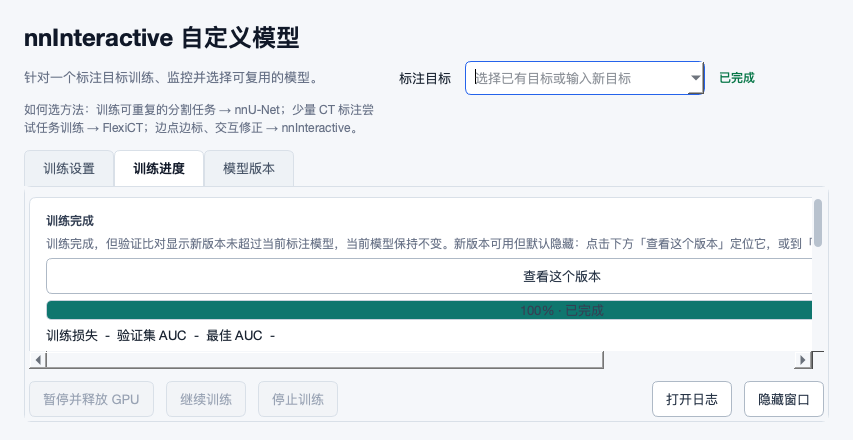
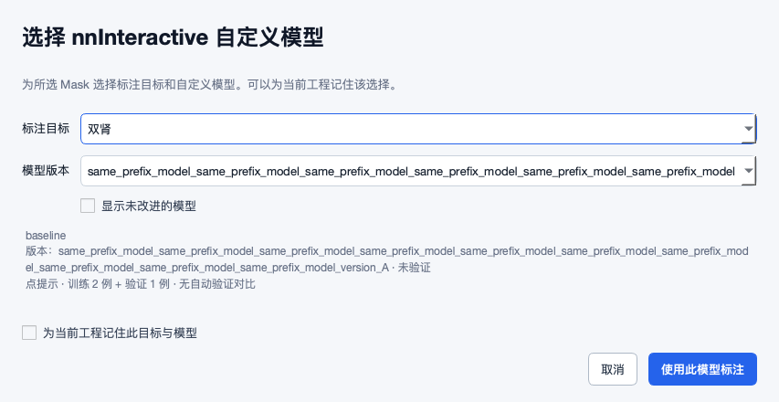

# 远程变更审查：fda3444

_2026-10-16 · 每 20 分钟监控的首次手动执行 · 仅审查报告与证据_

## 📌 本轮结论

已安全 pull 到 `fda3444427360dfba0515648da1b7b04bd1eb94b`：相对上轮自身推送 `447870e`，远程新增 **43 个提交、31 个文件变更**，主要修复 R01–R17 并补充复审账本。这些提交在本轮 fetch 前不在本地 HEAD 历史，也未登记为本任务自身推送；Git 不证明推送者来自哪台机器，本轮按提交 SHA/历史与本地记录判断，不凭相同的作者邮箱推断来源。

远程改动总体解决了正确的问题，**17 张旧卡中 10 项通过本轮关键离线复核、7 项仍只能算部分解决**。这里的“通过”不是 Windows/Mimics/GPU 最终验收。新增快照交接出现实际回归；预测有效性、旧结果保护、冻结验证集合等仍有可复现缺口。因此不接受“R01–R17 全部功能验收完成”的扩大表述。本轮列出 **11 张开放处理卡**，包含新回归、旧卡剩余边界及新发现的恢复风险，不将它们全部冒充新增独立 bug。

已重走 28 个脚本库入口的实际分发测试，更新 20 个主要 UI 源模块的控件/信号清单；默认字号与 1.25 倍字号各渲染 150 个状态，并补 7 张针对性 Qt 截图。按钮内容测量未复现越界；长版本详情和完成页导航改善已直接观察。没有修改业务源码、业务配置或真实数据，也没有启动真实 Mimics/GPU 模型训练、推理或 SSH 工作负载。

优先处理 S02/S03 的发布边界、S01/S04 的回执与人工修改保护；其次处理 S05/S06/S07/S09/S10 的数据/训练/排名可信性，以及 S08 的点击响应。每张卡均有当前代码位置、合成证据、修改方法与验收条件。源码链接固定到本次被审查提交，旧报告/证据继续保留原版本身份。

## 🔎 17 项旧问题的独立复核

| 原卡 | 本轮判断 | 核对结果 |
|---|---|---|
| R01 | 关键离线复核通过 | 长中文/ASCII ID 均为 96 字符、四者不同且再次规范化不变。 |
| R02 | 关键离线复核通过 | 真实三病例 scanner 含空 Mask 例，实际 Qt 警告点名 B/C 与多标签部分缺失。 |
| R03 | 关键离线复核通过 | worker 完成状态保留 source_path/output_path；独立新回归 S01 仍使真实队列回执无法生成。 |
| R04 | 部分解决 | Mimics 零等待并排队补写通过；外部 UI 同步等待仍见 S08。 |
| R05 | 关键离线复核通过 | 非默认镜像/目录被摘要与折叠计数显示，信号/缓存开关回归覆盖。 |
| R06 | 部分解决 | 中文多器官请求与原名保留通过；其他命名规约的真实文件匹配仍有 S07。 |
| R07 | 部分解决 | 旧 c0 不再移到 train；新增启发式并集可制造空训练集，见 S05。 |
| R08 | 关键离线复核通过 | 打包保存 patient_group，共享 prepared-row 重建兼容顶层映射并拒绝冲突；相关本地/远程回归通过。 |
| R09 | 部分解决 | 原非等距/重复层反例拒绝；缺字段/完整位置/像素间距未守住，见 S06。 |
| R10 | 部分解决 | 完全坏文件/单份错 affine 在发布前拒绝，暂存名唯一；S02/S03 仍未达到原成果保护和有效性验收。 |
| R11 | 关键离线复核通过 | 显示与应用使用当前 state 优先解析；原位与全局副本记忆相反的反例已通过。 |
| R12 | 关键离线复核通过 | 实际长版本号可换行到 version_A，键盘选择有效；新增测试有字体前提失败，见验证边界。 |
| R13 | 关键离线复核通过 | 实际“查看这个版本”点击切页、打开过滤并选中对应行；目标消失提示已有回归。 |
| R14 | 关键离线复核通过 | 原位改子文件、父目录 mtime 不变时签名已变化；网络盘扫描性能未测。 |
| R15 | 部分解决 | A/B affine 不同可拒绝；共同错源/输入身份及恢复产物缺口仍见 S09/S10，D25 不能等同已实现。 |
| R16 | 关键离线复核通过 | 保留 background 输出名被拒绝，writer 再次守卫零背景。 |
| R17 | 部分解决 | 有效快照可识别等体积编辑、v1 拒绝有效；S04 的旧 v2/空 SHA 和 S01 的交接仍不闭环。 |

不能用“未立项的需求缺口”改变原有风险的事实状态。D24/D25 可以作为后续产品取舍记录，但当前有效预测的常规覆盖、两模型共同错源，以及旧产物混入本轮结果，仍须以原先的成果保护和数据正确性目标评估。新单测通过和局部注释不能替代真实交接契约。

## 🧩 开放问题与开发测试卡

| 编号 | 优先级 | 问题 | 性质与关联 |
|---|---|---|---|
| [S01](#s01) | P1 | Mask 快照返回类型改变，真实导入队列无法写撤销回执 | new_regression；R17, R03 |
| [S02](#s02) | P0 | 有效预测成功发布后仍删除旧结果，保护只覆盖失败路径 | remaining；R10, F43, D24 |
| [S03](#s03) | P1 | 发布校验只加载文件头，截断体素、4D 和概率值仍能发布 | newly_identified_boundary；R10 |
| [S04](#s04) | P1 | 旧 v2 或缺 SHA 快照仍按像素数放行删除 | remaining；R17, UI15, F18 |
| [S05](#s05) | P1 | 冻结验证集与新启发式取并集，让合法两病例续训变空集 | new_regression；R07, F16, UI30 |
| [S06](#s06) | P1 | DICOM 校验仍放行缺位置、平面内跳动和不一致像素间距 | remaining；R09, F01, UI16 |
| [S07](#s07) | P1 | 标签语义校验与文件匹配使用不同规约，两个标签指向同一分割 | new_regression；R06 |
| [S08](#s08) | P2 | Mimics 侧已不等锁，外部“标记已标注”仍同步等待两秒 | remaining；R04, UI31 |
| [S09](#s09) | P1 | 两个 AL 预测彼此同网格，仍可能共同偏离该病例输入 | remaining；R15, D25, F20 |
| [S10](#s10) | P1 | AL 重试已拒绝的病例仍从旧不确定度文件进入本轮排名 | newly_identified_recovery_risk；R15, F26 |
| [S11](#s11) | P2 | 训练完成长文案不换行，把状态卡和按钮撑出可见区 | new_regression；R13, UI01, UI27 |

### S01 · Mask 快照返回类型改变，真实导入队列无法写撤销回执（P1）

**源码：** [runtime_py35/create_mcs_batch.py:207](https://github.com/ShijianRuan/MIMICS_SCRIPTS/blob/fda3444427360dfba0515648da1b7b04bd1eb94b/runtime_py35/create_mcs_batch.py#L207)、[runtime_py35/create_mcs_batch.py:1172](https://github.com/ShijianRuan/MIMICS_SCRIPTS/blob/fda3444427360dfba0515648da1b7b04bd1eb94b/runtime_py35/create_mcs_batch.py#L1172)、[runtime_py35/create_mcs_batch.py:1499](https://github.com/ShijianRuan/MIMICS_SCRIPTS/blob/fda3444427360dfba0515648da1b7b04bd1eb94b/runtime_py35/create_mcs_batch.py#L1499)。

**场景与复现：** 导入带分割的病例，后台创建 .mcs，再为最终文件写回执。标注者看到创建完成后希望可以撤销。 _capture_mask_snapshot 返回 _MaskIdentity 对象，真实队列 main 在 item.get 处抛 AttributeError。合成队列运行退出 0，.mcs 已发布、completed=1/failed=0，却没有 .import_receipt.json；异常只在日志出现。真实创建/保存 Mimics 工程为边界桩，快照生产、队列、发布和回执调用使用当前代码。

**原因与影响：** 生产者以前传字典，新改动传对象；消费者仍按字典读取。新回归测试手写了字典形态的 fake_create 返回值，没有使用当前生产者的类型，因此继续通过。R03 状态路径保持虽然修好，也不能找回一个没有生成的回执。

**要改什么、怎么改：** 固定 receipt 数据契约，推荐交接处显式转成包含 name/guid/pixel_count/sha256 的普通字典，再由消费者按该契约构造；或让同进程消费者直接接收对象，但需检查其他序列化边界。增加从真实快照生产者到真实 main 的组合测试。回执失败应作为可见警告/部分成功保留在任务结果，提供补写依据，不让 completed 掩盖恢复能力缺失。

**验收条件：**

- 用 _capture_mask_snapshot 真实返回值喂给队列，成功后回执存在并指向最终 .mcs，快照四字段一致。
- 旧/新交接数据、空 Mask、多个 Mask、快照读取失败和回执目录不可写分别测试；异常不得仅写日志后显示完整成功。
- 重启/重试能补写恢复依据且不重复创建工程，随后通过真实 Mimics 撤销链路验收。

**证据：** A：当前生产函数/跨模块链路的隔离复现；[queue_snapshot_handoff](2026-10-16-fda3444-evidence/observations.json)。

### S02 · 有效预测成功发布后仍删除旧结果，保护只覆盖失败路径（P0）

**源码：** [tools/nnunet_pipeline.py:1852](https://github.com/ShijianRuan/MIMICS_SCRIPTS/blob/fda3444427360dfba0515648da1b7b04bd1eb94b/tools/nnunet_pipeline.py#L1852)、[tools/nnunet_pipeline.py:1865](https://github.com/ShijianRuan/MIMICS_SCRIPTS/blob/fda3444427360dfba0515648da1b7b04bd1eb94b/tools/nnunet_pipeline.py#L1865)、[tools/nnunet_pipeline.py:1881](https://github.com/ShijianRuan/MIMICS_SCRIPTS/blob/fda3444427360dfba0515648da1b7b04bd1eb94b/tools/nnunet_pipeline.py#L1881)。

**场景与复现：** 同一输出路径已有人工复核结果，标注者重跑模型或接收远程结果；新结果格式、网格正确，但内容并不代表人工成果。 真实 publish_prediction_output 发布一个有效同网格 NIfTI 后，旧内容被替换，.replaced-* 备份随即 unlink，目录只剩 candidate 和新的 prediction。没有版本选择/冲突提示，也没有保留可恢复的旧结果。

**原因与影响：** 新增暂存、坏文件拒绝和失败回滚有效，但成功路径主动清理旧文件。把它描述为“旧结果永不丢失”或仅归为微秒级人工保存竞态，会遗漏普通的确定性有效文件覆盖；并发目标版本也没有临界区校验。D24 已登记部分交互缺口，但不能据此把 R10 原有成果保护验收标为完成。

**要改什么、怎么改：** 目标存在时默认发布为新版本，或保留旧文件并将恢复路径写入产物清单/结果页；不要成功后立即删除唯一旧副本。以目标指纹/版本和短临界区保护发布，发生较新改动或并发发布时保留两份并报告。复用现有任务/产物清单，无需新增大型平台或每例多次确认。

**验收条件：**

- 已有人工结果、普通有效新结果和并发同目标，旧内容都能通过明确路径找回。
- 显式授权替换后原文件再次变化，拒绝静默覆盖；两个完成出口、本地与远程均复用同一规则。
- 发布失败/取消/磁盘满时原结果不变，结果页说明最终发布路径及保留的旧版本。

**证据：** A：当前生产函数/跨模块链路的隔离复现；[publication_valid_overwrite](2026-10-16-fda3444-evidence/observations.json)。

### S03 · 发布校验只加载文件头，截断体素、4D 和概率值仍能发布（P1）

**源码：** [tools/nnunet_pipeline.py:1774](https://github.com/ShijianRuan/MIMICS_SCRIPTS/blob/fda3444427360dfba0515648da1b7b04bd1eb94b/tools/nnunet_pipeline.py#L1774)、[tools/nnunet_pipeline.py:1820](https://github.com/ShijianRuan/MIMICS_SCRIPTS/blob/fda3444427360dfba0515648da1b7b04bd1eb94b/tools/nnunet_pipeline.py#L1820)、[tools/nnunet_pipeline.py:1859](https://github.com/ShijianRuan/MIMICS_SCRIPTS/blob/fda3444427360dfba0515648da1b7b04bd1eb94b/tools/nnunet_pipeline.py#L1859)。

**场景与复现：** 下载或导出生成了文件头正常、体素区缺失的 .nii.gz，或某 backend 返回 4D/浮点概率结果，却被当作最终整数分割。 合法 gzip 内只保留 352 字节 NIfTI 头、没有 64 个体素，函数仍成功发布并删除旧结果；随后读取体素时报 Expected 64 bytes, got 0。4×4×4×2 的 4D 文件和全部 0.25 的浮点体也通过相同的源 shape/affine 校验。

**原因与影响：** nib.load 是延迟数据访问；重复 load 不等于读取和验证体素。维度条件 len(shape)<3 放行 4D，几何只用前三维，标签有限性/整数性/允许 ID 没有校验。UI 无法可靠弥补最终发布边界缺失的验证。

**要改什么、怎么改：** 在外部进程按块消费候选数据，检查完整可读、恰为支持的 3D 分割、有限整数标签和模型映射范围，再校验物理网格。staging 副本须验证同一输入身份/必要摘要；保持内存可控，不为全身体积一次复制多份数组。损坏候选与错误详情留在 job 目录，原结果不变。

**验收条件：**

- 头正常但 payload 截断、gzip 截断、4D、NaN/Inf、0.25 概率、非法标签值均在触碰最终目标前拒绝。
- 正常多器官标签、合法空前景（按既定策略）可通过，产物声明与模型标签表一致。
- 分别覆盖 candidate 与 staging 检查、传输/复制中断和后台完成状态，不能只测试完全不可解析的垃圾字节。

**证据：** A：当前生产函数/跨模块链路的隔离复现；[publication_truncated_voxels, publication_four_dimensional, publication_fractional_labels](2026-10-16-fda3444-evidence/observations.json)。

NiBabel 官方文档说明 load 后数据可由 ArrayProxy 延迟读取，因此文件头正常不能证明体素 payload 完整。[NiBabel 图像与代理](https://nipy.org/nibabel/nibabel_images.html)。nnU-Net 的分割契约要求整数语义标签与相同几何，概率图不能直接当最终标签。[nnU-Net 数据格式](https://github.com/MIC-DKFZ/nnUNet/blob/master/documentation/dataset_format.md)。

### S04 · 旧 v2 或缺 SHA 快照仍按像素数放行删除（P1）

**源码：** [runtime_py35/import_undo_mimics.py:284](https://github.com/ShijianRuan/MIMICS_SCRIPTS/blob/fda3444427360dfba0515648da1b7b04bd1eb94b/runtime_py35/import_undo_mimics.py#L284)、[runtime_py35/import_undo_mimics.py:303](https://github.com/ShijianRuan/MIMICS_SCRIPTS/blob/fda3444427360dfba0515648da1b7b04bd1eb94b/runtime_py35/import_undo_mimics.py#L303)、[runtime_py35/create_mcs_batch.py:207](https://github.com/ShijianRuan/MIMICS_SCRIPTS/blob/fda3444427360dfba0515648da1b7b04bd1eb94b/runtime_py35/create_mcs_batch.py#L207)。

**场景与复现：** 旧 v2 回执没有新 SHA 字段，或当前导入时读取 buffer 失败记录了空 SHA。后来用户移动一个前景体素，前景数量、GUID/名字不变。 有完整 SHA 时，当前代码检测到等体积编辑并保留 Mask；但旧 v2 无 SHA/计数的记录、或 sha256="" 且计数相同的记录，都调度删除了手改 Mask。使用当前判定/删除函数，原生 delete/transaction 为列表边界桩。

**原因与影响：** 新实现拒绝 v1 是有效进步，但 _content_edited 在没有 recorded_count 时直接返回 False，有计数时仅比较数量；无法排除内容编辑却将其当成未编辑。import-time buffer 失败不是可安全降级为计数的理由。

**要改什么、怎么改：** 缺少可靠导入内容摘要应视为“无法证明未编辑”，默认保留对象与回执，说明需要手动/备份处理；不要从当前内容回填所谓历史快照。新回执明确声明快照是否有效，旧 v2 走兼容但保守的恢复路径。保持有 SHA 情况的正常撤销能力。

**验收条件：**

- v1、旧 v2 无字段、空 SHA、buffer 无法读、只有相同计数、等体积位置变化均不自动删除人工内容。
- 可靠快照且未修改时可撤销；可靠快照有修改时保留，异常不消费回执。
- 真实 Windows/Mimics 导入→保存/不保存编辑→撤销→重启，人工工作从明确恢复点可找回。

**证据：** A：当前生产函数/跨模块链路的隔离复现；[undo_legacy_v2, undo_failed_snapshot, undo_valid_snapshot](2026-10-16-fda3444-evidence/observations.json)。

### S05 · 冻结验证集与新启发式取并集，让合法两病例续训变空集（P1）

**源码：** [tools/flexict_pipeline.py:582](https://github.com/ShijianRuan/MIMICS_SCRIPTS/blob/fda3444427360dfba0515648da1b7b04bd1eb94b/tools/flexict_pipeline.py#L582)、[tools/flexict_pipeline.py:621](https://github.com/ShijianRuan/MIMICS_SCRIPTS/blob/fda3444427360dfba0515648da1b7b04bd1eb94b/tools/flexict_pipeline.py#L621)、[tools/flexict_pipeline.py:625](https://github.com/ShijianRuan/MIMICS_SCRIPTS/blob/fda3444427360dfba0515648da1b7b04bd1eb94b/tools/flexict_pipeline.py#L625)。

**场景与复现：** 上次把 c0 指定为验证、c1 为训练；重开设置/扫描后没有重新指定验证病例，希望沿用旧验证集合继续训练。 当前 _write_flexict_splits(frozen_val=[c0]) 仍先按默认启发式选 c1，再与 c0 合并，得到 0 训练/2 验证并报错。四病例例子 val_cases=1、旧验证 c0，实际变成 c0+c3 两个验证例。旧 c0 不回到训练的修复有效，但最终集合不稳定。

**原因与影响：** 冻结集合只作为必须包含的补丁，未成为默认拆分权威；新抽样与旧冻结同时决定验证集合。用户未主动重新划分，也会被要求增加病例或调整选择，破坏小样本训练和可比验证。

**要改什么、怎么改：** 存在有效冻结集合时，以它及患者组扩展结果直接确定验证，其余可用病例进入训练；只有明确的新建/重新划分动作才走启发式。界面回显旧验证和最终数量；保持空集合 fail-closed，但不要先人为制造空集合。

**验收条件：**

- 上述两病例原样续训保持 c0 验证/c1 训练，不要求新增数据；四病例不擅自把 1 个验证变成 2 个。
- 重扫顺序、新增病例、中文 ID/旧 key 映射、患者组扩展、本地与远程的最终 splits 一致。
- 明确重新划分与冻结约束矛盾时展示具体变化；检查真实 materialize→最终 writer→trainer 读取顺序。

**证据：** A：当前生产函数/跨模块链路的隔离复现；[R07_frozen_four_cases, frozen_two_case_retrain](2026-10-16-fda3444-evidence/observations.json)。

### S06 · DICOM 校验仍放行缺位置、平面内跳动和不一致像素间距（P1）

**源码：** [mimics_bridge.py:1694](https://github.com/ShijianRuan/MIMICS_SCRIPTS/blob/fda3444427360dfba0515648da1b7b04bd1eb94b/mimics_bridge.py#L1694)、[mimics_bridge.py:1708](https://github.com/ShijianRuan/MIMICS_SCRIPTS/blob/fda3444427360dfba0515648da1b7b04bd1eb94b/mimics_bridge.py#L1708)、[mimics_bridge.py:1782](https://github.com/ShijianRuan/MIMICS_SCRIPTS/blob/fda3444427360dfba0515648da1b7b04bd1eb94b/mimics_bridge.py#L1782)、[mimics_bridge.py:1808](https://github.com/ShijianRuan/MIMICS_SCRIPTS/blob/fda3444427360dfba0515648da1b7b04bd1eb94b/mimics_bridge.py#L1808)。

**场景与复现：** 同系列切片沿法向间距规则，但中间切片偏移，或缺一片 ImagePositionPatient，或 PixelSpacing 不同；真实数据可能来自混合导出/缺字段。 原来的 [0,1,3] 非等距和 [0,1,1] 重复位置现在被拒绝。新反例中，位置 [0,0,0]/[8,0,1]/[0,0,2] 仍被压成 x=0 的规则体；缺中间 IPP 的三片推断为 z=[0,2,4]；中间 PixelSpacing=[2,2] 也被当作首片 [1,1] 的网格。

**原因与影响：** 校验只看有位置切片的法向投影，忽略缺字段与完整 3D 步向量一致性；affine 构造又用首片 PixelSpacing 和位置差中位数。安全拒绝重复/不等距并不等于所有不可表示为单一网格的数据都已拒绝。

**要改什么、怎么改：** 验证每片必需几何字段、有限/合法方向与一致 PixelSpacing；位置步向量需满足统一线性堆栈，允许规则倾斜而拒绝非线性跳动。缺失几何无法证明时拒绝自动转换，给具体层/字段，不默用计数和默认原点；如增加重采样需显式变换与恢复映射。

**验收条件：**

- 规则/倒序/斜位/线性倾斜通过；上述三种反例在构造训练/预测网格前拒绝。
- 全部或部分缺 IPP/IOP/PixelSpacing、非有限数、混合方向/尺寸、多帧各有明确处理。
- 原始层面→体素角点→Mimics 所选 Image→导出 Mask 以实际物理位置核对，不能只检查 shape。

**证据：** A：当前生产函数/跨模块链路的隔离复现；[dicom_geometry](2026-10-16-fda3444-evidence/observations.json)。

### S07 · 标签语义校验与文件匹配使用不同规约，两个标签指向同一分割（P1）

**源码：** [tools/nnunet_common.py:405](https://github.com/ShijianRuan/MIMICS_SCRIPTS/blob/fda3444427360dfba0515648da1b7b04bd1eb94b/tools/nnunet_common.py#L405)、[tools/nnunet_pipeline.py:323](https://github.com/ShijianRuan/MIMICS_SCRIPTS/blob/fda3444427360dfba0515648da1b7b04bd1eb94b/tools/nnunet_pipeline.py#L323)、[tools/nnunet_pipeline.py:349](https://github.com/ShijianRuan/MIMICS_SCRIPTS/blob/fda3444427360dfba0515648da1b7b04bd1eb94b/tools/nnunet_pipeline.py#L349)、[tools/nnunet_pipeline.py:612](https://github.com/ShijianRuan/MIMICS_SCRIPTS/blob/fda3444427360dfba0515648da1b7b04bd1eb94b/tools/nnunet_pipeline.py#L612)。

**场景与复现：** 两个输出标签叫 Liver-Left、Liver_Left，数据中只有一个 Liver_Left.nii.gz；用户对有意重叠的器官选择了允许顺序替换。 normalize_labels 接受两个不同标签，_find_label_files 却把两者都匹配到同一源文件。真实 _materialize_case 在 overlap_policy=replace 时最终全部前景变成 ID 2，ID 1 消失；默认 fail 则会在准备中报重叠，而非指出名称规约歧义。

**原因与影响：** 语义唯一性采用 NFKC+casefold，文件 key 采用 lower 并把 -/./空格变成 _；后者比前者更有损。中文不同器官不再全部变成 item 的修复正确，但没有统一跨模块身份/别名规则。

**要改什么、怎么改：** 源文件解析优先精确匹配，宽松别名只在唯一且无跨标签所有权冲突时使用；同一文件被不同输出标签重复认领要在准备前拒绝并点明两行。标签/别名/文件名的等价规则须一致或显式区分，不能把歧义混进 overlap_policy。保留用户原有名称与稳定 ID。

**验收条件：**

- Liver-Left/Liver_Left、空格/点/斜杠、全角/半角、大小写折叠与中文组合，不会把两个标签归到同一源文件。
- 文件名宽松匹配存在歧义时明确拒绝；有意同一标签多别名/union 仍正常。
- 验证实际 materialized label 和逐标签体素数，允许顺序替换也不能绕过源身份检查。

**证据：** A：当前生产函数/跨模块链路的隔离复现；[label_key_disagreement](2026-10-16-fda3444-evidence/observations.json)。

### S08 · Mimics 侧已不等锁，外部“标记已标注”仍同步等待两秒（P2）

**源码：** [tools/flexict_active_learning_ui.py:142](https://github.com/ShijianRuan/MIMICS_SCRIPTS/blob/fda3444427360dfba0515648da1b7b04bd1eb94b/tools/flexict_active_learning_ui.py#L142)、[tools/flexict_active_learning_ui.py:201](https://github.com/ShijianRuan/MIMICS_SCRIPTS/blob/fda3444427360dfba0515648da1b7b04bd1eb94b/tools/flexict_active_learning_ui.py#L201)、[tools/flexict_active_learning_ui.py:1003](https://github.com/ShijianRuan/MIMICS_SCRIPTS/blob/fda3444427360dfba0515648da1b7b04bd1eb94b/tools/flexict_active_learning_ui.py#L1003)。

**场景与复现：** Mimics 或另一个窗口持有 annotation_state 锁，标注者点击外部复核窗口“标记为已标注”。 当前 Mimics _al_mark_viewed 约 0.1 ms 返回并排队，解锁后可补写；但实际外部点击处理 _mark_annotated 同步调用 set_case_state，持锁时约 2.02 秒才显示稍候再试。未持有真实 Qt 事件循环；同步回调链由当前源码确定。

**原因与影响：** 修复集中于宿主零等待，外部 UI 的默认两秒循环/sleep 不变。状态不会被无锁覆盖是进步，但点击响应和连续标记仍会卡顿。

**要改什么、怎么改：** 外部状态写入放入已有后台 worker/队列，完成回执后刷新行；等待时呈现轻量进行中状态，失败保留可重试错误。Mimics 的零等待重试保留。无需数据库或新增窗口。

**验收条件：**

- 点击回调不 sleep/等锁；外部 UI 可滚动和取消，解锁后确认落盘才显示成功。
- 独立进程、两个窗口和不同病例并发，显式标注/跳过不丢失、不被 viewed 降级。
- Windows msvcrt、只读/离线/UNC 和进程退出验收；排队失败与应用失败分别反馈。

**证据：** A：当前生产函数/跨模块链路的隔离复现；[external_ui_lock_wait, R04_nonblocking_marker](2026-10-16-fda3444-evidence/observations.json)。

### S09 · 两个 AL 预测彼此同网格，仍可能共同偏离该病例输入（P1）

**源码：** [tools/flexict_pipeline.py:1591](https://github.com/ShijianRuan/MIMICS_SCRIPTS/blob/fda3444427360dfba0515648da1b7b04bd1eb94b/tools/flexict_pipeline.py#L1591)、[tools/flexict_pipeline.py:1645](https://github.com/ShijianRuan/MIMICS_SCRIPTS/blob/fda3444427360dfba0515648da1b7b04bd1eb94b/tools/flexict_pipeline.py#L1645)、[tools/flexict_pipeline.py:1767](https://github.com/ShijianRuan/MIMICS_SCRIPTS/blob/fda3444427360dfba0515648da1b7b04bd1eb94b/tools/flexict_pipeline.py#L1767)、[integrations/flexict-finetune/uncertainty/uncertainty.py:84](https://github.com/ShijianRuan/MIMICS_SCRIPTS/blob/fda3444427360dfba0515648da1b7b04bd1eb94b/integrations/flexict-finetune/uncertainty/uncertainty.py#L84)。

**场景与复现：** 两模型结果用了同一份过期/错误转换，shape 与 affine 彼此相同，但不属于当前输入网格；另有同网格不同病例的身份问题。 单独 100 mm 平移的一份预测现在被拒绝。真实 folder-predict→uncertainty 链路中，两份结果都 x 平移 100 mm，job/input 与 input_geometries 明确为原点 0，仍返回 caseA 为成功。只有模型执行替换为合成输出，产物路径、接口和不确定度计算使用当前代码。

**原因与影响：** 新增检查仅比较预测 A 与 B，不比较各自与病例源；已有 input_geometries 未作为该入口的校验条件。D25 已记录同网格异病例指纹，但两份共同错网格也不能靠 pair affine 比较或后续 Mimics 辅助带校验修复排序。

**要改什么、怎么改：** 每份预测在进入分歧计算前与该病例 input 的 shape/affine、输入指纹、模型/标签映射分别核对；一致后再互相比对。身份不明/过期或错网格的病例列为失败及具体原因，不生成可信排名。复用现有 input_geometries/manifest。

**验收条件：**

- 仅 A 错、仅 B 错、A/B 同时错相同 affine、同网格不同病例、输入原位更新和错标签表分别拒绝。
- 正常结果照常进入排名；被剔除病例既有数量也有逐例原因，不能仅在日志中消失。
- 两端真实模型/GPU 与 Mimics 辅助带位置仍需目标机，离线契约通过不得宣称当前患者准确率。

**证据：** A：当前生产函数/跨模块链路的隔离复现；[al_pair_wrong_source_chain, R15_pair_affine](2026-10-16-fda3444-evidence/observations.json)。

### S10 · AL 重试已拒绝的病例仍从旧不确定度文件进入本轮排名（P1）

**源码：** [tools/flexict_pipeline.py:1757](https://github.com/ShijianRuan/MIMICS_SCRIPTS/blob/fda3444427360dfba0515648da1b7b04bd1eb94b/tools/flexict_pipeline.py#L1757)、[tools/flexict_pipeline.py:1788](https://github.com/ShijianRuan/MIMICS_SCRIPTS/blob/fda3444427360dfba0515648da1b7b04bd1eb94b/tools/flexict_pipeline.py#L1788)、[integrations/flexict-finetune/uncertainty/uncertainty.py:823](https://github.com/ShijianRuan/MIMICS_SCRIPTS/blob/fda3444427360dfba0515648da1b7b04bd1eb94b/integrations/flexict-finetune/uncertainty/uncertainty.py#L823)、[integrations/flexict-finetune/uncertainty/uncertainty.py:983](https://github.com/ShijianRuan/MIMICS_SCRIPTS/blob/fda3444427360dfba0515648da1b7b04bd1eb94b/integrations/flexict-finetune/uncertainty/uncertainty.py#L983)。

**场景与复现：** 同一个作业/输出目录第一次计算成功，恢复或重试时其中一模型几何不匹配，被新检查拒绝；用户期待它不再列入本轮有效排名。 实际 run_batch 第一次返回 stale_case 成功，第二次错网格返回空成功列表，日志明确写处理失败；随后真实 analyze_uncertainty_dir 仍从旧目录将 stale_case 写入排名。当前失败没有清除或隔离旧 uncertainty/consensus，目录扫描又没有本轮成功集合约束。

**原因与影响：** 新失败计数使用本轮 metrics，但排名依据目录内任意匹配文件，二者不是同一个本轮产物集合。新增“被剔除数量”提示不能保证被拒绝病例真的不在排名；新测试使用全新空目录，遗漏恢复/重复计算。

**要改什么、怎么改：** 每次计算写入独立 staging/run 目录并携带输入、模型版本；分析阶段只接收该次成功 manifest/显式病例文件集合。旧结果可保留为历史，但不可自动混入本轮；终态的成功、失败、排名与辅助带引用同一份产物清单。不要不加区分清空用户目录。

**验收条件：**

- 成功一次后，对同一输出目录制造错网格、缺 Mask、损坏文件再重试，失败病例不进入新排名或辅助带。
- 正常病例不受影响，失败清单与有效排名互斥；取消、崩溃、重复执行不把旧成功冒充当前成功。
- 覆盖完整 folder-prediction→run_batch→analyze→bands→status/UI，不能只断言 run_batch 返回值为空。

**证据：** A：当前生产函数/跨模块链路的隔离复现；[al_failed_retry_uses_old_output](2026-10-16-fda3444-evidence/observations.json)。

### S11 · 训练完成长文案不换行，把状态卡和按钮撑出可见区（P2）

**源码：** [tools/nninteractive_task_model_center.py:728](https://github.com/ShijianRuan/MIMICS_SCRIPTS/blob/fda3444427360dfba0515648da1b7b04bd1eb94b/tools/nninteractive_task_model_center.py#L728)、[tools/nninteractive_task_model_center.py:1959](https://github.com/ShijianRuan/MIMICS_SCRIPTS/blob/fda3444427360dfba0515648da1b7b04bd1eb94b/tools/nninteractive_task_model_center.py#L1959)。

**场景与复现：** 853×440 小窗口下训练结束，current_model_retained 的新说明要告诉用户模型去向及隐藏过滤开关。 实际 Qt 完成页中 progress_detail 未设 wordWrap，说明长行超出视口；整个状态卡、查看版本按钮和进度条随内容被撑宽，出现水平滚动条，文字右尾及控件右侧需要横向滚动才能看到。查看版本按钮本身能成功导航，不能因此认为完成页布局也已通过。

**原因与影响：** 新文案长度增加，但 QLabel 的不换行最小内容宽度仍参与自然布局；常规按钮检测只比较按钮文字与按钮自身尺寸，无法发现按钮/父表面整体超出视口。

**要改什么、怎么改：** 说明 QLabel 启用自动换行并采用可收缩的水平尺寸策略，让内容宽度服从 viewport；纵向滚动容纳解释，主动作保持完整可达。按当前长状态/错误文案复核同类标签，保留准确导航而非仅把文字改短。

**验收条件：**

- 853×440 和放大字体下 current_model_retained、未验证、失败诊断的长文案完整可读，无强制横向滚动。
- 状态卡、查看版本按钮与进度条的可见区域均在 viewport 内，底部主要操作仍可达。
- 验收真实父表面/控件 visibleRegion 与截图，不只看 fontMetrics(button.text) 小于 button.width。

**证据：** A：真实 Qt 完成状态截图与布局测量；非 Windows DPI 实机验收；[completion_layout / 完成页截图](2026-10-16-fda3444-evidence/ui-observations.json)。

## 🧭 UI、入口与完整使用流程

本轮入口/控件清单见[当前 inventory](2026-10-16-fda3444-evidence/control-and-entry-inventory.json)。28 个前门与方法内 action 的真实分发测试通过，原生副作用为边界桩；不能解释为所有功能的 Windows 端到端验收。完整逐入口职责沿用[上轮入口与工作流表](2026-10-13-revalidation.md)，本轮按以下链路检查交接点，并没有只看 diff 或修复说明。

| 使用环节/视角 | 本轮证据与判断 | 仍需处理或目标机验收 |
|---|---|---|
| 产品：从数据到可交付标注 | 导入预检、任务上下文、模型选择均有改善 | `.mcs` 创建成功、回执可用、标注完成、保存、导出不能互相替代；S01 的“成功却不可撤销”必须可见 |
| 标注者：混合病例/多器官输入 | 无 Mask 病例和部分器官缺失实际出现在确认内容 | S07 标签身份；确认过的缺失事实须跟随真实任务结果持久化，启动弹窗不是最终结果页 |
| 标注者：原位/副本与撤回 | 当前有效写入方式文案一致；可靠摘要识别等体积编辑 | S04 缺证明不可删除；跨 Image/工程切换、后台结果落地、撤回/保存失败仍需原生验收 |
| UI/视觉：模型号与训练结束路径 | 长 ID 可换行和键盘复制；查看版本能切页、展开过滤并定位 | 通用表格仍允许省略但需配套全文详情；原生 DPI/字体、焦点/Tab/Esc/Enter 与多屏未验收 |
| 架构：外部计算与宿主协作 | 双环境、外部 worker、零等待 viewed 路线合理 | S08 外部 UI 同步锁；快照普通数据契约、最终发布/拆分/产物 manifest 应有唯一权威 |
| 数据/算法：训练与验证 | 患者组序列化及 prepared 重建改善，背景名保护有效 | S05 验证集合、S06 物理网格、S09/S10 输入和产物身份；验证指标不能被当成当前病例准确率 |
| 批量与恢复 | 逐例队列、日志、任务完成状态的原有回归覆盖 | S01 恢复凭据缺失、S10 旧产物污染；停止/崩溃/重试后不能以文件存在推断本次成功 |
| 管理/部署 | 模型包、任务停止、环境引导、健康诊断应继续分层 | 仍需 Windows 原生进程/API、离线安装、GPU/驱动/后端最小自检与真实 SSH 中断恢复 |
| 性能与维护 | 目录签名去掉错误缓存提高正确性，宿主不等锁有直接计时 | 大体积 Mask 摘要、源目录 stat 扫描和 UNC 的真实成本未测；分块哈希若无事件回调并不自动保证 GUI 可响应 |

新的 UI 截图均为真实 Qt 控件加合成数据。下两图展示可接受的改善；没有使用手工写入的“成功提示”充当真实训练/提交完成。

入口取舍仍建议保留“导入数据/补充 Mask”“通用模型包管理/方法内作业停止”“官方交互模型/自定义模型”“单例/批量”等实际不同职责。当前最高收益是闭合当前任务到下一步的导航与可信状态，避免增加平级入口或重复训练/管理窗口。人类标注者应继续使用 Mimics 原生视图和精修工具，扩展承担计算、适配与受控交接。

## 🧪 回归、反例与证据边界

恢复了仓库外隔离审查工具环境后，14 组主要回归记录 **841 次测试方法执行、831 次通过、5 个执行错误、2 个断言失败**；跳过 3 个测试方法，另有 1 个权重测试类未进入方法执行。套件选择可能重叠，数字不是不同测试总数。没有执行仓库声明的 Windows `fast 30/30` 门禁；本轮选用具体相关套件，不能代替发布方的目标环境结果，也不能标为全量通过。

| 套件 | 执行方法数 | 通过 | 错误 / 失败 / 跳过方法 | 结论 |
|---|---:|---:|---|---|
| ui | 22 | 21 | 0 / 1 / 0 | FAILED (failures=1) |
| gui | 83 | 83 | 0 / 0 / 0 | OK |
| nnunet | 119 | 119 | 0 / 0 / 0 | OK |
| flexict | 142 | 141 | 1 / 0 / 0 | FAILED (errors=1) |
| remote | 138 | 138 | 0 / 0 / 0 | OK |
| runtime | 114 | 114 | 0 / 0 / 0 | OK |
| cross | 2 | 2 | 0 / 0 / 0 | OK |
| geometry | 6 | 6 | 0 / 0 / 0 | OK |
| review | 11 | 11 | 0 / 0 / 0 | OK |
| nnint-deep | 75 | 75 | 0 / 0 / 0 | OK |
| nnint-functional | 91 | 90 | 0 / 0 / 1 | OK (skipped=1) |
| scribble | 23 | 21 | 0 / 0 / 2 | OK (skipped=2) |
| ui-quality | 5 | 5 | 0 / 0 / 0 | OK |
| flexict-pkg | 10 | 5 | 4 / 1 / 0 | FAILED (failures=1, errors=4, skipped=1) |

5 个执行错误均来自审查环境缺少 torch（4 个 backbone/decoder 测试、1 个 FlexiCT preflight），没有将其计为业务 bug。2 个断言失败需分开解释：

- chooser 新测试假设指定 ID 的字号宽度一定超过视口，本机实际 400 ≤ 805，失败在 fixture 前提；实际更长版本号的 Qt 渲染可读和键盘选择通过。这是测试对字体/平台的依赖，不是再次复现 R12 的产品缺陷。建议用当前 fontMetrics 构造足够长样本并验证真实可见区域。
- uncertainty 新测试沿用默认 `save_plots=True`，审查环境缺 matplotlib，正常病例在保存部分产物后绘图失败，成功列表因此为空。单独将测试调用设为 `save_plots=False`（与当前 AL 生产调用一致）重跑所选两项均通过，原测试源码未改。不能把这个诊断重跑抹掉原始失败；同时暴露了“只看产物存在而不看本次成功集合”的测试缺口，S10 有独立恢复复现。

S01/S02/S03/S04/S05/S06/S07/S08/S09/S10 的反例并非上述环境失败推导，均有独立的当前函数调用记录。[回归详情](2026-10-16-fda3444-evidence/regression-results.json) 与 [观察结果](2026-10-16-fda3444-evidence/observations.json) 保留实际结果。默认/1.25 字号各 150 状态，渲染无构造错误/测量按钮越界；它仍不能证明 Windows 100/125/150/200% DPI、原生 Mimics 弹窗和完整焦点链通过。

本轮没有具体 Mimics 版本、安装版 API 文档和真实 GPU/驱动配置。Mimics 对象/API、buffer 轴序与 HU/GV、保存/删除事务、真实大体积性能与各 backend 的权重输出，继续按[目标机清单](../mimics_real_data_validation.md)验收。此轮变化没有修改 AI 模型配方，不用“代码接口已接通”声称医学分割效果已验证。

## 🛠️ 后续开发与最小交付

| 顺序 | 工作包 | 交付边界 | 关键验收 |
|---|---|---|---|
| 1 | 成果发布与恢复：S01–S04 | 普通快照数据契约、可见回执状态、候选完整验证、旧结果版本保护、缺证明的撤销保守处理 | 真实快照生产→真实队列→回执→手改→撤销；新预测→staging→校验→并发/旧结果→发布/恢复 |
| 2 | 数据与训练：S05–S07 | 一个最终 split、完整源网格检查、标签/文件所有权一致 | 两病例续训、多期患者组、缺几何 DICOM、不同名称同文件、允许 overlap replace 的真实标签内容 |
| 3 | 主动学习：S08–S10 | 异步状态写回、逐预测对源输入检查、每轮产物 manifest | 锁竞争时可操作；两预测共同错源拒绝；失败重试的病例不进入排名或辅助带 |
| 4 | 产品/UX 与测试维护 | 延续已改好的可复制详情与直接导航；修复 S11 文案撑宽；分层反馈计算、复核、保存、恢复状态 | Windows 字体/DPI/焦点、正常+失败+重试、真实病例/全身体积性能与可恢复路径 |

不需要把这些改动扩展成企业级平台。复用现有任务目录、JSON 清单、后台线程与详情/状态区即可。新模型/新入口的优先级低于把已有结果正确、安全、高效地交给标注者。

## 📎 交付与监控衔接

本轮提交范围是本报告、[结构化记录](2026-10-16-fda3444-revalidation.json)、[合成证据说明](2026-10-16-fda3444-evidence/README.md)和审查索引；业务代码未修改。源码和证据 SHA-256 见[manifest](2026-10-16-fda3444-evidence/manifest.json)。报告先完成，再单独做事实核验，核对每张卡的证据键、源码版本和判断边界。

只有报告与证据成功 push 后才推进本地监控游标并登记自身提交 SHA；推送失败保留待续记录。后续每 20 分钟无其他来源新增提交时不生成重复报告/空提交；这些开放卡也不会被自己的文档提交反复触发。
