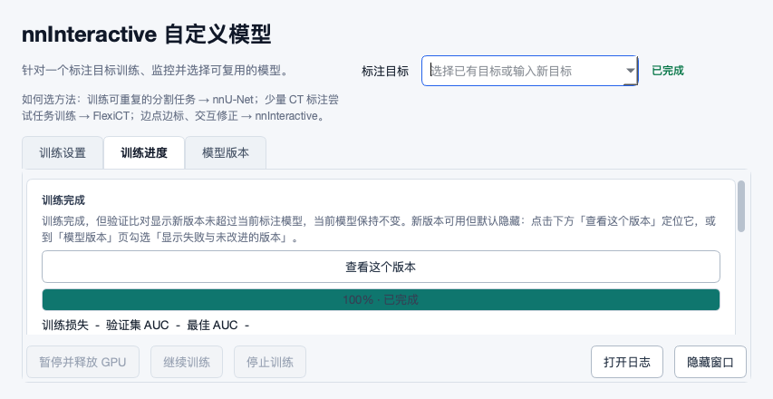
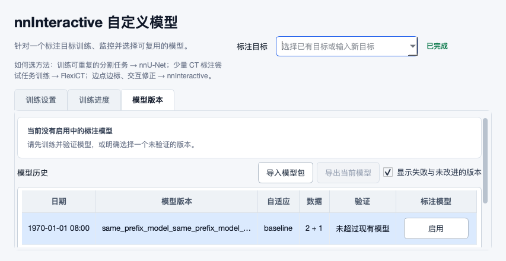
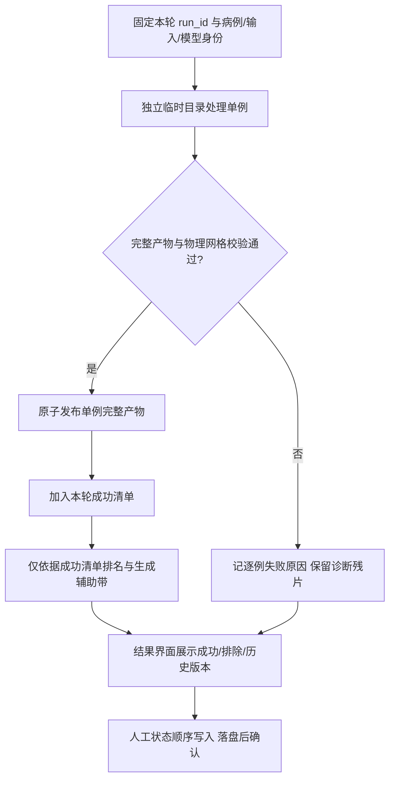

# Mimics 扩展复审：修复验证与真实工作流边界（336e99d）

本轮确认多项修复方向正确，但目前不能将 S01–S11 全部关闭。11项旧卡中，7项的原关键离线反例已通过，4项仍需继续处理；另发现4个相关边界问题。本报告交付8张开放处理卡，每张均给出场景、原因、修改办法和验收条件。没有修改业务代码。

## 📌 审查基线与结论

- 被审源码：`336e99d6bbe1b01a192a9a450a4af29adf0f3ee4`；上次已发布报告提交：`70bddad4d4c5095d3b272dfc3e9ec53a77210be7`。新增12个提交、20个文件，其中9个生产模块、7个测试文件、4个文档文件。
- 按提交SHA、拓扑和本地自行推送清单区分来源；这12个提交不在已记录自推列表中。不依赖author/email，也不声称已证明开发者从哪台机器推送。
- 上游已把上一轮JSON中的S01–S11改为fixed，并记录fast门禁30/30；这是提交者的修复声明。本轮保留旧报告与证据，单独记录本源码的验证结果，不把原证据冒称为新代码证据。
- 建议首先处理S10排名可信度、S06物理网格、T02训练拆分，再完成S01/S02反馈与恢复。T01/T03/T04分别影响大体积效率、外部数据接入和高频操作可靠性。
- 证据来自真实生产函数/文件处理/Qt控件和合成数据；模型执行、原生Mimics创建/删除及GPU预约在明确边界替代。Windows/Mimics/GPU上未执行真实病例，不构成临床准确性或全部兼容性验收。

## ✅ 上一轮11项逐项验收

| 旧卡 | 本轮结论 | 依据与剩余边界 |
|---|---|---|
| S01 | 部分解决 | 生产者/消费者字典契约已实际验证；回执失败反馈与恢复链仍不完整。 |
| S02 | 部分解决 | 成功发布保留旧字节；覆盖冲突和用户找回路径未实现，P0不可恢复丢失已消除，剩余降P1。 |
| S03 | 关键离线反例已解决 | 截断体素、4D、概率值均在发布前拒绝；新性能边界另列T01，不重复计算为旧错误。 |
| S04 | 关键离线反例已解决 | 缺SHA、空SHA、真实内容变化均保留；可靠快照未修改时仍允许删除。 |
| S05 | 关键离线反例已解决 | FlexiCT 原两/四病例冻结反例已解决；nnU-Net并行路径缺陷另列T02并承接R07/F16。 |
| S06 | 部分解决 | 原三反例与规则倾斜已验证；部分缺间距和全部缺位置仍放行。 |
| S07 | 关键离线反例已解决 | 子目录精确匹配和跨标签文件独占检查已生效；平铺格式可用性另列T03。 |
| S08 | 关键离线反例已解决 | 原GUI等待锁已移走，真实Qt的Windows持锁用例本机跳过，合成OS文件锁验证回调不等待；新顺序问题另列T04。 |
| S09 | 关键离线反例已解决 | 两端共同错位100mm在真实AL链被拒绝；同网格错误病例/标签语义的D25系统问题未由几何测试证明解决。 |
| S10 | 部分解决 | 不同秒的通常目录隔离与新路径读取消费已接通；碰撞及本轮失败残片仍可排名。 |
| S11 | 关键离线反例已解决 | 853×440真实Qt：详情宽749且可见749、横向滚动最大值0，查看版本导航可用；WindowsDPI未验收。 |

这里的“已解决”仅指卡片原关键离线反例；真实目标机验证仍待完成。T02/T03/T04承接旧问题家族，不把原反例重复累计为新缺陷。几何匹配也不能证明两个同网格文件属于同一患者或同一标签，历史D25仍应保留待验收。

## 🔎 开发与测试处理卡

### S01 · P1 · 回执类型错误已修，但回执失败仍被界面归为零失败且缺少补写恢复入口

**关联与状态：** S01, R03, F30；旧项部分解决。

**标注场景：** 批量工程已保存，但同目录回执因权限、共享目录短暂不可写或磁盘问题未写入；标注者只看导入状态窗口后继续编辑。

**实际现象：** 真实 _receipt_payload→队列链路已能写出四字段回执。注入仅发生在回执写入边界的 OSError 后，最终仍 code=0、closed、completed=1、failed=0；receipt_failed=1 只在原始状态中。实际 viewer _row 丢掉该字段，error 为空；工作目录已清理，回执不存在。

**原因与影响：** 新增计数没有接到状态解释/界面；异常分支记录日志后按普通成功清理，未保存可重放的回执载荷。 工程本身可用，但用户无法从现有任务反馈知道撤销依据缺失；排查与恢复成本高，重跑整个导入又可能误碰已有工程。

**改什么、为什么、怎么改：** 保留工程成功计数，同时增加可见的“完成但有恢复记录失败”状态和逐病例提示，不重复计入总病例。把回执载荷先持久化到可恢复位置，按最终工程身份/摘要幂等补写；界面提供查看受影响病例和重试补写动作。

**源码：** [runtime_py35/create_mcs_batch.py:232](https://github.com/ShijianRuan/MIMICS_SCRIPTS/blob/336e99d6bbe1b01a192a9a450a4af29adf0f3ee4/runtime_py35/create_mcs_batch.py#L232)；[runtime_py35/create_mcs_batch.py:1209](https://github.com/ShijianRuan/MIMICS_SCRIPTS/blob/336e99d6bbe1b01a192a9a450a4af29adf0f3ee4/runtime_py35/create_mcs_batch.py#L1209)；[tools/batch_status_viewer.py:72](https://github.com/ShijianRuan/MIMICS_SCRIPTS/blob/336e99d6bbe1b01a192a9a450a4af29adf0f3ee4/tools/batch_status_viewer.py#L72)。

**验收条件：**

1. 正常回执内容保持正确，指向最终 .mcs。
2. 回执写失败时状态窗口明确告知具体病例、工程已生成但撤销记录不可用。
3. 重启后补写成功，不重新创建工程、不覆盖人工修正；再次失败可继续重试。

**可复现证据：** [receipt_success, receipt_failure](2026-10-17-336e99d-evidence/observations.json)。

### S02 · P1 · 旧预测已保留，但覆盖授权与用户可理解的找回路径尚未接通

**关联与状态：** S02, R10, F43, D24；旧项部分解决。

**标注场景：** 同一目标路径已有人工检查过的结果，用户再次预测；候选文件有效、网格正确，但结果内容并非用户希望替换的版本。

**实际现象：** 成功替换后备份确实存在且逐字节等于旧结果，原不可恢复的数据丢失点已修。备份地址只写入 replaced_previous_output；全仓生产代码未发现界面读取该字段，也没有目标是否已人工确认/在任务运行期间变化的检查。

**原因与影响：** 发布层完成“保留一个文件”，结果交付层没有形成“知道被替换、知道如何找回”的工作流。 风险由不可恢复丢失降为可恢复但容易误用新结果；并发或长任务仍可能无提示替换较新的人工结果，留下难发现的版本分歧。

**改什么、为什么、怎么改：** 默认产生新版本或在任务启动时约定明确覆盖策略；发布时核对目标指纹，目标改变则保留候选并提示冲突。结果页显示替换说明、旧版本时间与打开/恢复入口；恢复也走冲突保护。无需新增复杂的全局版本管理系统。

**源码：** [tools/nnunet_pipeline.py:1868](https://github.com/ShijianRuan/MIMICS_SCRIPTS/blob/336e99d6bbe1b01a192a9a450a4af29adf0f3ee4/tools/nnunet_pipeline.py#L1868)；[tools/nnunet_pipeline.py:2369](https://github.com/ShijianRuan/MIMICS_SCRIPTS/blob/336e99d6bbe1b01a192a9a450a4af29adf0f3ee4/tools/nnunet_pipeline.py#L2369)；[tools/remote_training_controller.py:2847](https://github.com/ShijianRuan/MIMICS_SCRIPTS/blob/336e99d6bbe1b01a192a9a450a4af29adf0f3ee4/tools/remote_training_controller.py#L2847)。

**验收条件：**

1. 有效替换与失败回滚均保留旧内容。
2. 结果页可直接找到并打开旧结果；普通标注者无需读 JSON 或猜文件名。
3. 两个任务及人工修改交错时，不静默替换较新的结果，恢复操作不损坏当前版本。

**可复现证据：** [publish_valid](2026-10-17-336e99d-evidence/observations.json)。

### S06 · P1 · 部分缺 PixelSpacing 会跳过整个间距校验，全部缺位置仍默认造网格

**关联与状态：** S06, R09, F01, UI16；旧项部分解决。

**标注场景：** 同一病例三片 DICOM 的 PixelSpacing 分别为 [2,2]、缺失、[3,3]；或整组切片没有 ImagePositionPatient。

**实际现象：** 原来的面内跳动、部分缺位置、全字段存在但间距变化均已拒绝，规则线性倾斜可通过。新反例仍接受部分缺间距，并按首片 2mm 构造统一 affine；全部缺位置也仍接受并默认原点/层步长。

**原因与影响：** 遇到第一片缺 PixelSpacing 就把 spacings 清空并 break，随后 if spacings 条件绕过校验，后面的异常间距不再读取；全部缺位置在最前面直接 return。注释称部分缺失不可证明，代码却未实现该约束。 导入、训练与回写可能共同使用无法证实的物理坐标；shape 一致不能发现物理尺寸错误。

**改什么、为什么、怎么改：** 先分别收集每片字段完整性，再验证所有实际值；部分缺失必须拒绝。全部缺失也不得把默认值当作可信坐标：需要明确的替代几何来源并记录来源，否则阻止自动网格转换。提示字段和受影响切片；保留规则倾斜正例。

**源码：** [mimics_bridge.py:1694](https://github.com/ShijianRuan/MIMICS_SCRIPTS/blob/336e99d6bbe1b01a192a9a450a4af29adf0f3ee4/mimics_bridge.py#L1694)；[mimics_bridge.py:1865](https://github.com/ShijianRuan/MIMICS_SCRIPTS/blob/336e99d6bbe1b01a192a9a450a4af29adf0f3ee4/mimics_bridge.py#L1865)。

**验收条件：**

1. [2,2]/缺失/[3,3] 及首片/末片缺失均在构建 affine 前拒绝。
2. 全部缺位置/方向/间距、非有限值和单层输入有明确且一致的证据规则。
3. 规则斜位/线性倾斜通过；目标机核对源层面、Mimics Image 和导出结果的物理位置。

**可复现证据：** [dicom_geometry](2026-10-17-336e99d-evidence/observations.json)。

### S10 · P1 · 按秒目录仍会碰撞，且新目录中的失败病例残片也会被重新排名

**关联与状态：** S10, R15, F26；旧项部分解决。

**标注场景：** 排序完成后重试，部分病例这次没有预测结果；或在新一轮里某病例先写出不确定度图，再因共识图写入失败被 run_batch 标为失败。

**实际现象：** 同秒重试：本轮排除 1 例但仍排名 3 例，目录确实复用。全新目录反例同样排除 1 例却排名 3 例，case01 共识图不存在。两个反例都调用真实 run_active_learning→run_batch→analyze→bands→status 链路；第一例仅控制目录命名时钟，第二例仅在共识图保存处注入失败。仓库新增 S10 测试本轮也自然失败（预期2、实得3）。

**原因与影响：** 目录名只有秒级时间，不能保证每次调用唯一；更根本的是 metrics 成功列表仅用于 excluded_case_count，后续分析仍扫描整个目录，辅助带又遍历所有 case_ids。目录隔离不能代替产物提交契约。 用户看到成功排名和可操作叠加，但其中包含旧结果或本轮未完成结果；“另有1例被剔除”与列表实际内容矛盾。

**改什么、为什么、怎么改：** 每轮生成 UUID/排他创建的独立目录；每例以临时目录完成全套产物后再发布。排名与辅助带只消费该轮成功清单中的明确路径，记录 case/run/模型/输入身份；失败残片保留为诊断但不能被目录扫描捞回。旧轮保留为历史并明确标注。

**源码：** [tools/flexict_pipeline.py:1784](https://github.com/ShijianRuan/MIMICS_SCRIPTS/blob/336e99d6bbe1b01a192a9a450a4af29adf0f3ee4/tools/flexict_pipeline.py#L1784)；[integrations/flexict-finetune/uncertainty/uncertainty.py:665](https://github.com/ShijianRuan/MIMICS_SCRIPTS/blob/336e99d6bbe1b01a192a9a450a4af29adf0f3ee4/integrations/flexict-finetune/uncertainty/uncertainty.py#L665)；[integrations/flexict-finetune/uncertainty/uncertainty.py:983](https://github.com/ShijianRuan/MIMICS_SCRIPTS/blob/336e99d6bbe1b01a192a9a450a4af29adf0f3ee4/integrations/flexict-finetune/uncertainty/uncertainty.py#L983)。

**验收条件：**

1. 强制同一秒运行两轮，目录不同，第一轮历史完整保留。
2. 缺预测、体素损坏、共识保存失败、取消等使某例失败后，该例既不排名也不生成本轮辅助带。
3. 排名集合严格等于本轮成功清单，成功数+排除数与请求数一致；全部失败时 UI 禁用操作。

**可复现证据：** [al_initial, al_same_second_retry, al_fresh_partial_write_failure, al_wrong_grid_rejected](2026-10-17-336e99d-evidence/observations.json)。

### T01 · P2 · 新增逐层读取对普通 gzip 反复从头解压，校验开销随层数放大

**关联与状态：** S03；新增/扩展边界。

**标注场景：** 工作站没有可选 indexed_gzip 扩展，接收数百至上千层的全身器官压缩预测结果。

**实际现象：** 合法 64×64×96 uint8 的体素数据仅 393216 字节，实际一次校验累计解压 19510272 字节（49.62倍，文件头/缓冲也计入），共2450次底层读取。该数由真实 gzip reader 返回字节统计，非耗时推测；候选与发布副本各校验一次。截断、4D、概率值拒绝的正确性已验证。

**原因与影响：** 每层 image.dataobj[..., index] 在未保持打开的 gzip 代理上单独切片；反复打开/seek 导致前面层不断重复解压。内存受控不等于 IO/CPU 高效。 大体积结果在推理完成后的校验阶段继续消耗 CPU/磁盘，批量处理和标注者等待明显放大。当前是外部处理进程，不能据此声称直接堵住 Mimics 主线程。

**改什么、为什么、怎么改：** 保持单个顺序读取句柄并分块验证，或一次流式解压到受控临时文件后 memmap 校验；保留数值/完整性验证。不要只把 indexed_gzip 增为必装依赖来掩盖普通 gzip 路径。显示校验进度与可取消点，异常清理临时文件。

**源码：** [tools/nnunet_pipeline.py:1816](https://github.com/ShijianRuan/MIMICS_SCRIPTS/blob/336e99d6bbe1b01a192a9a450a4af29adf0f3ee4/tools/nnunet_pipeline.py#L1816)；[tools/nnunet_pipeline.py:1868](https://github.com/ShijianRuan/MIMICS_SCRIPTS/blob/336e99d6bbe1b01a192a9a450a4af29adf0f3ee4/tools/nnunet_pipeline.py#L1868)。

**验收条件：**

1. 普通 gzip、无 indexed_gzip 时解压总量随文件大小近似线性，不随层数重复扫描前缀。
2. 截断/4D/小数/NaN/负值等仍拒绝，内存上限明确。
3. 以解压字节/读次数作回归指标；另在目标机衡量大体积发布耗时，不能把本合成文件秒数外推为真实病例耗时。

**可复现证据：** [gzip_validation_cost, publish_truncated, publish_four_d, publish_fractional](2026-10-17-336e99d-evidence/observations.json)。

### T02 · P1 · nnU-Net 冻结分支仍扩大验证集，患者分组路径还能写出空训练集

**关联与状态：** S05, R07, F16, UI30；新增/扩展边界。

**标注场景：** 用户在 FlexiCT 或 nnU-Net 间切换，沿用已有冻结验证集；两名患者各一例，c0验证/c1训练，继续构建同一数据集。

**实际现象：** FlexiCT 原反例已修：两/四病例始终仅 c0 验证。nnU-Net 四病例 val_cases=1、frozen=[c0] 的第0折仍变 c0+c3。两患者分组反例五折全是 train=[]、val=[c0,c1]；真实 _materialize_nnunet_raw 也把空训练折写入 splits_final.json，未止于内存计算。未运行训练器。

**原因与影响：** 无组路径没有达到目标数量的停止条件，仍追加旋转窗口；有组路径“至少补一个自由组”的兜底在冻结集合已经足够时也执行，把最后一个训练患者拉走。两个引擎没有共用冻结拆分契约。 小样本续训失败或无法开始；更多病例时评估集合悄然变化，模型比较的样本基础不稳定。

**改什么、为什么、怎么改：** 存在有效冻结集时明确默认验证集权威，按患者组扩展后只把其余病例分到训练。只有显式重划分才补充验证病例；写最终 split 前检查两侧非空、患者不交叉、最终验证数和已承诺集合一致。本地与远程共用最终清单。

**源码：** [tools/nnunet_pipeline.py:835](https://github.com/ShijianRuan/MIMICS_SCRIPTS/blob/336e99d6bbe1b01a192a9a450a4af29adf0f3ee4/tools/nnunet_pipeline.py#L835)；[tools/nnunet_pipeline.py:996](https://github.com/ShijianRuan/MIMICS_SCRIPTS/blob/336e99d6bbe1b01a192a9a450a4af29adf0f3ee4/tools/nnunet_pipeline.py#L996)。

**验收条件：**

1. 上述两患者真实 writer 保持 c0 验证/c1 训练，五折都不能产生空训练集。
2. 四病例冻结 c0、val_cases=1 时不默增验证；确需交叉验证时明示与冻结评估的区别。
3. 新增病例、组大小不均、中文病例 key 和旧清单重建均保持同一契约。

**可复现证据：** [flexict_frozen_two, flexict_frozen_four, nnunet_frozen_four, nnunet_frozen_two_patient_groups, nnunet_writer_empty_train](2026-10-17-336e99d-evidence/observations.json)。

### T03 · P2 · 精确标签匹配只修了病例子目录，平铺标签格式仍把两个准确文件判成歧义

**关联与状态：** S07, R06；新增/扩展边界。

**标注场景：** 图像与标签分开保存，标签目录平铺 caseA_Liver-Left.nii.gz 和 caseA_Liver_Left.nii.gz；用户明确选择两个对应标签。

**实际现象：** 病例/segmentations 子目录中的两个文件现在各自唯一匹配。平铺目录里即使两份精确命名文件都存在，两个标签仍各自收到“more than one file matching aliases”错误。这里是可用数据被拒绝，原来的静默混标已由跨标签所有权校验阻止。

**原因与影响：** 精确匹配只用于无病例前缀的 stem；处理平铺 case_alias 的第二个循环仍完全使用有损分隔符折叠，全部放入 loose_matches。 同一组标注仅因存储布局不同就无法导入训练，用户被迫改名/搬目录，不利于开放通用工具接入真实数据。

**改什么、为什么、怎么改：** 对平铺格式先验证并去除明确病例前缀，再对剩余标签部分应用同一 Unicode 语义精确匹配；无精确命中才启用宽松回退。保留跨标签独占源文件检查，无法唯一确定时说明病例/标签/候选和具体更名办法。

**源码：** [tools/nnunet_pipeline.py:343](https://github.com/ShijianRuan/MIMICS_SCRIPTS/blob/336e99d6bbe1b01a192a9a450a4af29adf0f3ee4/tools/nnunet_pipeline.py#L343)；[tools/nnunet_pipeline.py:681](https://github.com/ShijianRuan/MIMICS_SCRIPTS/blob/336e99d6bbe1b01a192a9a450a4af29adf0f3ee4/tools/nnunet_pipeline.py#L681)。

**验收条件：**

1. 子目录与平铺目录均将两个标签一一对应到不同文件。
2. 单文件不能被两个标签认领，overlap_policy 不能绕过身份规则。
3. 大小写、Unicode、别名、多个分隔符和前缀相似病例都不会跨病例误取；错误提示为可执行的中文说明。

**可复现证据：** [label_subfolder_exact, label_flat_exact](2026-10-17-336e99d-evidence/observations.json)。

### T04 · P2 · 每次点击各开线程，先后标记的最终状态可能倒置

**关联与状态：** S08, R04, UI31；新增/扩展边界。

**标注场景：** 工作区慢/正被写锁占用时，标注者先点“已标注”，随后发现选错而点“跳过”；按钮仍可操作。

**实际现象：** 持有真实跨进程文件锁时，当前点击回调立即返回并在解锁后落盘，原两秒卡顿已修。只控制线程调度、保留真实 set_case_state/文件锁/JSON 写入，先点 annotated 后点 skipped，最终却得到 annotated；两个成功回执均没有值、job或序号可区分。

**原因与影响：** 一个 daemon 线程对应一次点击，锁只保障互斥不保障点击顺序；界面未禁用同一病例冲突操作，也没有持久化请求序号或顺序队列。只忽略迟到 UI 回执不能修复磁盘上反序的写入。 列表/导出进度与最后的人工决定不一致；退出窗口还可能终止尚未落盘的 daemon 工作，用户误以为标记完成。退出丢失属于源码风险，本轮未单独做进程退出复现。

**改什么、为什么、怎么改：** 采用每个 job/case 的顺序队列或单一状态写工作线程；明确最后意图胜出，保存值/序号/job/case 到回执。排队期间禁用该病例冲突动作或允许替代请求并回显待保存；退出时等待有界保存/提示未保存，避免新增独立入口。

**源码：** [tools/flexict_active_learning_ui.py:1033](https://github.com/ShijianRuan/MIMICS_SCRIPTS/blob/336e99d6bbe1b01a192a9a450a4af29adf0f3ee4/tools/flexict_active_learning_ui.py#L1033)；[tools/flexict_active_learning_ui.py:559](https://github.com/ShijianRuan/MIMICS_SCRIPTS/blob/336e99d6bbe1b01a192a9a450a4af29adf0f3ee4/tools/flexict_active_learning_ui.py#L559)。

**验收条件：**

1. 强制第一点击晚完成，磁盘最终状态仍符合最后点击或界面已阻止冲突操作。
2. 不同病例/任务切换不串回执；失败后保留原状态并可重试。
3. 真实 Qt 持锁时仍可移动/切换窗口，成功提示只在持久化后显示；关闭窗口未落盘状态不被当成成功。

**可复现证据：** [async_state_responsive, async_state_click_order](2026-10-17-336e99d-evidence/observations.json)。

## 🎨 UI、入口与操作体验

本轮未增加面向标注者的新入口。沿“导入→预测→人工精修→撤销/恢复→训练→主动学习复核”的链路审查，主要欠缺是操作结果的含义与可追溯性，而非继续堆按钮：

| 环节/视角 | 本轮实际观察 | 后续设计约束 |
|---|---|---|
| 标注者：导入结果 | 工程成功而回执失败，在任务列表仍是零失败 | 说明可用性与恢复能力的区别，在原结果区提示并补写，见S01 |
| 标注者：已有结果再预测 | 文件备份保留，但没有可理解的找回操作 | 恢复入口放在对应结果，不单开无上下文的管理菜单，见S02 |
| 产品：通用数据接入 | 病例子目录可用，平铺标签同名规则却失败 | 同一逻辑标签在不同布局下语义一致，见T03 |
| UX：状态写入 | 点击变流畅，但连续纠正操作可能反序落盘 | 明确“待保存/已保存”，同病例写入有顺序，见T04 |
| 系统/医学影像：数据可信度 | 排名可包含失败病例；缺几何仍构造坐标 | 失败结果不进入可操作列表，证据不足不默认可信，见S06/S10 |
| 测试维护：可见性 | 完成卡换行后不再被横向挤出 | 检查相对祖先视口的真实可见区域，不能仅比较不同父控件坐标或字体高 |

当前853×440真实Qt完成卡：详情可见宽度749/749，横向滚动条最大值0；“查看这个版本”可定位版本行。功能可用性已改善。视觉上保留统一卡片、按钮与状态色，尚未证明所有窗口在Windows中文字体、125%/150%/200%DPI与长UNC路径下都精美。

其他真实Qt场景：[长模型标识](2026-10-17-336e99d-evidence/chooser-long-model.png)、[中文器官训练设置](2026-10-17-336e99d-evidence/chinese-label-submission.png)、[远程配置摘要](2026-10-17-336e99d-evidence/remote-hidden-identity.png)、[批量双器官确认](2026-10-17-336e99d-evidence/batch-two-mask-confirmed.png)。全部为合成状态；不包含患者信息，不是Windows/Mimics截图。

## 🧭 可编辑的结果交付契约

下图是建议补齐的轻量流程，Mermaid源文可直接修改；不要求引入企业级调度平台。

## 🧪 验证范围、失败解释与限制

本轮执行10组受影响测试/类选择，共714次方法执行：709通过、3断言失败、1依赖错误、1跳过。选择可能有交集，不能称为714个独立测试。另运行本文合成反例和7个真实Qt画面。未重复运行与本轮无关的全部算法/GPU矩阵。

| 范围 | 执行 | 通过 | 失败 | 错误 | 跳过 |
|---|---:|---:|---:|---:|---:|
| ui | 23 | 21 | 2 | 0 | 0 |
| gui | 84 | 83 | 0 | 0 | 1 |
| nnunet | 126 | 126 | 0 | 0 | 0 |
| flexict | 147 | 145 | 1 | 1 | 0 |
| remote | 138 | 138 | 0 | 0 | 0 |
| runtime | 114 | 114 | 0 | 0 | 0 |
| cross | 2 | 2 | 0 | 0 | 0 |
| geometry | 6 | 6 | 0 | 0 | 0 |
| review | 11 | 11 | 0 | 0 | 0 |
| runtime-changed | 63 | 63 | 0 | 0 | 0 |

3项断言失败不能一概算作产品回归：

1. FlexiCT新S10重试用例预期2例、实际3例，与本文完整链反例一致，属于仍存在的产品问题。
2. 新S11用例比较详情高度和另一标签高度，实测14不大于15而失败；本轮固定小屏真实Qt画面及visibleRegion显示换行/可见性已修。这条测试需要用确定的长文案、已完成布局和同坐标系可见区域验收。
3. 原长模型标识用例假设其样例必超视口，实际400≤805，延续上一轮的字体/窗口夹具假设失败；本轮更长真实标识画面仍可键盘选择、阅读并导航。

1项错误来自远程预检测试导入torch失败：隔离审查环境没有torch/权重，不据此判定产品回归。1项跳过是新增S08的Windows msvcrt持锁Qt用例在macOS跳过；本文另以本机真实文件锁验证回调响应和持久化，并用受控线程调度检查顺序，不能替代Windows实机。

尚待目标机：Mimics准确版本/API许可实例、Python3.5运行时与Mask buffer/事务行为，多Image/多期真实物理点回写，CUDA/驱动/显存差异，Windows文件锁/UNC/断电与大体积性能，实际模型权重与标签语义/患者身份，完整高DPI键盘操作。没有执行真实病例、模型训练、环境修复或远程部署。

本次代码没有更换AI方法或Mimics API调用策略，因此优先验证受影响的本地数据契约；没有把公开Mimics营销/教程网页当作当前版本方法级API文档，也没有借本轮几何测试宣称原论文精度或医学有效性。

## 📚 交接与证据

- [结构化记录](2026-10-17-336e99d-revalidation.json)：逐项状态、关联旧ID、场景、修改建议、验收条件、源码身份。
- [证据与复现说明](2026-10-17-336e99d-evidence/README.md)：探针、原始日志、Qt画面、环境与哈希。
- [上轮原始报告](2026-10-16-fda3444-revalidation.md)：旧观察仅对应fda3444；原始JSON可在[报告发布时的固定版本](https://github.com/ShijianRuan/MIMICS_SCRIPTS/blob/70bddad4d4c5095d3b272dfc3e9ec53a77210be7/docs/reviews/2026-10-16-fda3444-revalidation.json)查阅。
- [审查总索引](README.md)。

开发人员应按卡片的最终数据契约修改；测试人员同时保留“正确路径”与“边界反例”。本报告提供当前范围的可行动发现，不声称发现了全部问题。
