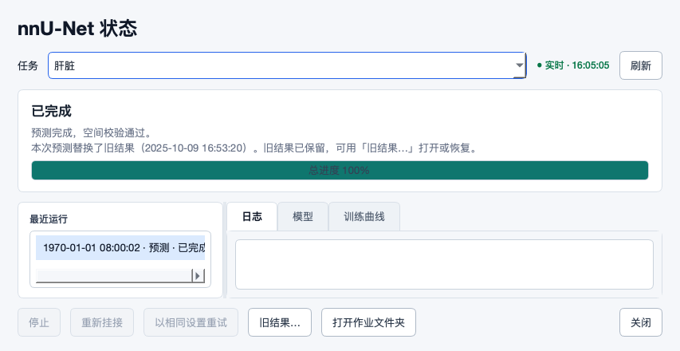
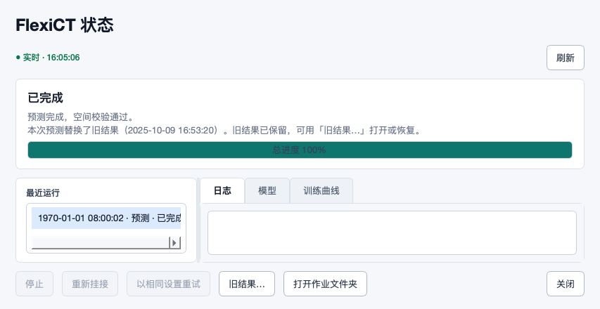
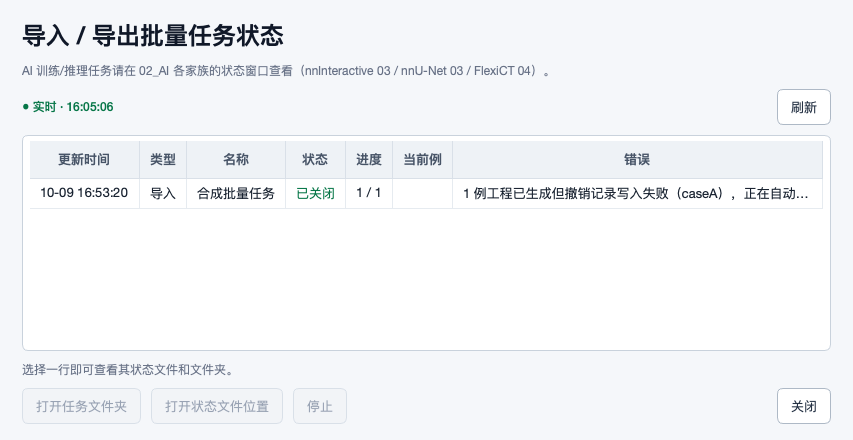
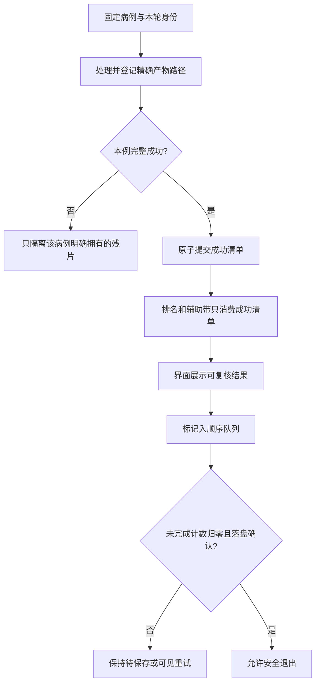

# Mimics 扩展修复复审与工作流边界（6d73583）

本轮9个新增提交针对上轮8张处理卡。实现有明确进展，但不支持“8卡全部关闭”：2项原关键离线反例已解决，6项部分解决；另外识别2项修复引入的边界。本报告保留8张开放处理卡，未修改业务代码。

## 📌 基线与优先处理项

- 被审源码 `6d735832db9847e98d60fd99eab4f241b21c6d28`，上次报告发布提交 `9f11e2643d0cb0a19e75608875b3711cf1b6f878`。新增9提交、20文件。来源按SHA、Git拓扑及已记录自行推送清单判断，不凭作者身份猜测物理来源。
- 首先处理S02目标存在性冲突、S01补写版本身份、S06可信几何、T02固定评估集合及U01病例归属。T03、T04、U02影响数据接入、进度保存和窗口响应。
- 上游把上一轮JSON中的8卡置fixed，是提交者的修复声明；本轮独立验证。旧证据仍对应336e99d，当前观察、截图、日志均固定到6d73583。
- 无生产代码修改、真实病例、训练、GPU/远程部署或环境修复。本机没有Windows/Mimics实例；真实Qt为macOS/offscreen，所有病例/模型状态为合成。

## ✅ 上一轮8卡状态

| 卡片 | 本轮结论 | 通过与剩余部分 |
|---|---|---|
| S01 | 部分解决 | 失败提示和缺失回执的正常补写有效；旧回执存在时错误清待办。 |
| S02 | 部分解决 | 旧结果入口、正常恢复、已存在目标变化保护有效；启动时缺失仍绕过冲突。新增恢复同步IO见U02。 |
| S06 | 部分解决 | 部分缺间距、全部缺位置已拒绝；全缺间距默认1mm和非法方向未完整拒绝。 |
| S10 | 关键离线反例已解决 | 原同秒目录和本轮失败残片反例已修；相关新增前缀误隔离独立列U01。 |
| T01 | 关键离线反例已解决 | 实际gzip解压量393216→409952字节，约1.04倍；旧版同夹具49.62倍。不是病例耗时承诺。 |
| T02 | 部分解决 | 指定验证数的两/四例和空训练校验有效；自动比例随新增病例继续扩大冻结集合。 |
| T03 | 部分解决 | 单下划线精确匹配有效，双下划线被短分隔符提前抢占。 |
| T04 | 部分解决 | FIFO最后意图正常可落盘；退出前完成判定仍可能早于最后一笔保存。 |

这些状态不代表Windows/Mimics/GPU端到端验收。S10的原残片问题与U01的新增病例前缀问题分开记账；其余延续项不重复算新缺陷。

## 🔎 开发与测试处理卡

### S01 · P1 · 补写遇到旧回执就清空待办，把错误版本当作补写成功

**关联/证据类型：** S01, R03, F30；延续项部分解决。

**真实场景：** 同病例重新导入生成了新工程，旁边还留有上一轮回执；本次回执写入临时失败，随后启动补写。

**实际观察：** 没有旧回执时，新快照载荷可补写，工程字节未改变；失败计数/病例提示也已接入状态行。但存在旧回执时，flush 返回 healed=[caseA]、待办清空，而回执仍是 old-mask-guid/old-source，不是待办中的 new-mask-guid/new-source。真实文件读写与补写函数复现。

**原因与影响：** 幂等判断只看 os.path.isfile(receipt_path)，没有验证现有内容是否与待补写载荷属于同一次导入；文件存在不等于写入已成功。 自动补写显示恢复，实际撤销证据仍指向旧工程对象，本轮恢复依据被从待办丢弃。并非本轮复现了删除人工Mask，但恢复承诺不可信。

**改什么、为什么、怎么改：** 为每次导入载荷保留稳定事务ID/摘要；只有现有回执与待办完全匹配才允许清空。发现旧版/损坏/其他事务回执时保留旧证据并原子发布正确新记录或提示冲突。补写日志、计数与界面仅在读回验证后更新，不能根据文件存在宣告完成。

**源码：** [runtime_py35/create_mcs_batch.py:350](https://github.com/ShijianRuan/MIMICS_SCRIPTS/blob/6d735832db9847e98d60fd99eab4f241b21c6d28/runtime_py35/create_mcs_batch.py#L350)；[runtime_py35/create_mcs_batch.py:288](https://github.com/ShijianRuan/MIMICS_SCRIPTS/blob/6d735832db9847e98d60fd99eab4f241b21c6d28/runtime_py35/create_mcs_batch.py#L288)；[tools/batch_status_viewer.py:123](https://github.com/ShijianRuan/MIMICS_SCRIPTS/blob/6d735832db9847e98d60fd99eab4f241b21c6d28/tools/batch_status_viewer.py#L123)。

**验收条件：**

1. 回执缺失、完全相同、旧导入、损坏JSON四类分别验证。
2. 旧回执存在时不丢新待办；补写后GUID/源指纹/导入时工程摘要一致，人工保存不被重新采样为历史事实。
3. 任务已关闭且没有扫描器时不持续显示“正在自动补写”；重启/重试触发与实际状态一致。

**复现证据：** [receipt_replay_missing, receipt_replay_existing, receipt_visible_note](2026-10-17-6d73583-evidence/observations.json)。

### S02 · P1 · 任务启动时目标不存在会禁用冲突检查，后来出现的新结果仍被覆盖

**关联/证据类型：** S02, R10, F43, D24；延续项部分解决。

**真实场景：** 两个预测任务最初都没有结果文件；第一个先完成或标注者先保存了新结果，第二个较慢任务随后发布。

**实际观察：** 已有目标内容发生变化时，发布现在会保留新目标、旁存候选并报冲突；正常恢复与恢复前人工编辑阻止也已通过。但启动时目标缺失→file_fingerprint=None→另一个结果出现后，发布仍成功，把值3的新结果换成值2的候选。旧字节保留为备份，问题是未经冲突反馈就替换。

**原因与影响：** None 同时表示“启动时不存在/不可读”和“调用方未启用保护”；发布只在 expected_previous_fingerprint is not None 时检查。远程保存后又把空值转换成None，沿用相同漏洞。 常见并发首轮任务仍可能替换较新人工结果；新增入口不能弥补发布策略本身放行。

**改什么、为什么、怎么改：** 显式记录目标的存在性和可读性：缺失、存在且有摘要、不可读应为不同状态；“明确要求不存在”必须在发布时检查仍不存在。保留兼容旧调用的单独哨兵，无法取证时保守冲突；本地/远程/恢复共用同一策略，并对检查与发布的竞争提供排他保护或安全版本路径。

**源码：** [tools/nnunet_common.py:118](https://github.com/ShijianRuan/MIMICS_SCRIPTS/blob/6d735832db9847e98d60fd99eab4f241b21c6d28/tools/nnunet_common.py#L118)；[tools/nnunet_pipeline.py:1954](https://github.com/ShijianRuan/MIMICS_SCRIPTS/blob/6d735832db9847e98d60fd99eab4f241b21c6d28/tools/nnunet_pipeline.py#L1954)；[tools/remote_training_controller.py:2867](https://github.com/ShijianRuan/MIMICS_SCRIPTS/blob/6d735832db9847e98d60fd99eab4f241b21c6d28/tools/remote_training_controller.py#L2867)。

**验收条件：**

1. 启动缺失→发布前出现，目标不变、候选保留、状态显示冲突。
2. 启动存在→修改/删除/重建、不可读、两个并发首次发布均覆盖。
3. 正常替换和恢复保持可用，界面可打开旧版；不能仅测试初始目标已经存在的分支。

**复现证据：** [publish_changed_existing, publish_appeared_later, restore_normal, restore_after_manual_edit](2026-10-17-6d73583-evidence/observations.json)。

### S06 · P1 · 全部缺像素间距仍默认为1mm，非法方向也未被完整拒绝

**关联/证据类型：** S06, R09, F01, UI16；延续项部分解决。

**真实场景：** 某批导出数据整组缺 PixelSpacing，或方向字段能解析但两方向向量不正交；工具准备统一物理网格供导入、训练、回写。

**实际观察：** 部分缺间距与全部缺位置的新拒绝规则已验证有效，规则序列仍通过。全部缺PixelSpacing仍被接受并构造1×1mm平面；IOP=[1,0,0,1,1,0]也通过，affine两平面轴夹角为45°。单纯非单位向量在当前affine函数中会归一化，本轮没有把它误记为尺寸放大。

**原因与影响：** 代码明确保留全缺间距的legacy默认值；方向只检查跨片一致与叉积非退化，没有验证完整有限/正交语义。缺证据和可解析非法数据仍会进入坐标构建。 体素数量正确却不能证明物理尺寸/方向正确，影响后续掩膜位置、尺度与测量。

**改什么、为什么、怎么改：** 无可信替代几何来源时拒绝默认间距；有Mimics所选Image等可信来源则明确记录并核对，不把1mm当事实。方向要求6个有限数、近似单位且正交；仅容许可说明的数值容差，不静默修复大偏差。

**源码：** [mimics_bridge.py:1694](https://github.com/ShijianRuan/MIMICS_SCRIPTS/blob/6d735832db9847e98d60fd99eab4f241b21c6d28/mimics_bridge.py#L1694)；[mimics_bridge.py:1885](https://github.com/ShijianRuan/MIMICS_SCRIPTS/blob/6d735832db9847e98d60fd99eab4f241b21c6d28/mimics_bridge.py#L1885)。

**验收条件：**

1. 全部缺间距、NaN/Inf、非法长度、非正交方向均在产生网格前拒绝或有明确可信替代证据。
2. 规则斜位、线性机架倾斜和合理舍入误差仍通过。
3. Windows/Mimics以物理点和多Image身份核对，不能只比shape。

**复现证据：** [dicom](2026-10-17-6d73583-evidence/observations.json)。

### T02 · P1 · 指定验证数的反例已修，自动比例下新增病例仍扩张冻结验证集

**关联/证据类型：** T02, S05, R07, F16, UI30；延续项部分解决。

**真实场景：** 用户沿用已有c0验证集，训练设置仍是“自动”验证病例数；继续标注并把可用病例从4例增加到8例。

**实际观察：** val_cases=1 时，原两患者空训练与四病例额外验证反例已修；写入前空训练检查也已增加。改用自动 val_cases=0、validation_fraction=.25、8例、frozen=[c0]，第0折又增加另一例，验证数变2，用户没有明确重划分。

**原因与影响：** 新增停止条件只限制到本次按总病例数重新计算的count，冻结集合仍是最低包含约束，不是默认验证集权威。患者组路径也仍按target补自由组。 随着标注数据增长，模型比较的验证样本集合变化，重复训练的结果不再基于原承诺集合；引擎间冻结语义仍不一致。

**改什么、为什么、怎么改：** 明确区分固定评估集合与交叉验证/自动拆分。存在有效冻结集合时默认仅按患者组扩展冻结成员，不再按新总量自动补人；只有显式重划分操作才更新并展示差异。最终写盘和远程复用同一清单。

**源码：** [tools/nnunet_pipeline.py:870](https://github.com/ShijianRuan/MIMICS_SCRIPTS/blob/6d735832db9847e98d60fd99eab4f241b21c6d28/tools/nnunet_pipeline.py#L870)；[tools/nnunet_pipeline.py:1041](https://github.com/ShijianRuan/MIMICS_SCRIPTS/blob/6d735832db9847e98d60fd99eab4f241b21c6d28/tools/nnunet_pipeline.py#L1041)。

**验收条件：**

1. 自动比例下4→8→更多病例，冻结验证成员不擅自增加。
2. 明确重划分时显示新增/移出成员与患者组影响，用户决定后形成新评估版本。
3. 保留两患者非空训练及最终writer校验；新增数据、中文key、多期患者组都验证。

**复现证据：** [frozen_grouped, frozen_four, frozen_default_expansion](2026-10-17-6d73583-evidence/observations.json)。

### T03 · P2 · 平铺单下划线已修，双下划线病例前缀仍被短前缀抢先解析

**关联/证据类型：** T03, S07, R06；延续项部分解决。

**真实场景：** 已有平铺导出使用caseA__Liver-Left与caseA__Liver_Left；两个标签语义不同、两份文件都精确命名。

**实际观察：** caseA_Liver-Left / caseA_Liver_Left 现在各自唯一匹配。双下划线布局仍令两个标签都报more than one file matching aliases；这条格式原查找器曾显式支持，新函数列表也列有__。

**原因与影响：** _strip_case_prefix先尝试_后尝试__，短前缀已命中便返回，剩余标签以_开头；语义精确匹配失败后又落入有损宽松匹配，两份文件冲突。 有效外部标注因存储命名被拒绝，用户需要手工重命名，通用接入仍不一致；原静默混标保护保持有效。

**改什么、为什么、怎么改：** 采用最长合法前缀优先或明确分隔符解析；确认病例边界后保留原标签拼写进行精确匹配。把所有受支持分隔符组合用同一身份契约验证，不撤销跨标签源文件独占保护。

**源码：** [tools/nnunet_pipeline.py:344](https://github.com/ShijianRuan/MIMICS_SCRIPTS/blob/6d735832db9847e98d60fd99eab4f241b21c6d28/tools/nnunet_pipeline.py#L344)；[tools/nnunet_pipeline.py:364](https://github.com/ShijianRuan/MIMICS_SCRIPTS/blob/6d735832db9847e98d60fd99eab4f241b21c6d28/tools/nnunet_pipeline.py#L364)。

**验收条件：**

1. 单/双下划线、横线、点、空格前缀分别测试两个近似标签。
2. 别名、大小写、Unicode与相似病例前缀不跨病例认领。
3. 无唯一匹配时清楚说明候选与处理办法，不用英文技术错误代替引导。

**复现证据：** [flat_labels_single, flat_labels_double](2026-10-17-6d73583-evidence/observations.json)。

### T04 · P2 · FIFO顺序已正确，但退出检查会在最后一笔仍运行时误报全部保存

**关联/证据类型：** T04, S08, UI31；延续项部分解决。

**真实场景：** 先标记“已标注”再改成“跳过”，第二笔因工作区慢而尚未写入，随后关闭窗口。

**实际观察：** 顺序worker让最后skipped确实能最终写入，原反序已修。但第一笔完成后busy=False，第二笔被取走正在执行、队列为空时，wait_for_state_writes(.05)立即返回0；此时磁盘仍是annotated。释放第二笔后才变skipped。只控制调度，真实文件锁/JSON写入不替代，未实际杀进程。

**原因与影响：** busy只在入队时置True，每笔完成置False，却未在每次出队开始重置True。空队列不代表没有in-flight任务；main随后允许进程退出，daemon未完成的工作可能丢失。打印到stderr也不是可见的退出处理。 用户最后的标注进度决定可能未保存却收到“无待保存”的隐含结论；本轮未声称实际Mask内容丢失。

**改什么、为什么、怎么改：** 以Queue.task_done/未完成计数或受锁保护的in-flight计数作为真实完成依据；主线程与worker通过明确回执确认。关闭窗口前处理待保存状态，超时要有可见提示/可重试的持久待办，不仅打印stderr。

**源码：** [tools/flexict_active_learning_ui.py:1062](https://github.com/ShijianRuan/MIMICS_SCRIPTS/blob/6d735832db9847e98d60fd99eab4f241b21c6d28/tools/flexict_active_learning_ui.py#L1062)；[tools/flexict_active_learning_ui.py:1077](https://github.com/ShijianRuan/MIMICS_SCRIPTS/blob/6d735832db9847e98d60fd99eab4f241b21c6d28/tools/flexict_active_learning_ui.py#L1077)；[tools/flexict_active_learning_ui.py:1144](https://github.com/ShijianRuan/MIMICS_SCRIPTS/blob/6d735832db9847e98d60fd99eab4f241b21c6d28/tools/flexict_active_learning_ui.py#L1144)。

**验收条件：**

1. 第二笔已经出队且被阻塞时，退出检查仍报告至少1笔待保存。
2. 全部成功后返回0且磁盘为最后意图；写入失败单列处理，不能当作已保存。
3. 真实Qt关闭窗口、锁超时、断开共享目录、跨任务切换均有清楚可见的结果。

**复现证据：** [fifo_exit_drain, fifo_final_state](2026-10-17-6d73583-evidence/observations.json)。

### U01 · P1 · 隔离失败残片按病例前缀匹配，误搬走同前缀的成功病例

**关联/证据类型：** S10, R15, F26；新增边界。

**真实场景：** 病例池同时有case01和case01_phase2，后者代表另一Image/期相；case01在共识保存时失败，case01_phase2实际完整成功。

**实际观察：** 正常命名下，新成功清单和UUID目录已修原S10：部分失败只排名2个成功病例。同一完整AL链加入case01_phase2后，其共识和不确定度也被搬进failed；排名只剩1例但成功清单2例，整轮报失败。新断言保护避免交付错误排名，但有效病例被误隔离使任务无法完成。

**原因与影响：** fragment.name.startswith(case+"_")把病例ID的文本前缀当作产物所有权边界，case01_phase2_*也匹配case01_。 通用工具的多期/多Image常见命名触发确定性失败；用户按提示简单重试不能修复命名碰撞。

**改什么、为什么、怎么改：** 按显式case→产物路径清单隔离，或用固定后缀精确解析完整病例ID；不要用病例前缀判断归属。排名/辅助带继续只消费成功清单，保留集合一致性断言；真实失败残片可保留诊断。

**源码：** [tools/flexict_pipeline.py:1789](https://github.com/ShijianRuan/MIMICS_SCRIPTS/blob/6d735832db9847e98d60fd99eab4f241b21c6d28/tools/flexict_pipeline.py#L1789)。

**验收条件：**

1. case01、case01_phase2和更长前缀共存，一例失败不影响其余成功产物。
2. 排名/辅助带只包含成功病例，失败原因逐例可见。
3. 同秒多轮隔离、旧轮保留及本轮部分写失败保护不回退。

**复现证据：** [al_partial_write, al_prefix_collision, al_uuid_names](2026-10-17-6d73583-evidence/observations.json)。

### U02 · P2 · 恢复旧结果的入口可见，但完整校验和文件交换同步运行在界面线程

**关联/证据类型：** S02, R04；新增边界。

**真实场景：** 标注者在旧结果菜单点恢复，文件是大体积压缩分割或位于慢共享盘。

**实际观察：** 两个真实Qt状态页均已显示替换说明和完整可见的80×36旧结果按钮，恢复确实完成。实际回调在UI线程执行体素校验、两次文件摘要及交换。只给每次摘要存储读注入200ms延迟，回调持续约0.4秒，10ms定时器期间零次触发，返回事件循环后才触发；这是慢盘模拟，不是真实病例性能计时。

**原因与影响：** _restore_previous直接调用同步restore_replaced_output；后台刷新只保护事后列表刷新，没有把恢复操作本身移出GUI线程。 大文件/共享盘下窗口不能及时响应或给进度，用户可能重复操作或误以为程序卡死；未声称因此阻塞Mimics原生主线程。

**改什么、为什么、怎么改：** 恢复复用后台worker/回执模式：GUI只提交与展示状态，worker做校验/摘要/交换。禁用同一结果的冲突动作，提示当前阶段；耗时校验可取消，短暂原子交换阶段不接受中断。失败回执应说明最终路径与保留版本。

**源码：** [tools/nnunet_status_viewer.py:580](https://github.com/ShijianRuan/MIMICS_SCRIPTS/blob/6d735832db9847e98d60fd99eab4f241b21c6d28/tools/nnunet_status_viewer.py#L580)；[tools/flexict_status_viewer.py:526](https://github.com/ShijianRuan/MIMICS_SCRIPTS/blob/6d735832db9847e98d60fd99eab4f241b21c6d28/tools/flexict_status_viewer.py#L526)；[tools/nnunet_jobs.py:392](https://github.com/ShijianRuan/MIMICS_SCRIPTS/blob/6d735832db9847e98d60fd99eab4f241b21c6d28/tools/nnunet_jobs.py#L392)。

**验收条件：**

1. 真实Qt慢存储模拟下计时器/窗口操作持续响应，控件显示恢复中。
2. 成功与冲突/权限/磁盘错误均在GUI线程呈现，但文件IO都在worker。
3. 重复点击、切换任务、关闭窗口不会重复交换或失去版本位置。

**复现证据：** [nnunet_recovery_entry, flexict_recovery_entry, nnunet_restore_callback, flexict_restore_callback](2026-10-17-6d73583-evidence/ui-observations.json)。

S06的几何约束另核对了[DICOM官方Image Plane Module C.7.6.2](https://dicom.nema.org/medical/dicom/current/output/chtml/part03/sect_C.7.6.2.html)：平面像素间距表示患者物理距离，方向余弦的行列轴应为单位且正交。该依据说明字段语义，不是Mimics当前许可版本的API兼容性证明。

## 🎨 标注者、产品与UI复核

| 环节/视角 | 本轮可用性与体验 | 应落到的设计 |
|---|---|---|
| 导入与恢复 | 回执失败说明进入错误列并有tooltip；补写可能误认旧记录 | 先验证记录属于本次导入，再给“已修复”的反馈；已关闭任务不能假称仍自动处理 |
| 已有预测再运行 | 已存在目标修改可阻止；最常见“起初没有输出”仍漏保护 | 把存在性和内容同等纳入快照，冲突后保留候选而不替换 |
| 结果页入口 | 两个状态页都出现“旧结果…”及版本时间，853×440按钮80×36完整可见 | 入口数量合理，恢复过程还应后台执行并显示阶段，见U02 |
| 高频标注进度 | FIFO改善连续纠正的顺序；关闭窗口的完成判断仍错误 | 最后一次人工决定落盘后才结束，超时可见且可续 |
| 批量/多期标注 | case01与case01_phase2被文本前缀误认成同一归属 | 病例、Image和期相按身份映射，不靠字符串前缀 |
| 训练与评估 | 指定验证数的小数据集正常；自动比例仍改变冻结集 | 让用户理解并选择固定评估或明确重划分，默认遵守已有承诺 |

这些画面用于区分“入口可用”与“过程好用”：按钮现在可见且原恢复功能成功，耗时动作却仍会阻塞外部窗口。截图中的历史时间/病例均为合成字段；小屏检查不等于Windows中文字体和各级DPI全面验收。

## 🧭 可编辑的恢复与产物契约

## 🧪 验证范围与限制

10组受影响测试/类选择共734次方法执行：728通过、2断言失败、1缺依赖错误、3跳过。可能有选择交集，不能称为同数量的独立测试。另运行本文实际文件/完整AL反例及3张真实Qt画面。未重跑与变更无关的全部模型矩阵。

| 选择 | 执行 | 通过 | 失败 | 错误 | 跳过 |
|---|---:|---:|---:|---:|---:|
| ui | 23 | 21 | 2 | 0 | 0 |
| gui | 88 | 85 | 0 | 0 | 3 |
| nnunet | 138 | 138 | 0 | 0 | 0 |
| flexict | 148 | 147 | 0 | 1 | 0 |
| remote | 140 | 140 | 0 | 0 | 0 |
| runtime | 114 | 114 | 0 | 0 | 0 |
| cross | 2 | 2 | 0 | 0 | 0 |
| geometry | 6 | 6 | 0 | 0 | 0 |
| review | 11 | 11 | 0 | 0 | 0 |
| runtime-changed | 64 | 64 | 0 | 0 | 0 |

- 两项UI断言失败延续上一轮：模型标识样例宽400不大于805的字体/视口假设，以及完成卡详情高14不大于另一标签15的比较。当前生产对应区域本轮未修改；上一轮固定小屏真实Qt证据已证明原卡片换行和导航可用。没有把这两条夹具失败算作新产品bug，也没有删除/改写失败日志。
- 一项FlexiCT远程预检错误为没有torch；隔离环境不安装/训练模型，未据此认定远程产品回归。
- 三项跳过均为Windows msvcrt持锁的GUI用例。本文FIFO/退出反例使用本机真实JSON与文件锁、受控线程调度，不能替代Windows目标机。
- 慢盘UI模拟只延迟实际摘要读边界，每次200ms；0.4秒数值是该模拟结果，不是大型医学影像性能基准。gzip优化按实际解压字节验证，未外推分钟数。
- 原S10用例本轮通过；相同源码仍有U01前缀归属反例。测试变绿不代表病例身份边界全部正确。
- 尚待真实Windows/Mimics/GPU：具体版本API、Mask事务/撤销、多Image/期相与物理点回写、UNC/文件权限与断电恢复、CUDA/显存、真实模型/患者分组/标签映射、125%/150%/200%DPI和大体积用户操作。

## 📚 交接

- [结构化处理卡](2026-10-17-6d73583-revalidation.json)：状态、优先级、场景、原因、修改办法、验收条件及精确源码身份。
- [证据与复现说明](2026-10-17-6d73583-evidence/README.md)：生产链路探针、原始回归日志、真实Qt截图、环境、哈希与独立事实核对。
- [上一轮报告](2026-10-17-336e99d-revalidation.md)与[当时发布的原始JSON](https://github.com/ShijianRuan/MIMICS_SCRIPTS/blob/9f11e2643d0cb0a19e75608875b3711cf1b6f878/docs/reviews/2026-10-17-336e99d-revalidation.json)，保留历史证据身份。
- [审查索引](README.md)。

本报告没有声称发现全部bug、所有测试通过或AI方法达到特定医学精度。当前任务定位仍是轻量通用Mimics扩展，建议补齐身份、恢复、反馈的必要契约，不扩大为企业级平台。
