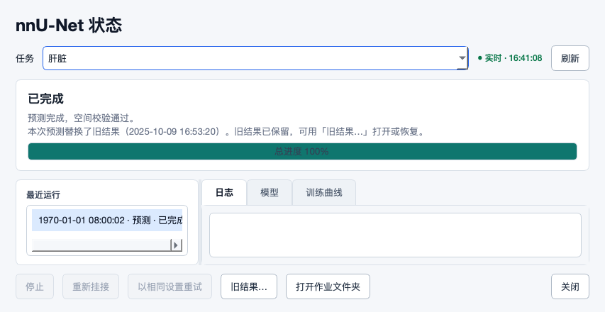
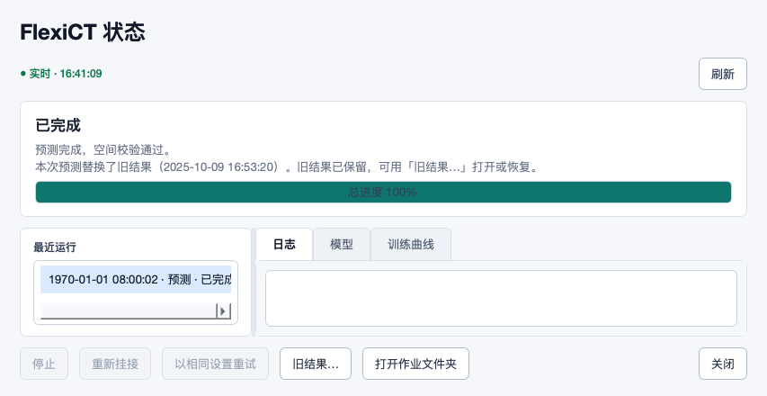
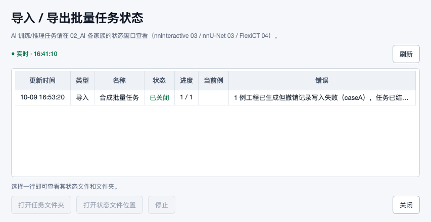
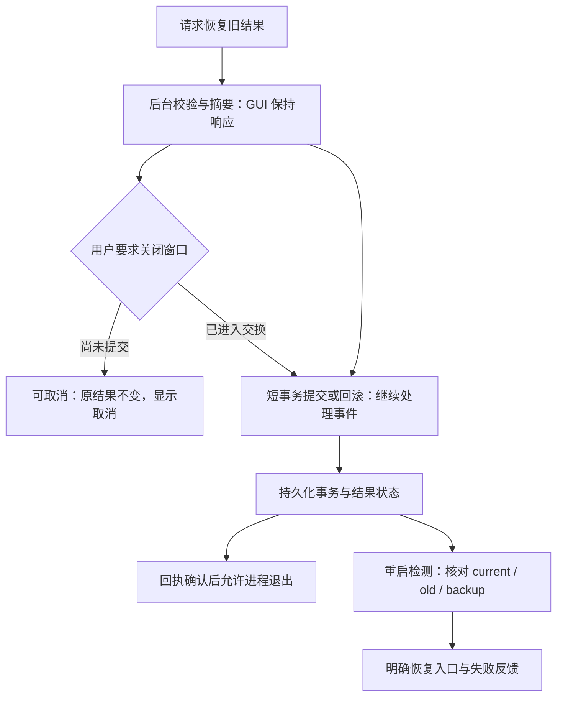

# 2026-10-18 · e325e3a 第三轮修复复审

复审结论：上轮 8 卡中 **4 项关键离线反例已解决、4 项部分解决**；当前列出 **5 张开放卡（4 项延续、1 项新回归，4×P1、1×P2）**。新增 V01：恢复旧结果时关闭最后窗口，可以正常退出却留下缺失的当前结果路径；两个文件版本仍保留，状态未同步。

这不是全部历史问题的关闭清单。本轮交付仅为审查记录、可编辑示意图及合成证据，未修改业务源码、处理真实病例、训练模型或修复环境。

## 📌 源码身份与提交范围

- 被审查源码：[`e325e3a8a91c7c64e2c68e1b8b117f6cf08fc31f`](https://github.com/ShijianRuan/MIMICS_SCRIPTS/commit/e325e3a8a91c7c64e2c68e1b8b117f6cf08fc31f)。
- 增量范围：`b609be3ece372f0d4299542394ee16f018532527..e325e3a8a91c7c64e2c68e1b8b117f6cf08fc31f`，10 个提交、19 个文件（10 个业务文件、5 个测试文件、4 个文档文件）。
- 来源判定：这 10 个 SHA 在 fetch 后首次观察到；远端跟踪 reflog 是 fetch fast-forward，没有这些 SHA 的本地 update-by-push 记录。它们不在自动化自身推送记录内；真实操作者/物理推送端未知，未按 author/email 猜测。
- 工作区起初干净，分支 al-review-loop；本地以 fast-forward 同步。原审查游标在成功发布前保持不动，pending 记录本批 SHA，避免重复审查。
- 前轮 JSON 已被本次开发提交改为 fixed。本报告对照的是上次发布时的[不可变原记录](https://github.com/ShijianRuan/MIMICS_SCRIPTS/blob/b609be3ece372f0d4299542394ee16f018532527/docs/reviews/2026-10-17-6d73583-revalidation.json)，没有覆盖旧证据的源码身份。
- [结构化问题与验收记录](2026-10-18-e325e3a-revalidation.json) · [证据说明](2026-10-18-e325e3a-evidence/README.md) · [准确提交与文件清单](2026-10-18-e325e3a-evidence/source-scope.json)。

## ✅ 上轮八卡逐项核对

“关键离线反例已解决”仅指这里实际运行的边界，不代表 Windows/Mimics/GPU 完整验收。

| 原卡 | 本轮状态 | 证据与剩余边界 |
|---|---|---|
| S01 | 部分解决 | 同摘要/较旧/损坏回执补写与关闭文案已改善；回拨时钟仍把旧事务当作补写成功。 |
| S02 | 部分解决 | 缺失、出现、删除、不可读状态显式保护已补；冲突检查与文件交换间无共享锁，并发发布仍同时成功。 |
| S06 | 部分解决 | 全缺 PixelSpacing、多个层面非法方向拒绝；单层提前返回跳过方向约束。 |
| T02 | 关键离线反例已解决 | 自动比例下已有冻结验证成员在五折均保持 c0，扩增数据只进训练；患者整组/空训练回归通过。 |
| T03 | 关键离线反例已解决 | 单/双下划线两个精确器官文件各只命中自身，旧别名防混淆保留。 |
| T04 | 部分解决 | FIFO 与第二项 in-flight 计数修复；写入失败也把 pending 减至零，退出误认保存完毕。 |
| U01 | 关键离线反例已解决 | 失败 case01 不再隔离成功 case01_phase2，真实 AL 整理/排名链完成；模型边界为合成输出。 |
| U02 | 关键离线反例已解决 | 两窗口恢复回调真实 IO 均离开 GUI 线程，事件循环持续响应；新后台生命周期缺陷另记 V01。 |

已确认的改善包括：启动缺失后来出现的目标会拒绝覆盖并保留 candidate；较旧磁盘回执会正确换成本次 payload；缺 PixelSpacing 的多层输入及多层非法方向均拒绝；冻结验证集不再按增长后的总病例数扩员；双下划线精确标签不再冲突；case01_phase2 成功病例不再随 case01 失败残片被隔离；FIFO 第二项已取出但尚未写盘时，退出计数为 1。

## 🔎 开放处理卡

下列 S/T 卡沿用原 ID，只更新剩余条件，不累计成新的缺陷。V01 是本次后台恢复改动引入的生命周期回归。

### S01 · P1 · 回拨时钟下旧回执仍被误认成本次导入证据

**场景：** 工程经过一次重新导入，系统时间回调或来自不同机器的时钟不一致；本次导入回执写失败，进入补写队列。

**源码：** [runtime_py35/create_mcs_batch.py:376](https://github.com/ShijianRuan/MIMICS_SCRIPTS/blob/e325e3a8a91c7c64e2c68e1b8b117f6cf08fc31f/runtime_py35/create_mcs_batch.py#L376)（flush_pending_receipts）；[runtime_py35/create_mcs_batch.py:369](https://github.com/ShijianRuan/MIMICS_SCRIPTS/blob/e325e3a8a91c7c64e2c68e1b8b117f6cf08fc31f/runtime_py35/create_mcs_batch.py#L369)（_receipt_epoch）。

**实际复现：** 当前工程指纹与 queued payload 匹配，新 guid 为 new-guid、epoch=100；磁盘是 old-guid 的旧事务、epoch=200。flush 返回 healed=[caseA]、队列清空，却仍是 old-guid。普通较旧/相同摘要回执用例已通过。

**原因：** flush 在摘要不同时仅比较 created_at_epoch，新时间值被视为新事务的充分证明，没核对当前工程与两个事务的实际关联。

**影响与界限：** 本次 Mask 的撤销证据丢出待恢复队列，用户看不到仍未补写的事务；本反例未执行 Mask 删除，也未复现人工数据被删。

**要改什么、为什么：** 把时间排序降为显示线索，以事务 ID、项目代次与内容指纹裁决；不能确定时保留 pending。 时间可能回拨；文件较新不等于属于当前工程。

**怎么改：** 为导入建立事务 ID；补写先对比当前工程/版本与排队快照，再保留旧事务历史并原子发布新回执、读回核对。若工程已编辑或代次不明，保持待处理并显示具体冲突，不能称已恢复。

**验收条件：**

- 项目匹配新 payload、旧回执 epoch 更大时不得误报 healed；新事务必须有正确 guid 和指纹，或明确冲突并保留队列。
- 较旧队列确实属于历史项目时保持新证据；相同事务幂等、不重复写；旧证据有可追溯历史。

证据：[observations.json](2026-10-18-e325e3a-evidence/observations.json)，键：`receipt_replay_existing`、`receipt_clock_rollback`。

### S02 · P1 · 同时发布仍能越过缺失目标保护

**场景：** 两个本地/远端任务都以同一尚不存在的输出为目标，计算完成后接近同时发布。

**源码：** [tools/nnunet_pipeline.py:1968](https://github.com/ShijianRuan/MIMICS_SCRIPTS/blob/e325e3a8a91c7c64e2c68e1b8b117f6cf08fc31f/tools/nnunet_pipeline.py#L1968)（publish_prediction_output）；[tools/nnunet_common.py:158](https://github.com/ShijianRuan/MIMICS_SCRIPTS/blob/e325e3a8a91c7c64e2c68e1b8b117f6cf08fc31f/tools/nnunet_common.py#L158)（publish_target_conflict）；[tools/nnunet_jobs.py:392](https://github.com/ShijianRuan/MIMICS_SCRIPTS/blob/e325e3a8a91c7c64e2c68e1b8b117f6cf08fc31f/tools/nnunet_jobs.py#L392)（restore_replaced_output）。

**实际复现：** 两个真实 publisher 均记录 __absent__，均在目标缺失时检查为无冲突；A 完成后放行已检查的 B，二者都成功，最终是 B=2，A=1 被存成 B 的备份。目标运行中先出现的顺序场景已正确拒绝。

**原因：** publish_target_conflict 与 exists/rename/replace 是分离操作，没有目标路径共享互斥；检查完成后可继续使用已经过时的结论。

**影响与界限：** 较新的已发布结果被无冲突提示地替换，两个任务都可认定交付成功；A 仍有备份，并非不可恢复丢失。

**要改什么、为什么：** 将最终身份检查、备份和发布放进同一按规范化目标路径共享的跨进程提交临界区，并与恢复入口共用。 唯一 staging 只能避免临时文件重名，不能提供目标版本的提交一致性。

**怎么改：** 复用项目现有锁机制，计算与大文件校验在锁外；锁内重读预期存在性/摘要，只有匹配者提交，另一个保留 candidate 并显式冲突。恢复操作也参与同一提交协议，状态写明真实输出版本。

**验收条件：**

- 用屏障让两个任务同时通过初次检查；最终只允许一个提交，另一个冲突，两个有效结果均保留。
- 本地 nnU-Net/FlexiCT、远端 finalize、恢复旧结果共用目标锁；正向顺序发布、缺失/删除/不可读用例不退化。

证据：[observations.json](2026-10-18-e325e3a-evidence/observations.json)，键：`publish_appeared_later`、`publish_changed_existing`、`publish_concurrent`。

### S06 · P1 · 单层 DICOM 提前返回，绕过方向单位正交校验

**场景：** 数据集里有单层图像、单层导出或拆分后的单幅 Image；PixelSpacing/IPP 存在但 IOP 两向量夹角为 45 度。

**源码：** [mimics_bridge.py:1694](https://github.com/ShijianRuan/MIMICS_SCRIPTS/blob/e325e3a8a91c7c64e2c68e1b8b117f6cf08fc31f/mimics_bridge.py#L1694)（_validate_dicom_slice_grid）。

**实际复现：** 单位长度却不正交的 [1,0,0,.7071,.7071,0] 在单层真实 public affine 路径被接受，前两轴点积约 .7071，输出剪切矩阵；有效单层仍正确通过。多层缺间距/非法方向均正确拒绝。

**原因：** _validate_dicom_slice_grid 在 len(positions)<2 时返回，新增的 IOP 六个有限值、单位、正交判断位于该返回之后。

**影响与界限：** 错误物理网格进入后续链路的源码边界仍开放；这里只验证解析与仿射返回，未执行真实 Mimics 导入或医学测量。

**要改什么、为什么：** 每幅图像自身的方向/坐标完整性验证放到单层返回之前，只有层间步长验证依赖至少两层。 单幅图像同样必须有可信的平面方向；只有层间差分在单层时不可计算。

**怎么改：** 提取逐图像几何验证函数，统一检查 IOP/IPP 长度、有限值、单位与正交；单层仅跳过相邻层差分。缺少可靠层厚时对三维体素语义给出明确限制。

**验收条件：**

- 单层 45 度非正交、非单位、非有限、错长度方向都拒绝；正规单层、正规多层保持可用。
- 同一异常头放进 1 层和 3 层时，逐图像方向校验结果一致；在目标 Mimics 检查物理坐标。

证据：[observations.json](2026-10-18-e325e3a-evidence/observations.json)，键：`dicom`。

### T04 · P2 · 失败写入被计为排空成功，关窗丢失未保存反馈

**场景：** 标注者点击已标注后立刻关窗，保存线程遇到锁超时或存储写失败，错误回执尚未被界面轮询。

**源码：** [tools/flexict_active_learning_ui.py:1069](https://github.com/ShijianRuan/MIMICS_SCRIPTS/blob/e325e3a8a91c7c64e2c68e1b8b117f6cf08fc31f/tools/flexict_active_learning_ui.py#L1069)（_run_state_writes）；[tools/flexict_active_learning_ui.py:1087](https://github.com/ShijianRuan/MIMICS_SCRIPTS/blob/e325e3a8a91c7c64e2c68e1b8b117f6cf08fc31f/tools/flexict_active_learning_ui.py#L1087)（wait_for_state_writes）；[tools/flexict_active_learning_ui.py:1152](https://github.com/ShijianRuan/MIMICS_SCRIPTS/blob/e325e3a8a91c7c64e2c68e1b8b117f6cf08fc31f/tools/flexict_active_learning_ui.py#L1152)（main）。

**实际复现：** 模拟存储拒写，真实 FIFO 线程产生错误回执，disk cases 为空，但 wait_for_state_writes 返回 0；最后可见文案仍是正在标记。第二项写入在途时返回 1 的上一轮反例已修复。

**原因：** pending 在成功和失败 finally 中均减一；退出只看未完成数量，没有消费/累计失败回执，app.exec 返回后也不会再触发 GUI 轮询。

**影响与界限：** 丢失进度标记而非 Mask 内容；正常开窗会显示错误，关窗竞态才绕过该反馈。超时仅 stderr 提示也不足以保证可见。

**要改什么、为什么：** 区分完成、持久化成功、失败待处理，退出前展示并保留未保存操作。 请求处理完并不意味着状态已保存。

**怎么改：** 维护带操作 ID 的结果与失败集合；关闭流程仍在事件循环内异步等待并处理回执，失败提供重试/保留未保存日志/明确放弃。不能在普通失败分支统一把保存成功计数归零。

**验收条件：**

- 拒写后立即关窗不能返回零未保存且无可见反馈；重开能发现待处理标记并安全重试。
- FIFO、第二项 in-flight、锁超时、成功排空都覆盖；Windows msvcrt 的 3 项目标检查补跑。

证据：[observations.json](2026-10-18-e325e3a-evidence/observations.json)，键：`fifo_exit_drain`、`fifo_final_state`、`failed_write_exit_drain`。

### V01 · P1 · 恢复期间关窗可中断交换，当前结果缺失且状态仍完成

**场景：** 标注者恢复旧结果，文件系统慢或线程恰在两次 rename 间被调度挂起，此时关闭状态窗口。nnU-Net 和 FlexiCT 都受影响。

**源码：** [tools/nnunet_status_viewer.py:595](https://github.com/ShijianRuan/MIMICS_SCRIPTS/blob/e325e3a8a91c7c64e2c68e1b8b117f6cf08fc31f/tools/nnunet_status_viewer.py#L595)（_restore_previous）；[tools/nnunet_status_viewer.py:267](https://github.com/ShijianRuan/MIMICS_SCRIPTS/blob/e325e3a8a91c7c64e2c68e1b8b117f6cf08fc31f/tools/nnunet_status_viewer.py#L267)（_close_event）；[tools/nnunet_status_viewer.py:653](https://github.com/ShijianRuan/MIMICS_SCRIPTS/blob/e325e3a8a91c7c64e2c68e1b8b117f6cf08fc31f/tools/nnunet_status_viewer.py#L653)（main）；[tools/flexict_status_viewer.py:541](https://github.com/ShijianRuan/MIMICS_SCRIPTS/blob/e325e3a8a91c7c64e2c68e1b8b117f6cf08fc31f/tools/flexict_status_viewer.py#L541)（_restore_previous）；[tools/flexict_status_viewer.py:244](https://github.com/ShijianRuan/MIMICS_SCRIPTS/blob/e325e3a8a91c7c64e2c68e1b8b117f6cf08fc31f/tools/flexict_status_viewer.py#L244)（_close_event）；[tools/flexict_status_viewer.py:599](https://github.com/ShijianRuan/MIMICS_SCRIPTS/blob/e325e3a8a91c7c64e2c68e1b8b117f6cf08fc31f/tools/flexict_status_viewer.py#L599)（main）；[tools/nnunet_jobs.py:392](https://github.com/ShijianRuan/MIMICS_SCRIPTS/blob/e325e3a8a91c7c64e2c68e1b8b117f6cf08fc31f/tools/nnunet_jobs.py#L392)（restore_replaced_output）。

**实际复现：** 真实 Qt 子进程在真实 current→backup rename 后暂停工作线程；关闭最后窗口后正常 exit=0。父进程检查 current 不存在，old 仍在、保留版本值为 2，status 仍 completed；未用 kill，未碰真实病例。

**原因：** 新增恢复线程 daemon=True，无进程持有的事务生命周期；close 只停刷新/恢复轮询并 deleteLater，main 在 app.exec 后直接退出。旧同步回调不会在中途处理关闭事件，后台化暴露该时序。

**影响与界限：** 当前结果路径不可用，任务完成状态与磁盘不一致，需要手动找备份恢复；两个数据版本都保留，不是体素数据永久丢失。

**要改什么、为什么：** 恢复必须受关窗/进程退出协调，短提交段不可被正常退出打断，并记录可恢复事务状态。 把 IO 移出 GUI 线程后，界面能关窗了；数据提交仍需要比窗口更长的生命周期。

**怎么改：** 保留可等待的非守护工作任务；开始恢复显示忙碌并禁用冲突动作。关闭时可在校验阶段取消，但进入短交换阶段要异步等待提交/回滚确认；配合最小事务记录让重启检查当前/旧/备份与状态，修复中断提交。保留现有 deleteLater 和停计时器清理，不以恢复 GUI 阻塞解决。

**验收条件：**

- 对两窗口在校验、首个 rename 后、状态发布前分别触发正常关窗；退出后 current 必存在且内容/状态/备份关系一致。
- 新开窗口识别未完成恢复事务并提供恢复路径；失败弹窗与忙碌提示实际可见；10ms GUI 计时器在慢校验时持续响应。

证据：[ui-observations.json](2026-10-18-e325e3a-evidence/ui-observations.json)，键：`nnunet_status_viewer_close_during_swap`、`flexict_status_viewer_close_during_swap`。

## 🧭 跨职能工作流检查

按开放通用扩展检查单病例与批量、空白提示标注、已有预测精修、已有标注训练，以及多器官、多 Image/多期数据。新增改动主要落在回执、发布、拆分、几何与桌面状态窗口；未修改 AI 推理算法，因此未把方法正确性扩大解释为模型医学有效性。

| 视角 / 实际工作流 | 本轮检查结果 | 未覆盖或下一步 |
|---|---|---|
| 标注者：原模型精修后重跑、撤回 | 顺序冲突保护、恢复与再次编辑拒绝通过；并发提交仍见 S02 | 同网格错患者/器官等历史身份问题未获关闭 |
| 标注者：单次导入失败后重开补写 | 正常新事务回执复原，关闭文案改为重新运行后补写 | 时钟回拨下仍有 S01；不能把回执文件存在当完整撤销验收 |
| 产品经理：批量部分失败还能继续 | case01 失败、case01_phase2 成功可完成，排名含 case00/case01_phase2 | 模型阶段使用受控合成输出；未跑真实模型 |
| 架构：本地/远端发布、恢复状态转换 | 缺失标记可序列化，远端相关回归通过 | 共享提交事务与退出生命周期见 S02/V01 |
| 医学影像：单层/多层、多 Image 物理网格 | 有效单/多层通过，缺间距多层拒绝；单层剪切反例成立 | 多 Image 选择与患者/期相归属需 Windows Mimics 真机核对 |
| 训练维护：冻结验证与患者整组 | 五折验证成员固定；既有患者分组、空训练拒绝回归通过 | 分割模型泛化、训练数值与 GPU/CUDA 未运行 |
| UX/UI：小窗口、长值、入口与焦点 | 853×440 实际状态/恢复界面，旧结果按钮完整 80×36；路由、长值复制、键盘重新检测回归执行 | 两项旧界面断言仍失败，详见下节；offscreen 不能代替真实显示器/DPI |
| UX/UI：慢盘恢复与关闭 | 两个恢复回调约 0.0041s/0.00058s 返回；注入每次摘要读取 0.2s 延时，10ms 计时器累计 48/47 次 | 恢复中仍显示已完成、旧结果/关闭可点；结合 V01 加忙碌与关闭反馈 |
| 测试维护：取消、异常、退出 | FIFO 在途计数正确；失败回执排空错误 T04；真实正常关窗中断 V01 | 3 个 msvcrt 检查仍跳过，Windows 崩溃码 0xC0000374 未验收 |
| 视觉设计：信息一致性 | 主题与 disabled 样式回归通过；批量错误行能看到撤销失败 | 重新运行后补写的长尾文案仍截断，完整文本在 tooltip；建议允许展开，属于设计建议，不另计缺陷 |

新增 close/deleteLater 相关 GUI 回归在当前 macOS Qt 下通过；不据此确认开发提交声称的 Windows 堆损坏根因或 P0 全部关闭。

## 🖥️ 真实 Qt 证据与可编辑示意图

以下都是实际控件绘制、合成路径/病例。共捕获并查看 5 张 PNG；运行中截图的状态仍显示“已完成”，说明后台线程内部 busy 并未形成可见的恢复状态。

[nnU-Net 恢复期间](2026-10-18-e325e3a-evidence/nnunet-restore-running.png) · [FlexiCT 旧结果入口](2026-10-18-e325e3a-evidence/flexict-previous-output.png)。

下图是针对 V01 的**建议状态转换**，不是当前实现或运行证据；[独立可编辑 Mermaid](2026-10-18-e325e3a-evidence/restore-lifecycle.mmd)。

## 🧪 回归范围、失败与证据限制

使用现有 macOS arm64 Python 3.13.12，PySide6 6.11.1、NumPy 2.4.6、nibabel 5.4.2、pydicom 3.0.2、SimpleITK 2.5.5、torch 2.12.0、scipy 1.17.1。未安装/修复依赖。上一轮临时隔离 Python 已不在本机，本次环境不同，不能把总数差直接当回归。

| 选择范围 | 执行 | 通过 | 失败 | 错误 | 跳过 |
|---|---:|---:|---:|---:|---:|
| nnunet | 143 | 143 | 0 | 0 | 0 |
| flexict | 149 | 149 | 0 | 0 | 0 |
| remote | 141 | 141 | 0 | 0 | 0 |
| gui | 99 | 96 | 0 | 0 | 3 |
| ui | 5 | 5 | 0 | 0 | 0 |
| geometry | 6 | 6 | 0 | 0 | 0 |
| cross | 2 | 2 | 0 | 0 | 0 |
| review | 11 | 11 | 0 | 0 | 0 |
| runtime | 119 | 119 | 0 | 0 | 0 |
| ui-workflow | 23 | 21 | 2 | 0 | 0 |
| **合计** | **698** | **693** | **2** | **0** | **3** |

套件/类方法执行可能重叠，不宣称 698 个互不重复的测试。原始日志与选择清单见[回归结果](2026-10-18-e325e3a-evidence/regression-results.json)。

- 两项断言来自 test_ui_workflow_regressions，与上一轮相同：完成详情高度 14 被要求大于用时标签 15；长 ID 实际字宽 400 被夹具要求大于 viewport 805。它们证明当前夹具断言不成立，不能单凭这两个数称产品又出现长文被截断；对应业务 UI 在本批未改，断言与实际可见区域的关系需调整后复验。保留[原始失败日志](2026-10-18-e325e3a-evidence/ui-workflow.log)，未改测试冒称通过。
- GUI 99 项中 3 项因 msvcrt 的 Windows guard-hold 模拟跳过，覆盖连续标记、立即退出与等待锁。其余 96 项通过。新增关闭/垃圾回收测试只证明当前平台进程未崩溃。
- 合成反例均执行真实回执、NIfTI 发布/恢复、JSON 文件、锁、几何、拆分与排名整理逻辑。Mimics API、模型/GPU 阶段只提供边界替身；S02 调度屏障、T04 拒写、V01 首次 rename 后暂停是明确注入条件，不代表自然发生概率或慢盘性能基准。
- V01 使用真实 Qt 子进程正常退出，父进程检查持久文件；没有 kill。S01 没有调用删除 Mask，T04 没有丢失 Mask 体素，V01/S02 都保留了旧版本，不能夸大为不可恢复的数据丢失。
- Windows、Mimics 指定版本/Scripting API、真实 GPU/CUDA/SSH、多期病例临床验证均未运行；真实设备/版本需求仍需目标机验收。

## 📚 原始文档核对与事实校验

DICOM Image Plane Module 定义的是二维图像平面在三维患者空间中的位置/方向，方向余弦需单位、正交，单幅图像同样适用。本轮据此检查逐图像方向与层间差分的职责分离：[DICOM PS3.3 C.7.6.2（读取到 2026d）](https://dicom.nema.org/medical/dicom/current/output/chtml/part03/sect_C.7.6.2.html)。此资料不能证明任何具体 Mimics 版本接口可用。

Python 官方说明仅剩 daemon 线程时程序会退出，这类线程不保证在退出时完成资源清理；V01 还通过实际子进程复现了持久文件结果：[Python 3.13 threading](https://docs.python.org/3.13/library/threading.html#thread-objects)。

生成报告后单独核对问题计数、断言输出、源码符号/行号、10 提交/19 文件范围、链接、Git 固定 SHA 与文件摘要：[事实校验](2026-10-18-e325e3a-evidence/fact-check.json) · [身份与证据摘要清单](2026-10-18-e325e3a-evidence/manifest.json)。旧证据保持原 SHA，本轮未借用旧测试输出冒充新源码结果。
