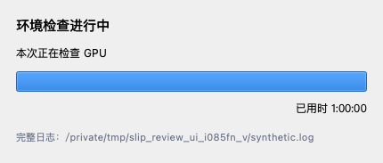

# 2026-10-22 · eee725b 新增改动与 SLIP 集成复审

**结论：SLIP 的集成方向合理，但当前版本还不能判为正确、可交付。** 本轮新增 8 张问题卡：SLIP 6 项、其他改动 2 项；其中 P1 五项、P2 三项。7 项有隔离合成复现，CPU 项是源码风险。优先处理人工编辑保护、会话续接、撤销基线与分发完整性，再验收真实模型交互。未修改产品代码。

- 被审源码：`eee725b45ec42b7c045def95e4682089a3ea13a2`；上轮游标：`e33dc74b93cb57b83f9fc863dc6da018a9cecafd`。
- 范围：23 个新增提交、42 个文件，涵盖 SLIP 入库/桥接/Mimics 入口、GPU 修复、进度窗口、网络盘与 nnInteractive 缓冲回退、肺窗转换、打包和随附文档。
- 当前工作区在拉取前干净，已安全快进。新增 SHA 均不在本自动化自推送记录中；由 fetch、拓扑和推送记录界定范围，未据共用 author/email 推断实际提交者。[范围与提交清单](2026-10-22-eee725b-evidence/source-scope.json)
- [结构化问题卡](2026-10-22-eee725b-revalidation.json) · [证据与复现方法](2026-10-22-eee725b-evidence/README.md) · [独立核对记录](2026-10-22-eee725b-evidence/fact-check.json)

## 方法调研与集成判断

SLIP 先缓存影像特征，再依据点击更新二值分割；论文交互延迟不含预交互加载/处理，CPU 实验预先在 GPU 计算特征并关闭记忆传播，不能直接证明当前桥接支持全流程 CPU。论文覆盖多种模态，当前入口限制 CT 是本地适配策略，建议文案明确“当前桥接只启用 CT”，并按具体权重验证，而非称方法本身仅支持 CT。[原论文](https://arxiv.org/html/2607.22332v1)

对照固定的官方提交 `d22df6e5acf5469808392333f68197e0d43d7ad0`：入库 15 个文件中 14 个逐字节一致，`transformer.py` 仅 LF/CRLF 差异，归一化后 15 个文本均一致。没有发现本地篡改模型算法；上游 README 的占位克隆地址也不是本地新增错误。[官方实现](https://github.com/IRCAD/SLIP/tree/d22df6e5acf5469808392333f68197e0d43d7ad0) · [文件摘要证据](2026-10-22-eee725b-evidence/upstream-comparison.json)

外部长驻 worker、文件队列与共享 GPU 锁的架构适合旧版 Mimics Python；已有项目/Image/Mask 身份检查和常规预测的内容摘要保护也有价值。问题集中在这些机制的边界：入口不能控制自己的锁拥有者、reset 没有共用保护、模型提示历史与用户可见 Mask 历史没有统一提交。

已有 Mask 目前被导出为恢复基线，未输入模型作为条件。因此它可以保留原标注并生成草稿，但不能把“从当前 Mask 开始”解释成模型已经理解并接着修补原轮廓。当前交互输出也是单个二值对象；多器官应显式选择目标与各自会话，不能把它当联合标签预测器。批处理、已有标注训练和冻结验证集仍走原有流程，本次没有证明 SLIP 覆盖这些工作流。

## 新增问题与修复验收

### SL01 · P1 · 重置结果绕过人工修改保护

**证据等级：实际复现（隔离合成边界）。** 源码：[runtime_py35/slip_mimics.py:624 · _handle_result](https://github.com/ShijianRuan/MIMICS_SCRIPTS/blob/eee725b45ec42b7c045def95e4682089a3ea13a2/runtime_py35/slip_mimics.py#L624)。

**场景与现象。** 提交重置后、后台回执到达前，标注者又手工调整当前 Mask。真实 _handle_result 消费 reset 回执后直接应用 base；合成手工编辑前后体素数同为 12，但内容被换回旧边界，未弹任何冲突问题框。

**原因与影响。** reset 分支在 refined 分支的 expected_target_sha256 检查之前直接返回。覆盖刚完成的人工边界；不是仅提示计数不准。复现通过 FakeMimics 的缓冲区 API，未在真实 Mimics 操作病例。

**要改什么、为什么。** 所有会改变 Mask 的结果共用同一个目标版本/内容验证关口。用户同意重置的是提交时的版本，不能据此覆盖随后产生的新编辑。

**怎么改。** 先统一校验项目、Image/Mask 身份与当前内容摘要，再分派 predict/undo/reset；发生变化保留当前内容并结束或显式重新确认新版本。

**验收条件：**

- 请求 reset 后做等体积边界移动，结果到达时不得覆盖；冲突提示与保留内容都验证。
- 无外部修改时正常 reset 恢复会话基线，保护逻辑不退化。

证据：[observations.json](2026-10-22-eee725b-evidence/observations.json)，记录键 `reset_after_manual_edit`。

### SL02 · P1 · SLIP 自己的 GPU 锁阻止会话续接与结束入口

**证据等级：实际复现（隔离合成边界）。** 源码：[runtime_py35/slip_mimics.py:1019 · run](https://github.com/ShijianRuan/MIMICS_SCRIPTS/blob/eee725b45ec42b7c045def95e4682089a3ea13a2/runtime_py35/slip_mimics.py#L1019)。

**场景与现象。** 已有 SLIP worker 持有 GPU，用户重新运行入口以续接、查看结果或结束会话；尤其自动监控不可用/已因错误停止时。使用真实临时 gpu.lock，目标有本会话元数据，worker PID 存活；run 返回 1，_run_session 根本没有调用，提示 GPU 被 SLIP worker 占用。

**原因与影响。** 入口在选择目标及读取会话之前无条件拒绝所有 GPU holder，没有区分本会话 worker 与其他任务。不能由入口管理自己的工作线程；可能只能等 idle timeout，影响恢复与资源释放。成功结果后的自动连续菜单未必受影响，不能夸大为每次点击均失败。

**要改什么、为什么。** 先识别现有会话，让续接/关闭进入原会话；仅新建 worker 时拒绝竞争 holder。互斥应阻止第二个模型加载，不应阻止控制现有 worker。

**怎么改。** 绑定 job ID、worker PID/进程身份与锁拥有者，验证同一会话后走原结果/关闭路径；外部 holder 和身份不匹配继续拒绝。

**验收条件：**

- 自己的活跃 worker 下重新启动入口可继续或关闭，保留原提示；另一个任务仍被拒绝。
- 定时器不可用和错误停止监控后，用户仍可主动查看/放弃并释放资源。

证据：[observations.json](2026-10-22-eee725b-evidence/observations.json)，记录键 `resume_own_gpu_lock`。

### SL03 · P1 · 已有 Mask 的第一次提示撤销被应用为空 Mask

**证据等级：实际复现（隔离合成边界）。** 源码：[runtime_py35/slip_mimics.py:624 · _handle_result](https://github.com/ShijianRuan/MIMICS_SCRIPTS/blob/eee725b45ec42b7c045def95e4682089a3ea13a2/runtime_py35/slip_mimics.py#L624)；[runtime_py35/slip_mimics.py:210 · _start_job](https://github.com/ShijianRuan/MIMICS_SCRIPTS/blob/eee725b45ec42b7c045def95e4682089a3ea13a2/runtime_py35/slip_mimics.py#L210)；[slip_bridge.py:446 · predict](https://github.com/ShijianRuan/MIMICS_SCRIPTS/blob/eee725b45ec42b7c045def95e4682089a3ea13a2/slip_bridge.py#L446)；[integrations/slip/SLIP_model/inference_module.py:361 · undo](https://github.com/ShijianRuan/MIMICS_SCRIPTS/blob/eee725b45ec42b7c045def95e4682089a3ea13a2/integrations/slip/SLIP_model/inference_module.py#L361)。

**场景与现象。** 从有内容的源 Mask 建立会话，应用第一次预测后点撤销。消费者接收 action=undo、history=0 的空输出，保存的基线有 12 体素，但实际目标变 0，未恢复基线、未询问清空。该输出边界按上游“撤销首个提示会 reset”的实现构造；本轮未运行真实模型。

**原因与影响。** 模型只从图像和点击产生预测，不接收已有 Mask 作为初始条件；Mimics 端只在 reset 状态恢复 base，对最后一次 undo 却直接写模型空预测，且空结果确认只限 predict。撤销没有回到用户操作前的 Mask；“从当前 Mask 开始”也不等于模型已把已有标注作为条件精修。

**要改什么、为什么。** 定义用户级撤销为恢复上一次实际可见 Mask；明确区分已有标注精修与基于点击重新生成。上游内部空提示状态不等于 Mimics 会话开始时的有内容状态。

**怎么改。** 当 undo 退到零条已提交提示时恢复保存的 base（仍须先做 SL01 的版本检查）；其余操作恢复真实历史可见状态。若上游不支持 mask conditioning，界面明确说明，提供保留原标注的草稿流程，不把 GT 参数冒充条件 Mask。

**验收条件：**

- 非空 base→首次预测→undo，结果逐体素等于 base；空基线的同流程才应为空。
- 重启/从当前开始/创建副本的基线、提示历史与实际模型输入语义一致。

证据：[observations.json](2026-10-22-eee725b-evidence/observations.json)，记录键 `undo_first_prompt_existing_base`。

### SL04 · P2 · 预测写盘失败后重试会重复累计同一提示

**证据等级：实际复现（隔离合成边界）。** 源码：[slip_bridge.py:446 · predict](https://github.com/ShijianRuan/MIMICS_SCRIPTS/blob/eee725b45ec42b7c045def95e4682089a3ea13a2/slip_bridge.py#L446)；[runtime_py35/slip_mimics.py:590 · _handle_error_result](https://github.com/ShijianRuan/MIMICS_SCRIPTS/blob/eee725b45ec42b7c045def95e4682089a3ea13a2/runtime_py35/slip_mimics.py#L590)。

**场景与现象。** 模型已经吸收点击并更新交互状态，但结果文件因存储/权限故障发布失败；用户点重试。真实桥接 predict 与输出失败路径执行；确定性模型替身记录历史，首次写盘失败后历史为 1，重试同一点击后历史为 2、文件 24 字节已发布。

**原因与影响。** click_inference 先修改状态，随后 _write_mask_u8 失败没有回滚；客户端重试新 sequence，再次执行上一条 predict。界面点击记录与 worker 历史分叉，撤销次数、重置/恢复语义不可靠；本轮不声称测得真实模型精度变化。

**要改什么、为什么。** 按用户操作身份保证交互与结果发布一次提交或可恢复，不能盲目重复推理。重试“交付失败的结果”和再次添加提示是两种操作。

**怎么改。** 让 retry 保留稳定 operation ID；已推理未发布时重试发布缓存结果，或在失败后回滚并重建已确认提示状态。推理中途异常不能保证回滚时明确废弃 worker 并重放已提交历史。

**验收条件：**

- 在状态修改后、文件发布前注入失败；同一提示成功重试后历史仍为 1，撤销一次回到之前状态。
- 预测异常、写盘失败、空结果不应用等路径都核对客户端与 worker 的已提交计数。

证据：[observations.json](2026-10-22-eee725b-evidence/observations.json)，记录键 `predict_retry_after_output_failure`。

### SL05 · P1 · 通用部署包包含入口但漏 SLIP 桥接和模型资源

**证据等级：实际复现（隔离合成边界）。** 源码：[tools/package_portable.py:270 · pack](https://github.com/ShijianRuan/MIMICS_SCRIPTS/blob/eee725b45ec42b7c045def95e4682089a3ea13a2/tools/package_portable.py#L270)；[runtime_py35/slip_mimics.py:210 · _start_job](https://github.com/ShijianRuan/MIMICS_SCRIPTS/blob/eee725b45ec42b7c045def95e4682089a3ea13a2/runtime_py35/slip_mimics.py#L210)。

**场景与现象。** 通过 package_portable 分发到另一台 Windows 电脑，而非手工拷贝开发目录。对两个真实 pack 模式构建小型合成 zip：均 exit=0，内有 SLIP 入口、runtime 和上游目录，却没有源目录中存在的 slip_bridge.py 与 slip_models/SLIP_ckpt.pth。

**原因与影响。** INCLUDE_FILES 未列根级 slip_bridge.py；INCLUDE_DIRS 不覆盖 slip_models，with-env 只加 Python 环境目录，补不到根级资源。生成看似成功的新功能包，目标机入口无法启动；不能以开发机单发 GPU 脚本通过证明分发包可用。

**要改什么、为什么。** 把 SLIP 的运行依赖纳入实际分发与校验契约。入口与运行实体必须成套交付，缺件应在打包检查时暴露。

**怎么改。** 补桥接脚本；为 checkpoint 和隔离 deps 明确同平台资源包/安装流程与校验，不仅添加菜单。打包后在解压目录验证桥接、权重与适配依赖均可定位。

**验收条件：**

- 标准与 with-env 合成包均包含桥接；完整 SLIP 发布模式包含或显式配套可校验模型资源。
- 从解压包启动预检，缺权重/依赖明示而不报发布成功；目标 GPU 真机走完整入口。

证据：[observations.json](2026-10-22-eee725b-evidence/observations.json)，记录键 `portable_slip_membership`、`actual_synthetic_archives`。

### SL06 · P2 · 自动 CPU 路径与当前上游的强制 CUDA 不一致

**证据等级：源码风险（未运行真实模型）。** 源码：[slip_bridge.py:169 · _resolve_device](https://github.com/ShijianRuan/MIMICS_SCRIPTS/blob/eee725b45ec42b7c045def95e4682089a3ea13a2/slip_bridge.py#L169)；[integrations/slip/SLIP_model/inference_module.py:298 · process_image](https://github.com/ShijianRuan/MIMICS_SCRIPTS/blob/eee725b45ec42b7c045def95e4682089a3ea13a2/integrations/slip/SLIP_model/inference_module.py#L298)。

**场景与现象。** 无 CUDA 或修复后 CUDA 仍不可用，入口由 device=auto 选择 CPU。本机实际 _resolve_device(auto) 返回 cpu；入库上游 process_image 第 298 行仍把 tensor .to(cuda)，combiner 导入并使用 CuPy。未执行模型构造或 GPU 推理。

**原因与影响。** 桥接把 torch 的设备探测当作后端能力判定；当前适配既未实现论文中的分阶段 CPU 部署，也未拒绝不支持的路径。无 GPU 机器会经过快照/资源检查后才在后端失败；不能按论文 CPU 交互结果称该入口已有完整 CPU 支持。

**要改什么、为什么。** 明确当前后端能力并提前拒绝不支持的 CPU 路径，或实现独立验证的 CPU 方案。论文 CPU 结果采用预先计算的图像特征并关闭记忆传播，和当前默认传播流程不同。

**怎么改。** 最小方案：启动前检查 CUDA 和必要依赖并清晰提示要求。需要 CPU 支持时在桥接层制定特征预计算/序列化和无传播配置，核对上游所有硬编码 CUDA/CuPy 分支，再独立验收。

**验收条件：**

- 无 CUDA 时在创建草稿/导出大缓冲区前给出准确结论，不进入必失败的模型加载。
- 若宣称 CPU 可用，需真实 CPU 特征与点击/undo/reset 测试，不能只测设备字符串。

证据：[observations.json](2026-10-22-eee725b-evidence/observations.json)，记录键 `cpu_path_source_risk`。

### N01 · P1 · GPU 恢复只要有任意备份就删除当前安装，部分备份仍会毁坏环境

**证据等级：实际复现（隔离合成边界）。** 源码：[repair/cu118/switch_gpu_torch.py:210 · has_pending_backup](https://github.com/ShijianRuan/MIMICS_SCRIPTS/blob/eee725b45ec42b7c045def95e4682089a3ea13a2/repair/cu118/switch_gpu_torch.py#L210)；[repair/cu118/switch_gpu_torch.py:334 · main](https://github.com/ShijianRuan/MIMICS_SCRIPTS/blob/eee725b45ec42b7c045def95e4682089a3ea13a2/repair/cu118/switch_gpu_torch.py#L334)。

**场景与现象。** 外部复制/清理后只剩 torch 的 dist-info.bak，torch/torchvision 目录备份不完整；当前 cu118 仍有可用 torch。ENV_SITE 被重定向到临时目录，真实 restore 分支认为有备份，返回 0，却删掉 working torch，只剩 cu124 dist-info；没有触碰用户环境。

**原因与影响。** has_pending_backup 是任意匹配项存在，不是可恢复组件集合完整；remove_variant_files 在恢复完整性未校验前执行。restore 分支也未调用占用检查，此为额外源码风险。默认版本不能恢复、原本可用安装被删；新增“完全无备份”守卫只覆盖了一个极端情况。

**要改什么、为什么。** 恢复前验证完整备份代次、组件和占用，提交失败保留可用版本。存在元数据备份不能证明二进制模块仍在。

**怎么改。** 用最小备份清单验证 torch/torchvision 目录及对应元数据共同存在，再把当前版本暂存而非先删除；交换/探测成功后才清理，可失败回滚。restore 与 switch 使用相同占用预检。

**验收条件：**

- 仅元数据、仅 torch、缺 torchvision、目录损坏等情况都拒绝且当前工作文件不变。
- 完整备份正常恢复，切换失败可回滚；进程占用/检查失败不进入改目录步骤。

证据：[observations.json](2026-10-22-eee725b-evidence/observations.json)，记录键 `restore_partial_backup`。

### N02 · P2 · 进度窗口把上次完成状态锁定为本次检查基线

**证据等级：实际复现（隔离合成边界）。** 源码：[tools/setup_progress_window.py:107 · _tick](https://github.com/ShijianRuan/MIMICS_SCRIPTS/blob/eee725b45ec42b7c045def95e4682089a3ea13a2/tools/setup_progress_window.py#L107)。

**场景与现象。** 窗口先读到上次 ok 状态，随后本次 worker 写入 checking 和新的 started_at/network_drive。真实 Qt 显示“本次正在检查 GPU”，却保留 100% 进度、1:00:00 的旧耗时，并隐藏本次网络盘提示；已截图。

**原因与影响。** _baseline_epoch、network_warning 只在首次状态初始化；读到新操作不重置 baseline、bar 和 terminal_seen。状态文件也没有会话 ID 帮助关联。反馈与实际任务不符，网络盘长等待时容易误判已完成；截图与测试均为合成状态，未做实际环境修复。

**要改什么、为什么。** 让进度窗口跟踪明确的操作实例，并可从旧终态切换到新运行态。共享状态文件会跨任务存活，首个可读值不一定属于本次启动。

**怎么改。** 启动 worker/窗口传相同 operation ID；忽略旧操作，或检测 started_at 变化后重置计时、跑马灯和结束标记。慢网络状态读取移到工作线程，Qt 线程只应用快照。

**验收条件：**

- 先旧 ok、后新 checking，显示新耗时/不确定进度/网络盘提示，不提前关闭。
- 慢状态读取时界面计时器持续响应；原始状态文件身份可追溯。

证据：[ui-observations.json](2026-10-22-eee725b-evidence/ui-observations.json)，记录键 `stale_previous_state`、`slow_state_read`。

## 独立工作流核查

| 视角 | 本轮判断与边界 |
| --- | --- |
| 标注者 | 空白提示流程可表达，但已有标注→首次预测→撤销必须回到原基线；reset 等待中不能覆盖新人工编辑。见 SL01/SL03。 |
| 产品与入口 | 应先提供管理已有会话的入口，再判断能否开启新 worker；需明确 CPU、CT、单对象与模型资源的实际支持范围。见 SL02/SL05/SL06。 |
| 系统架构 | 文件队列隔离模型依赖是可行方向；点击状态变更与输出发布缺少统一提交，重试不应再次添加同一提示。见 SL04。 |
| UX/UI 与视觉 | 真 Qt 进度窗口复现旧终态污染；同一个状态文件需操作身份。Mimics 原生提示框、DPI、长文本、快捷键/焦点及实际点选未验收，不以字符串检查替代。见 N02。 |
| 测试维护 | 50 项 SLIP 失败路径测试通过，但没有启动外部真实模型；需要补跨入口/消费者/worker/分发包的契约测试，再做 Windows/GPU 验收。 |
| 医学影像数据 | 实际提取的上游坐标方法在非立方数组单点往返正确；未验证物理坐标、斜切/多期 Image、强度转换全链、真实预测精度，不能据此认定坐标全部正确。 |

坐标方法检查采用原始形状 `(4,2,3)`，轴交换后点击 `[3,1,2]→[1,3,2]`，逆变换回到原始单体素。只执行两个真实上游方法，未加载模型，也未经过 Mimics 世界坐标到体素坐标的完整链路。[坐标观察](2026-10-22-eee725b-evidence/observations.json)

建议的结果提交与会话控制关系见[可编辑 Mermaid 图](2026-10-22-eee725b-evidence/slip-session-contract.mmd)。图是修复设计建议，不是已经实现或验证的状态。

## 运行结果与限制

| 隔离回归选择 | 方法执行数 | 通过 | 失败 | 跳过 |
| --- | ---: | ---: | ---: | ---: |
| slip-runtime | 50 | 50 | 0 | 0 |
| added-runtime | 15 | 15 | 0 | 0 |
| source-fallback | 31 | 31 | 0 | 0 |
| image-window | 8 | 8 | 0 | 0 |
| setup-guidance | 26 | 25 | 1 | 0 |
| import | 40 | 40 | 0 | 0 |
| gui | 99 | 96 | 0 | 3 |
| 合计 | 269 | 265 | 1 | 3 |

这是选定套件/类的方法执行数，选择之间可能重叠，不是 269 个唯一用例或全库通过。原始日志、退出码和选择项见[回归记录](2026-10-22-eee725b-evidence/regression-results.json)。

唯一断言失败是 `TestEnvGuidance.test_moved_checkout_detected_with_old_root`：POSIX `/private/tmp/...` 夹具期望被仅识别 Windows 盘符/UNC 的 detector 找到，实际为空。该 detector 的 AST 相对基线未变；保留失败，不伪称通过，也未执行基线完整套件来断言历史测试结果。[诊断](2026-10-22-eee725b-evidence/regression-diagnostics.json) · [原始日志](2026-10-22-eee725b-evidence/setup-guidance.log)

GUI 套件 3 项 Windows `msvcrt` 用例跳过。新增运行路径中，肺窗负 HU、网络盘路径规范化与缓冲回退等 15 项针对性回归通过。它们支持本机隔离边界内的修复判断，不能代替提交说明中的 Windows 真机证据。

实际 Qt 截图覆盖新进度窗口：新任务消息已更新，进度和耗时仍属于旧任务；合成慢读取 0.15 秒期间 10ms GUI 定时器未执行，返回事件循环后才执行一次。没有启动真实环境检查或修复。[UI 观察](2026-10-22-eee725b-evidence/ui-observations.json)

运行环境为现有 macOS Python 3.13.12；numpy、torch、SimpleITK、PySide6 已安装，TorchIO/CuPy、SLIP checkpoint 与隔离 deps 在本检出缺失。未安装依赖、修复环境、训练模型、处理真实病例或执行随附真实病例 GPU 脚本。Mimics 使用 FakeMimics，写盘失败的模型边界使用确定性替身；真实文件写入、锁、消费者、桥接命令与临时恢复目录操作实际执行。[环境记录](2026-10-22-eee725b-evidence/audit-environment.json)

首次独立探针的 AST 包装缺少 lineno，属于审查脚本错误；已修正后完成探针。单独保留[初始日志](2026-10-22-eee725b-evidence/probe-harness-initial.log)，不计作产品缺陷。

## 旧问题与提交者修复说明复核

以下五项涉及的产品源码在本批均未修改；保留上一轮状态和源码身份，不新增计数，不把旧证据说成本次重跑。[2026-10-18 报告](2026-10-18-e325e3a-revalidation.md)

| 旧卡 | 当前结论 | 本轮处理 |
| --- | --- | --- |
| S01 旧回执/回拨时钟 | 部分解决，剩余问题未解决 | 源码未变，保留旧证据 |
| S02 并发发布 | 部分解决，剩余问题未解决 | 源码未变，保留旧证据 |
| S06 单层方向校验 | 部分解决，剩余问题未解决 | 源码未变，保留旧证据 |
| T04 失败写入后退出 | 部分解决，剩余问题未解决 | 源码未变，保留旧证据 |
| V01 恢复中关窗 | 未解决 | 源码未变，保留旧证据 |

本批“无备份 restore 拒绝执行”回归确实通过，但“任意备份存在”仍不足以保证可恢复，另记 N01 的部分备份反例。“已补打包清单”只修了 RTX50 启动器，不能据此认定新增 SLIP 已完整交付。提交说明里的 GPU 证据未在本机重放。

## 建议推进顺序

1. 先修 SL01/SL03 与 N01，保护人工标注和现有可用环境；统一所有写入动作的版本检查。
2. 修 SL02/SL04，建立可续接、可关闭、重试不重复提交提示的会话协议。
3. 补 SL05 的完整分发与 SL06 的能力预检，修 N02 的操作身份，再在解压发布包上验收。
4. Windows/Mimics/GPU 验收至少覆盖：空白/已有 Mask/草稿，正负点和首个提示撤销，手工等体积编辑、切换 Image/项目、取消/关窗/重试，非立方/斜切影像，以及整幅预处理和交互的分开耗时。多器官和多 Image 必须核对实际对象身份；批量和训练功能按各自链路验收，不能用单病例 SLIP 结果代替。

发布只包含本报告、结构化记录、图与隔离证据；推送前重新核对远端，状态游标在成功后原子更新。这里没有声称发现全部问题或完成临床/目标平台验收。
