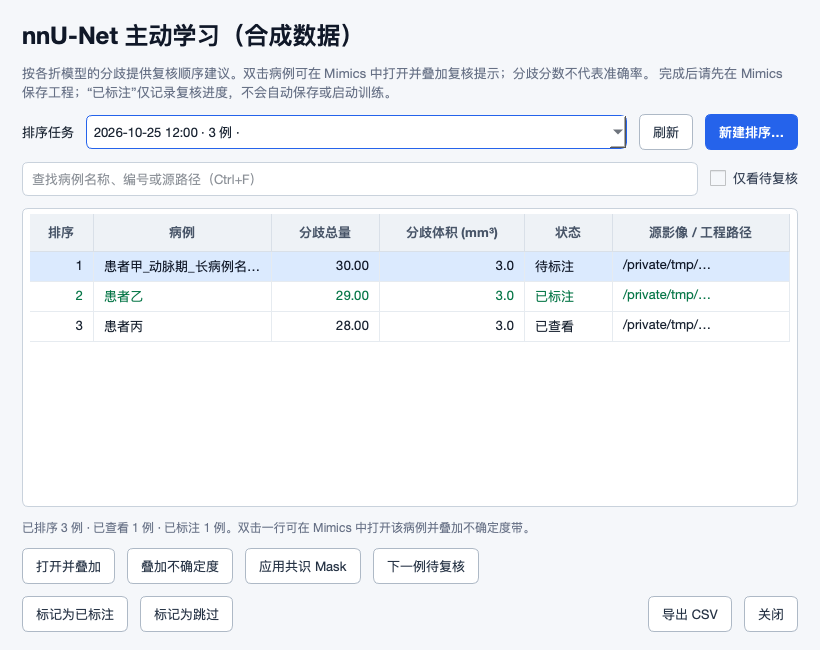
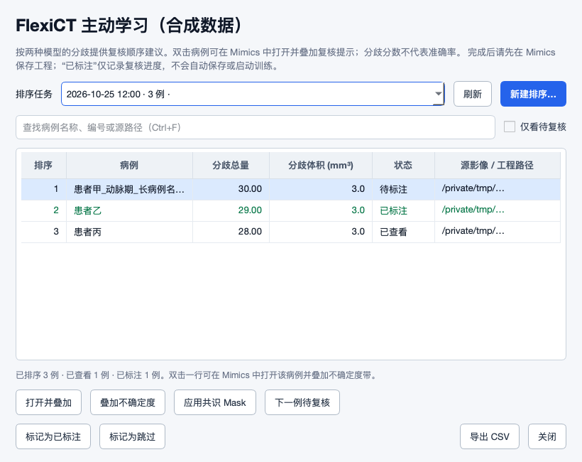

# 2026-10-25 · 新改动修复与双后端主动学习复核

**结论：nnU-Net 与 FlexiCT 已具备可运行的“模型分歧排序→Mimics 人工复核”基础；本轮修正了 9 项数据保护/联动问题并改善复核界面。但现有证据不足以宣称主动学习已节省标注成本，保存标注、更新训练集、重新训练与冻结验证评估仍是明确的后续步骤。**

- 远端审查范围：`a62109359a3c2e3f58940d189dc77732f9dff5d6..c5947bf681647c295e11a7096163733986bc9ba9`，29 个新增提交、29 个文件。拉取前工作区干净，已安全快进。
- 本轮实现提交：`4af03938284e59ac2673746c65ed70dfdbc47c44`。本文的问题位置和最终证据以这个提交为准；远端原始修改与本轮修改分开记录。
- [结构化记录](2026-10-25-c5947bf-active-learning.json) · [提交/文件范围](2026-10-25-c5947bf-evidence/source-scope.json) · [证据说明](2026-10-25-c5947bf-evidence/README.md) · [可编辑闭环图](2026-10-25-c5947bf-evidence/active-learning-loop.mmd)

## 新改动是否正确

新增 nnU-Net 路径按折分别调用 `easy_predict(use_folds=[fold])`，至少要求两个已训练的 0–4 折；`fold_all` 不冒充多个模型。新路径复用 FlexiCT 的预测网格核对、逐轮不确定度目录和失败片段隔离，再通过同一个 Mimics 接收端复核。这个方向合理，避免两套数据保护协议逐渐分叉。

原有测试仍遗漏了多标签转换输出与接收端之间的真实契约：桥接器会输出 `al_0_label1`、`al_0_label2`，旧接收端却只寻找 `al_0`。本轮用真实 NIfTI 网格转换接到接收端复现并修复。其他边界包括同一对象换网格、零分歧没有辅助带、两条辅助带文件数相同却体素不同，以及正常关闭与文件提交的生命周期。

上轮 SLIP 八张卡的远端修复通过本次选定离线回归：SLIP 两套测试共 77 项，另运行 GPU 恢复与进度窗口针对性检查。这里表示所测合同通过，不等于真实模型、不同模态强度、Windows/CUDA/Mimics 的全链验收。特别是多模态启用仍需核对具体权重、原始强度映射与实际输出；本轮没有处理真实病例。

## 本轮已修复的问题

以下 6 项 P1、3 项 P2 包含本轮新增发现与此前未解决项，不把旧卡重新累计为“新增缺陷”。代码只修复可由源码与隔离反例支持的行为。

### AL01 · P1 · 多器官共识转换后无法应用

**场景/原因与影响：** 转换器输出 al_0_label1/2，旧消费者只查 al_0，任务失败。

**修改：** 接收并逐个校验拆分标签，拒绝重复/未知输出；按任务标签命名，各器官保持独立。

**为什么 / 验收：** 让真实转换器输出与应用协议一致，避免多器官任务全部失败。 双后端共识经真实 NIfTI 转换后各器官名称与体素一致；第二器官损坏时任何 Mask 都不得创建。

**源码：** [runtime_py35/active_learning_apply.py:597 · _al_verify_conversion_buffers](https://github.com/ShijianRuan/MIMICS_SCRIPTS/blob/4af03938284e59ac2673746c65ed70dfdbc47c44/runtime_py35/active_learning_apply.py#L597)。

**验收证据：** `tests/test_active_learning_review_regressions.py::ConsensusContracts.test_multiorgan_consensus_reaches_both_hosts_with_correct_names_and_voxels`；实际运行覆盖对应文件或消费者边界，Mimics/模型边界仍为替身。

### AL02 · P1 · 同一 Image 改变网格后仍接收旧转换结果

**场景/原因与影响：** 原有完成校验只检查项目与对象 GUID；同对象配准改变物理网格后，转换结果仍属于旧网格。矩阵 NaN 也可绕过旧比较。

**修改：** 记录启动时网格，完成时复核形状和物理矩阵；非有限坐标拒绝。

**为什么 / 验收：** 异步结果必须属于提交时的物理空间；对象 GUID 不能证明网格未变化。 相同 GUID 的平移/网格变化拒绝；NaN/Inf 矩阵不能判为相等。

**源码：** [runtime_py35/active_learning_apply.py:647 · _al_target_still_matches](https://github.com/ShijianRuan/MIMICS_SCRIPTS/blob/4af03938284e59ac2673746c65ed70dfdbc47c44/runtime_py35/active_learning_apply.py#L647)。

**验收证据：** `tests/test_active_learning_review_regressions.py::ConsensusContracts.test_same_image_guid_with_changed_physical_grid_is_rejected`；实际运行覆盖对应文件或消费者边界，Mimics/模型边界仍为替身。

### S01 · P1 · 回拨时钟导致错误回执被认定补写完成

**场景/原因与影响：** 旧问题：不同事务仅比较 created_at_epoch，时钟回拨可清空待补写记录而保留旧 GUID 证据。

**修改：** 依据当前工程路径/内容指纹决定记录；冲突保留 pending，不以时间裁决；替换前归档旧回执，仍遵循既有 30 天清理规则。

**为什么 / 验收：** 时钟顺序不是工程/导入事务身份的可靠证据。 回拨时钟时根据当前工程匹配事务并归档旧回执；两个不同事务同时匹配时保持 pending。

**源码：** [runtime_py35/create_mcs_batch.py:369 · flush_pending_receipts](https://github.com/ShijianRuan/MIMICS_SCRIPTS/blob/4af03938284e59ac2673746c65ed70dfdbc47c44/runtime_py35/create_mcs_batch.py#L369)。

**验收证据：** `tests/test_active_learning_review_regressions.py::ReceiptContracts.test_clock_rollback_uses_current_project_identity_and_keeps_previous_receipt`；实际运行覆盖对应文件或消费者边界，Mimics/模型边界仍为替身。

### S02 · P1 · 两个结果发布可同时越过版本检查

**场景/原因与影响：** 旧问题：检查和替换分离，两个任务都能通过目标缺失检查并依次覆盖。

**修改：** 目标旁共享锁覆盖最终比较、备份与替换，恢复使用同一锁并在锁内读回状态；输家保留 candidate。

**为什么 / 验收：** 唯一 staging 名称不能保证对最终目标的比较与交换互斥。 并发实际发布仅一个提交，另一个保留候选并报告冲突；恢复也持有相同目标锁。

**源码：** [tools/nnunet_pipeline.py:1977 · publish_prediction_output](https://github.com/ShijianRuan/MIMICS_SCRIPTS/blob/4af03938284e59ac2673746c65ed70dfdbc47c44/tools/nnunet_pipeline.py#L1977)。

**验收证据：** `tests/test_active_learning_review_regressions.py::PublicationContracts.test_concurrent_publish_has_one_commit_and_preserves_losing_candidate`；实际运行覆盖对应文件或消费者边界，Mimics/模型边界仍为替身。

### S06 · P1 · 单层 DICOM 跳过方向校验

**场景/原因与影响：** 旧问题：不足两层时在 IOP 单位/正交检查之前返回，非法方向可形成剪切网格。

**修改：** 单幅方向检查完成后才跳过层间步长；位置必须恰为三个有限数。

**为什么 / 验收：** 单层图像同样需要可信的平面方向。 单层非正交/非单位方向拒绝，合法倾斜方向保持可用；公共几何读取路径覆盖。

**源码：** [mimics_bridge.py:1694 · _validate_dicom_slice_grid](https://github.com/ShijianRuan/MIMICS_SCRIPTS/blob/4af03938284e59ac2673746c65ed70dfdbc47c44/mimics_bridge.py#L1694)。

**验收证据：** `tests/test_active_learning_review_regressions.py::SingleSliceGeometry.test_single_slice_rejects_skew_and_nonunit_iop_through_public_helpers`；实际运行覆盖对应文件或消费者边界，Mimics/模型边界仍为替身。

### V01 · P1 · 正常关窗可能中断恢复文件交换

**场景/原因与影响：** 旧问题：恢复线程为 daemon，关窗停止回执轮询并退出，可停在 current→backup 后。FlexiCT 同样受影响。

**修改：** 恢复工作线程不再为 daemon；交换中关闭请求保持事件循环，成功提交后才关闭，失败仍可见。

**为什么 / 验收：** 恢复任务的数据提交生命周期必须跨越正常关窗请求。 两窗口在实际首个 rename 后关闭仍等待，最终当前结果、备份、状态摘要一致；强制退出恢复另待验证。

**源码：** [tools/nnunet_status_viewer.py:267 · _close_event](https://github.com/ShijianRuan/MIMICS_SCRIPTS/blob/4af03938284e59ac2673746c65ed70dfdbc47c44/tools/nnunet_status_viewer.py#L267)。

**验收证据：** `tests/test_active_learning_review_regressions.py::QtContracts.test_close_during_actual_restore_waits_for_completed_file_exchange`；实际运行覆盖对应文件或消费者边界，Mimics/模型边界仍为替身。

### T04 · P2 · 进度标记保存失败仍被算作排空成功

**场景/原因与影响：** 旧问题：finally 只减 pending，写失败后关窗返回零未保存，错误在退出后不可见。

**修改：** 记录失败集合并提供 FIFO 重试；正常关闭等待回执，失败保留窗口，只有明确放弃才能关闭。

**为什么 / 验收：** 请求完成并不等于进度标记已经持久化。 拒写后关闭保留窗口和未保存数量；重试后实际状态文件更新，FIFO 顺序保持。

**源码：** [tools/flexict_active_learning_ui.py:1419 · _close_event](https://github.com/ShijianRuan/MIMICS_SCRIPTS/blob/4af03938284e59ac2673746c65ed70dfdbc47c44/tools/flexict_active_learning_ui.py#L1419)。

**验收证据：** `tests/test_active_learning_review_regressions.py::QtContracts.test_failed_marking_close_keeps_window_and_retry_persists`；实际运行覆盖对应文件或消费者边界，Mimics/模型边界仍为替身。

### AL03 · P2 · 按文件个数误报两条分歧带相同

**场景/原因与影响：** 两条带各有相同数量文件，并不表示体素相同；多折多等级情况下原判断可误导。

**修改：** 计算实际逐体素相等元数据；确实相同时只叠加一组，旧任务仅阈值相同才可确定。

**为什么 / 验收：** 文件计数不包含逐体素位置与内容信息。 文件数相等但区域不同不视为重合；真正相同的双模型带只叠加一组。

**源码：** [tools/active_learning_common.py:214 · write_uncertainty_bands](https://github.com/ShijianRuan/MIMICS_SCRIPTS/blob/4af03938284e59ac2673746c65ed70dfdbc47c44/tools/active_learning_common.py#L214)。

**验收证据：** `tests/test_active_learning_review_regressions.py::BandContracts.test_file_counts_do_not_prove_same_voxels`；实际运行覆盖对应文件或消费者边界，Mimics/模型边界仍为替身。

### AL04 · P2 · 零分歧病例被报告为叠加文件丢失

**场景/原因与影响：** 一致预测不会生成非空辅助带，旧入口把正常空带与文件缺失一律报错。

**修改：** 完整核对病例、Image 和网格后，把明确零分歧记录为已查看并说明一致不代表正确；非零分歧缺文件仍失败。

**为什么 / 验收：** 明确的零分歧是一种合法结果，不能等同于文件损坏，也不等于分割正确。 身份和网格验证通过后零分歧可完成查看；非零分歧缺辅助带仍明确失败。

**源码：** [runtime_py35/active_learning_apply.py:401 · _al_apply_request](https://github.com/ShijianRuan/MIMICS_SCRIPTS/blob/4af03938284e59ac2673746c65ed70dfdbc47c44/runtime_py35/active_learning_apply.py#L401)。

**验收证据：** `tests/test_active_learning_review_regressions.py::ConsensusContracts.test_zero_disagreement_is_valid_view_but_missing_nonzero_bands_are_not`；实际运行覆盖对应文件或消费者边界，Mimics/模型边界仍为替身。

旧卡状态：SL01–SL06、N01–N02 的远端修复在所选离线合同中通过，目标平台效果仍待验证；S01/S02/S06/T04 的上述残留分支已修复。V01 为**部分解决**：正常退出已协调，强制终止后的重启事务恢复尚未增加。完整逐卡状态见结构化记录。

S01/S02/S06/T04/V01 是旧报告的剩余问题，本轮分别加入工程身份裁决、发布/恢复互斥、单层几何校验和正常退出协调。S01 在两个不同事务都能匹配同一工程内容时会保留 pending 并记录身份冲突，不能自动猜测哪次导入正确。恢复线程保护针对正常关闭；强制杀进程、掉电与文件系统故障后的完整事务恢复仍需另行验证。

## 主动学习方法调研与当前设计取舍

| 方法 | 选择依据 | 对本工具的判断 |
| --- | --- | --- |
| 模型分歧 / 委员会 | 多个预测是否一致 | 当前 nnU-Net 折间、FlexiCT 2D/3D 已实现。适合作为可解释的复核顺序，但模型可能一致地犯错，相关模型也不等于独立后验样本。 |
| 概率熵、MC dropout、BALD | 预测分布及模型不确定性 | 需要概率输出或重复随机预测及相应假设。当前硬 Mask 投票分歧/投票熵不能宣称就是预测概率熵或 BALD。 |
| 多样性 / 代表性 | 特征空间覆盖，减少相似样本重复入选 | 同患者多期、相似扫描与同类边界容易重复排前。可考虑在不确定候选中按明确患者组或特征分散选择，不能从文件名猜患者。 |
| 类别分层与随机探索 | 覆盖稀少结构，避免只盯住大器官 | 当前积分分数受分歧区域体积影响，应按任务/类别检查偏向；需要保留随机或前景感知随机的比较基线。 |
| 成本感知 / 局部查询 | 单位人工时间获得的改进，或只查询部分区域 | 当前按整病例排序、只记录完成状态，尚未测量修正时间。局部标注训练还需要显式 unknown/ignore 协议，不能把未标区域自动当背景。 |

Gal、Islam 与 Ghahramani 的工作把 Bayesian 深度学习用于图像主动学习，强调获取模型不确定性的必要性；它提供的方法依据不能用来证明这里的硬标签分歧已经经过校准。[原论文](https://proceedings.mlr.press/v70/gal17a.html)

Sener 与 Savarese 的 Core-Set 工作以样本表示空间覆盖构造查询集；Kirsch 等人的 BatchBALD 联合选择一批样本以减少重复信息。这些是考虑多样性的依据，不是当前病例级实现已经采用的方法，也不是对医学分割必然获益的承诺。[Core-Set](https://arxiv.org/abs/1708.00489) · [BatchBALD](https://arxiv.org/abs/1906.08158)

2025 年的 nnActive 以四个三维生物医学数据集和多个标注预算检查 AL 评价，指出改进的前景感知随机抽样是强基线，不能只和普通随机比较，也不能只按体素数衡量成本。[nnActive](https://arxiv.org/abs/2511.19183)

2026 年 ClaSP PE 将类别分层与随轮次变化的随机扰动加入预测熵查询，在作者的 nnActive 设置中改善类别覆盖与早期冗余。这为后续试验提供候选，不代表本项目已复现作者的收益。[ClaSP PE](https://arxiv.org/abs/2601.13677) · [nnActive 官方实现](https://github.com/MIC-DKFZ/nnActive)

因此本轮保持现有排序算法，不凭没有本地收益证据的新公式替换它。先修复可解释性、身份、反馈和标注交付；之后再按相同人工预算对比分歧排序、前景感知随机与分层/多样性策略。

## 是否达到预期：按目标分别判断

| 目标 | 当前结论 |
| --- | --- |
| 两个后端都能对池内病例产生分歧排序和辅助带 | 隔离生命周期测试通过；nnU-Net 多折、FlexiCT 双模型两条路径均覆盖，模型推理由合成预测代替。 |
| 在 Mimics 打开正确病例，叠加到正确 Image/物理网格 | 源路径、项目/对象身份、网格与应用回滚合同已加强；需要目标 Mimics 真机验收。 |
| 共识提供已有预测后人工精修的草稿 | 多标签输出合同已修复；共识创建新 Mask，保留人工对象，不能自动视为标准答案。两模型平票规则也不代表真实置信度。 |
| 标注完成后自动保存并进入下一轮训练 | 尚未实现自动闭环。现有“已标注”是人工进度记录，不保存工程、不校验所有标签完成、不自动导出或训练。界面已明确说明。 |
| 避免验证/测试患者进入查询池 | 训练侧已有患者分组和冻结验证逻辑；排序池没有自动排除重叠患者，需由选池保证。界面数据池提示已说明这一边界。 |
| 用更少时间达到同等分割效果 | 尚无本项目真实标注成本/冻结验证比较，不能判定达成。 |

不能只靠“排序窗口能打开”或“模型有分歧”验收主动学习。建议固定患者级验证/测试集合，以累计有效修正时间为横轴，比较相同预算下的 Dice、边界指标与少数类表现；记录新模型/权重、查询批次、人工确认标签和数据版本。先做随机基线与当前方法的小规模对照，再决定是否增加模型推理次数或接入新策略。

## 界面、便利性与 Mimics 联动改进

- 显示原始病例名称，保留内部病例 ID；筛选和显示中文名不会把请求错发给另一个病例。
- 新增名称/编号/源路径搜索、仅待复核筛选、下一例待复核导航；`Ctrl+F` 聚焦搜索、`Alt+N` 选择下一例。下一例只改变列表选择，不自动关闭尚未保存的 Mimics 工程。
- 刷新后保留当前任务及病例选择；已查看与已标注继续分开，已完成/已跳过可隐藏。
- 分数改称“分歧总量”，解释它受体积影响、不是准确率；真正重合的双带只显示一组。零分歧正常完成查看，也明确说明“一致不代表正确”。
- 在 820 像素窗口下重新分配列宽，隐藏重复行号，病例、路径和表头提供完整提示；两个后端分别读取自己的记忆目录设置。
- 标记保存失败可重试；关闭窗口先等待在途写入，再由用户决定是否明确放弃失败标记。“已标注”按钮说明先保存 Mimics 工程，不能混同于训练入库。

以下是从合成文件生成、实际运行的 Qt 窗口，普通缩放与 150% 缩放均检查。它们验证布局和本地事件行为，不是 Windows/Mimics 交互验收。

[150% nnU-Net 图](2026-10-25-c5947bf-evidence/nnunet-review-scale-1_5.png) · [150% FlexiCT 图](2026-10-25-c5947bf-evidence/flexict-review-scale-1_5.png) · [尺寸/控件观察](2026-10-25-c5947bf-evidence/ui-observations.json)

## 验证与限制

最终选择的 12 个套件覆盖 nnU-Net/FlexiCT 生命周期与共用模块、SLIP、几何清单、复核工作流、16 个新回归、真实 Qt 窗口和 UI 质量检查。完整选择项、退出码和尾部日志见[矩阵](2026-10-25-c5947bf-evidence/regression-matrix.json)。另运行 31 个导入队列/回执用例、59 个规范化/缓冲网格用例（1 项平台跳过）、GPU 恢复针对性用例；进度窗口 4 个用例在修正 Qt 测试对象生命周期后，连续 5 个独立进程均退出 0。

最初 59 项规范化/网格选择中有 1 项因未发现外部 Python 出错；通过进程级 `MIMICS_BRIDGE_PYTHON` 指向本机已存在的解释器后，原用例通过。没有安装环境或更改用户配置。进度窗口首次独立运行虽然打印了 4 项 OK，进程仍 exit=139，因此没有把它当成成功；已保留[初始崩溃日志](2026-10-25-c5947bf-evidence/setup-progress-initial-crash.log)和[五进程结果](2026-10-25-c5947bf-evidence/setup-progress-stability.json)。

测试使用现有 macOS Python 3.13/PySide6/numpy/nibabel 环境；没有启动真实训练、临床处理、GPU 推理或环境修复。Mimics API 与推理器仍有替身边界。GUI 套件 3 项 Windows 锁用例、几何套件 1 项 Windows 平台用例未在本机运行；本报告不声称全库通过、发现全部缺陷或实现目标平台端到端验收。[验证汇总与源码身份](2026-10-25-c5947bf-evidence/validation-summary.json)
