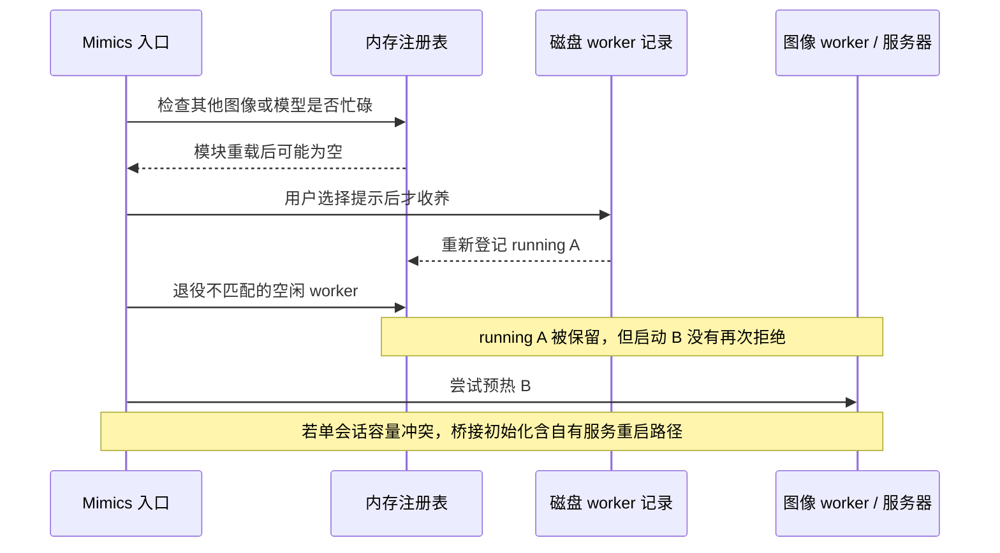
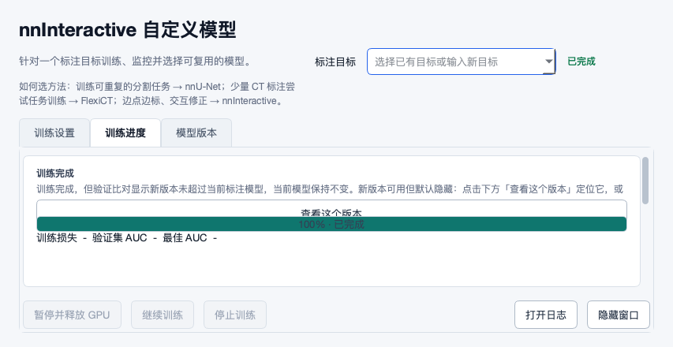

# 2026-10-31 · 新改动与 nnInteractive 加速复核

_被审源码 `09d5948988c4efd481ddb15d162551c644aebaef`；39 个新增提交、32 个文件；离线源码/合成文件/实际 Qt 检查。_

---

## 🔎 结论与范围

nnInteractive 的 R100 改动方向合理：从磁盘重新发现仍存活的 image worker，让同图跨入口调用复用已经上传/预处理的图像，避免再次触发单会话容量恢复。它针对重复启动的等待，不等于首次冷启动已加速。当前实现仍缺少充分的缓存身份、进程所有权及忙碌检查顺序保护；不能仅凭新增用例通过就视为已经验收。

本轮记录 **6 张问题卡：4 项 P1、2 项 P2**。其中 NI01 是既有缓存键缺口在跨入口持久复用后的新增暴露，NI02–NI04 属 R100 收养路径，PV01 属工程体素训练缓存，UND01 属归档回执过滤。旧 S11 界面问题单独标为部分解决，不重复计成新卡。

拉取前工作区干净、分支为 `al-review-loop`，从 `e22b65e89679786c98d6066365efe74a2949a32a` 安全快进。依据 SHA、Git 拓扑和本地推送记录划定范围，不根据共用 author/email 判断来源。本轮交付为审查与证据，业务源码未修改。

[结构化问题记录](2026-10-31-09d5948-revalidation.json) · [范围清单](2026-10-31-09d5948-evidence/source-scope.json) · [证据及重跑说明](2026-10-31-09d5948-evidence/README.md) · [合成观察](2026-10-31-09d5948-evidence/observations.json)

## 🧭 加速链路与关键边界

下面是当前代码的调用时序，图中的重启分支为源码风险，本轮没有实际启动服务器。

未改同图的正向收养可运行，R100 新增 fake-Mimics 用例也通过。但正向测试把 PID 存活作为充分条件，未覆盖图像变化、其他图像在途、非 worker 的存活 PID、字段级损坏。复用是否省去 65–72 秒、首次冷启动和 GPU 峰值显存的实际变化，仍需目标机计时，不能从此处离线用例推断。

## 🐛 问题卡

### NI01 · P1 · 同 GUID 图像变化后仍收养旧输入

**场景：** 同一 Image 在配准/处理后保持 GUID 和尺寸，或源文件已更新，再从入口标注另一器官。

**实际观察：** 真实磁盘收养后，合成图像原点改为 LPS x=100，_get_or_start_image_worker 仍返回原 worker，没有请求新导出/运行时验证。

**原因：** 官方模型 cache_key 仅 Image GUID；命中时只判断存活和输入模式，不比较当前图像、网格、工程或完整模型/预处理签名。

**影响及证据边界：** 存在用旧图像/映射计算当前提示的风险；应用端当前项目与 GUID 检查不能证明缓存输入正确。没有执行模型或观察临床错误。

**要改什么：** 持久化并验证图像输入的完整身份，不能以 GUID 单独决定跨入口命中。

**为什么：** 错误命中会静默跳过医学影像本应重新准备的步骤。

**怎么改：** 绑定工程/父 Mimics 会话、图像内容版本、live shape/affine、源文件身份、强度恢复和模型/权重/折/预处理契约；无法证明相同则保守不复用，并保留在途结果。

**源码：** [runtime_py35/nninteractive_mimics.py:3651 · _adopt_disk_image_workers](https://github.com/ShijianRuan/MIMICS_SCRIPTS/blob/09d5948988c4efd481ddb15d162551c644aebaef/runtime_py35/nninteractive_mimics.py#L3651)；[runtime_py35/nninteractive_mimics.py:902 · _worker_cache_key](https://github.com/ShijianRuan/MIMICS_SCRIPTS/blob/09d5948988c4efd481ddb15d162551c644aebaef/runtime_py35/nninteractive_mimics.py#L902)；[runtime_py35/nninteractive_mimics.py:3687 · _get_or_start_image_worker](https://github.com/ShijianRuan/MIMICS_SCRIPTS/blob/09d5948988c4efd481ddb15d162551c644aebaef/runtime_py35/nninteractive_mimics.py#L3687)。

**验收条件：** 相同 GUID/尺寸改变物理网格或输入后失效；未变同图跨入口仍可命中。 更换工程、源图、官方权重或预处理契约时失效；结果应用前再次检查网格。

**复现：** `reproduce_review.py` → `same_guid_changed_grid`；观察及限制见上述 JSON。

### NI02 · P1 · 先忙碌检查后收养，跨入口漏掉在途预测

**场景：** 图像 A 仍在预测，模块重载清空内存字典，此时用户在图像 B 或另一模型上运行入口。

**实际观察：** 真实 _run_with_config 返回 0 并走到预热；预热拦截点调用真实 busy helper 已能找到收养后的 running A，A 也未被退役。

**原因：** 入口 3139/3153 的 busy 检查先于 _continue_session_prompt 2993 的磁盘收养；退役函数遇到在途结果仅跳过，并不阻止随后启动。

**影响及证据边界：** 新 worker 可能遇到 max-sessions=1 容量错误；桥接容量恢复分支会尝试重启已有自有服务器，干扰旧预测并抵消加速。只复现错误放行，未启动或重启服务器。

**要改什么：** 在 busy 检查、草稿创建和预热之前完成经过身份验证的收养。

**为什么：** 忙碌检查必须读取完整任务集合才能保护在途工作。

**怎么改：** 将收养移到 _run_with_config 前置阶段，在提交租约下重查；容量恢复也应核对已有 active operation，不能仅因容量满就重启正在服务的服务器。

**源码：** [runtime_py35/nninteractive_mimics.py:2993 · _continue_session_prompt](https://github.com/ShijianRuan/MIMICS_SCRIPTS/blob/09d5948988c4efd481ddb15d162551c644aebaef/runtime_py35/nninteractive_mimics.py#L2993)；[runtime_py35/nninteractive_mimics.py:3139 · _run_with_config](https://github.com/ShijianRuan/MIMICS_SCRIPTS/blob/09d5948988c4efd481ddb15d162551c644aebaef/runtime_py35/nninteractive_mimics.py#L3139)；[nninteractive_bridge.py:2298 · _BridgeSessionContext.__init__](https://github.com/ShijianRuan/MIMICS_SCRIPTS/blob/09d5948988c4efd481ddb15d162551c644aebaef/nninteractive_bridge.py#L2298)。

**验收条件：** 清空内存注册表、保留磁盘 running/未消费结果，另一 Image/模型入口应拒绝，不能创建 worker、改 Mask 或重启服务。 空闲已消费结果可安全退役；同图续接仍可用。

**复现：** `reproduce_review.py` → `busy_guard_before_adoption`；观察及限制见上述 JSON。

### NI03 · P1 · 仅凭 PID 存活收养，退役可终止非 worker 进程

**场景：** worker 崩溃遗留 ready 记录，随后 PID 被复用；或同目录记录来自另一 Mimics 实例。

**实际观察：** 临时旧记录指向本次诊断进程真实 PID，initialize.parent_pid 不符，仍被收养并传给 terminate_process_async。终止被记录器拦截，没有杀进程。

**原因：** 仅核对 PID 存活与非终态；未检查 start marker、命令行/控制目录、父 Mimics 身份或所有权 token，退役则按裸 PID 终止。

**影响及证据边界：** 可能终止无关进程或其他标注实例。这是本地残留记录/进程身份问题，不是已证实的远程入侵或 RCE；没有诱发真实 PID 复用。

**要改什么：** 区分进程存在与有权管理该 worker；未知身份不收养也不终止。

**为什么：** 可复用的 PID 不构成终止权限。

**怎么改：** 启动时记录 start marker、父会话身份和 token；收养时核对命令行、控制目录并握手，实际终止前再次核验。

**源码：** [runtime_py35/nninteractive_mimics.py:3635 · _adopt_disk_image_workers](https://github.com/ShijianRuan/MIMICS_SCRIPTS/blob/09d5948988c4efd481ddb15d162551c644aebaef/runtime_py35/nninteractive_mimics.py#L3635)；[runtime_py35/nninteractive_mimics.py:3384 · _shared_image_worker_alive](https://github.com/ShijianRuan/MIMICS_SCRIPTS/blob/09d5948988c4efd481ddb15d162551c644aebaef/runtime_py35/nninteractive_mimics.py#L3384)；[runtime_py35/nninteractive_mimics.py:3552 · _retire_idle_image_workers](https://github.com/ShijianRuan/MIMICS_SCRIPTS/blob/09d5948988c4efd481ddb15d162551c644aebaef/runtime_py35/nninteractive_mimics.py#L3552)；[runtime_py35/runtime_common.py:1708 · terminate_process_async](https://github.com/ShijianRuan/MIMICS_SCRIPTS/blob/09d5948988c4efd481ddb15d162551c644aebaef/runtime_py35/runtime_common.py#L1708)。

**验收条件：** 存活但身份不同的 PID、父 Mimics 不符、缺失/损坏 marker 不得进入终止路径。 Windows 补测 PID 复用与信息不可读；并发 Mimics 实例不得共享交互命令序列。

**复现：** `reproduce_review.py` → `unowned_live_pid_retirement`；观察及限制见上述 JSON。

### PV01 · P1 · 工程体素缓存遗漏强度恢复和网格契约

**场景：** raw 字节和标签不变，工程的 GV→源强度参数修正后，再准备 nnU-Net/FlexiCT 训练。

**实际观察：** 真实 NIfTI 材料化：slope 由 1 改为 2，第二次 cache_hit=True，缓存 [0,1,2,3,4,5,6,7]，同参数重新物化应为 [0,2,4,6,8,10,12,14]。

**原因：** project_voxels 的 image_signature 只有 kind/raw sha256；shape/dtype、当前/目标 affine、slope/intercept/zero tolerance 等影响输出却未入签名。

**影响及证据边界：** 可能把旧输入继续用于本机或远程训练。证明的是实际输入不同，未训练或测量精度变化。

**要改什么：** 用完整物化语义生成内容签名，升级缓存契约。

**为什么：** raw 摘要只证明字节相同，不证明物理值和空间解释相同。

**怎么改：** 规范化签入 shape、dtype/字节序、网格、expected_grid、modality、强度恢复 basis/slope/intercept/zero tolerance 和版本；命中前验证当前字节，失效旧签名缓存。

**源码：** [tools/nnunet_pipeline.py:894 · prepare_source_grid_cases](https://github.com/ShijianRuan/MIMICS_SCRIPTS/blob/09d5948988c4efd481ddb15d162551c644aebaef/tools/nnunet_pipeline.py#L894)；[tools/nnunet_pipeline.py:585 · _case_source_signature](https://github.com/ShijianRuan/MIMICS_SCRIPTS/blob/09d5948988c4efd481ddb15d162551c644aebaef/tools/nnunet_pipeline.py#L585)；[tools/nnunet_pipeline.py:640 · _materialize_case](https://github.com/ShijianRuan/MIMICS_SCRIPTS/blob/09d5948988c4efd481ddb15d162551c644aebaef/tools/nnunet_pipeline.py#L640)。

**验收条件：** raw/标签不变而改变恢复参数、dtype 或网格时失效；输出等于独立新物化。 相同内容同语义重新导出仍可命中，不依赖临时路径和 mtime；覆盖两后端。

**复现：** `reproduce_review.py` → `project_voxel_cache_omits_intensity_contract`；观察及限制见上述 JSON。

### NI04 · P2 · 可解析但字段损坏的清单阻断整个入口

**场景：** 某个残留 image_worker.json 是合法 JSON，但 created_at_epoch 不是数字，其他 worker 本可继续工作。

**实际观察：** 真实 _adopt_disk_image_workers 抛 ValueError，没有逐项跳过，未达到失败回退原行为的约定。

**原因：** 只检查 dict，随后无逐项异常隔离地 float(created_at_epoch)；必需路径、shape、模型字段也缺完整 schema 校验。

**影响及证据边界：** 单个坏条目即可使本次提示入口失败；这是异常恢复缺口，未证实外部攻击入口。

**要改什么：** 逐项验证清单并隔离坏记录，禁止不完整条目进入可执行缓存。

**为什么：** 加速缓存不可用应退回初始化，而不是破坏原先可工作的入口。

**怎么改：** 验证 schema、有限时间、正整数 shape、路径归属、进程/模型必需字段；逐项记可读诊断后跳过，拒绝 NaN/Infinity 排序值。

**源码：** [runtime_py35/nninteractive_mimics.py:3642 · _adopt_disk_image_workers](https://github.com/ShijianRuan/MIMICS_SCRIPTS/blob/09d5948988c4efd481ddb15d162551c644aebaef/runtime_py35/nninteractive_mimics.py#L3642)。

**验收条件：** 坏 JSON/字段/状态文件与合法 worker 混存时不崩溃、不收养坏项，合法项仍可复用。

**复现：** `reproduce_review.py` → `valid_json_invalid_worker_schema`；观察及限制见上述 JSON。

### UND01 · P2 · 合法病例名含 .previous- 时最新导入回执被跳过

**场景：** 病例名如 kidney.previous-study；此轮归档过滤把它误认成历史回执。

**实际观察：** 真实生产者产生 .kidney.previous-study.import_receipt.json，发现器忽略最新记录，返回时间更早的 ordinary-case 回执。未打开工程或删除 Mask。

**原因：** 用任意位置的子串 .previous- 判归档，没有区分病例名与归档时附加的固定摘要后缀。

**影响及证据边界：** 撤销最近导入可能找不到当前病例，或指向更早另一病例；仍有后续确认/身份保护，不声称已删除错误对象。

**要改什么：** 用明确归档元数据或生产者约定的严格后缀识别历史文件。

**为什么：** 通用工具不能把合法病例命名片段当成事务类型。

**怎么改：** 共享归档命名/解析函数；优先独立 archive 标志或目录，兼容旧格式时仅识别末尾 .previous-<16hex>.import_receipt.json 并核对内容。

**源码：** [runtime_py35/import_undo_mimics.py:134 · find_latest_receipt](https://github.com/ShijianRuan/MIMICS_SCRIPTS/blob/09d5948988c4efd481ddb15d162551c644aebaef/runtime_py35/import_undo_mimics.py#L134)。

**验收条件：** 正常病例含 .previous- 仍能成为最新撤销候选；真正归档即使时间回拨也不能遮蔽当前回执。

**复现：** `reproduce_review.py` → `ordinary_case_name_misclassified_as_archive`；观察及限制见上述 JSON。

## 🪟 实际 Qt 结果与旧问题

`ui_workflow_regressions` 的 30 项中有两项失败，原始套件退出 1，未修改断言，也未把它改记为通过。

| 失败项 | 实际检查 | 结论 |
| --- | --- | --- |
| 模型选择器长 ID | 当前字体下 ID 宽 400、视口宽 805；实际 Qt 截图能看见完整尾部，控件可选择且 WrapAnywhere | “测试数据应比视口宽”的前置假设不成立。这不能证明产品裁切，也没有覆盖真正超长 token；应按当前 fontMetrics 构造足够长的 ID 再测。 |
| 完成说明长文案 | 853×440 窗口中 `wordWrap=True`，但说明高度仅 14，sizeHint 高 107；等待 0.6 秒事件循环后仍 14，尾部不可见 | 旧 S11 **部分解决**：水平溢出得到控制，垂直分配仍不足，不能因字符串存在或 wordWrap=True 宣称可读。该文件本批未改，不算新缺陷。 |

S11 的剩余场景是训练完成且保留当前模型，说明需要告诉用户新版本被默认隐藏以及如何定位。应让状态卡/滚动内容按 `heightForWidth` 分配实际说明高度，完成/错误长文案都检查；验收以截图、实际文本可见区域和可到达按钮为准，不能仅比较控件的自身宽度。当前证据为 macOS 离屏 Qt，不代表 Windows 所有 DPI 均复现。

[模型选择器截图](2026-10-31-09d5948-evidence/test_task_model_chooser_full_id_readable_and_copyable-settled.png) · [控件观察](2026-10-31-09d5948-evidence/ui-failure-observations.json)

## 📋 上轮问题回查

| 旧问题 | 当前状态 |
| --- | --- |
| AL01/AL02/AL03/AL04、多标签共识、网格、辅助带与零分歧 | 所选离线合同仍通过；目标 Mimics/GPU 未验收。 |
| S01 回执身份与时钟回拨 | 原保护仍通过；远端又排除了归档回执，但本轮发现 UND01 合法病例名误判，应同时修正。 |
| S02 发布/恢复互斥、S06 单层方向、T04 保存失败反馈 | 所选回归未发现退化；Windows 锁检查仍有平台跳过。 |
| V01 恢复期间退出 | 正常关闭保护仍通过；强制终止/掉电后的完整恢复仍待验证，维持部分解决。 |
| S11 完成页可读性 | 旧卡部分解决，证据如上；不重复累计为新卡。 |

更多精确状态、旧报告位置见结构化记录。新提交的工程体素本机/远程训练创建、失败原因透传、原图不可达预测、未压缩 NIfTI 重写，已有相应选定用例通过；这只说明这些受测合同可运行，不等于真实训练、上传或 Mimics 全链已验收。

## 🧪 验证、限制与交付

- 14 个选择套件：13 通过、1 失败；失败为上面的 UI 套件 2 项断言。GUI 套件另有 3 项 Windows 锁用例跳过。见[原始矩阵](2026-10-31-09d5948-evidence/regression-matrix.json)。
- 另选 nnInteractive 输入、解析、连续提示、草稿写入、资源生命周期、源路径/网格等 148 项，退出 0。见[针对性日志](2026-10-31-09d5948-evidence/nninteractive-targeted.log)。
- 6 个独立合成观察均复现所述消费者边界。脚本断言的是“缺口存在”，不能当作安全回归通过。网格缓存、入口忙碌、裸 PID、坏清单、真实 NIfTI 缓存与回执生产/发现分别记录。
- 29 个新增/修改 Python 文件通过语法解析，`runtime_py35` 文件按 Python 3.5 语法检查。语法通过不是运行时或医学正确性验收。
- 测试没有训练、真实病例处理、模型推理、环境修复或依赖安装；Mimics、服务器预热及进程终止有明确替身/拦截边界。未诱发真实 PID 回收、没有杀无关进程。

当前最值得优先补齐的是 NI01/NI02/NI03 的跨调用身份与生命周期协议，再修复 PV01 的缓存语义签名。加速收益应以同一患者/图像/模型身份下的首次与重复调用分阶段计时验证，同时确认失效、取消、换图及异常恢复不会牺牲数据保护。

[验证汇总](2026-10-31-09d5948-evidence/validation-summary.json) · [独立事实核对](2026-10-31-09d5948-evidence/fact-check.json)
