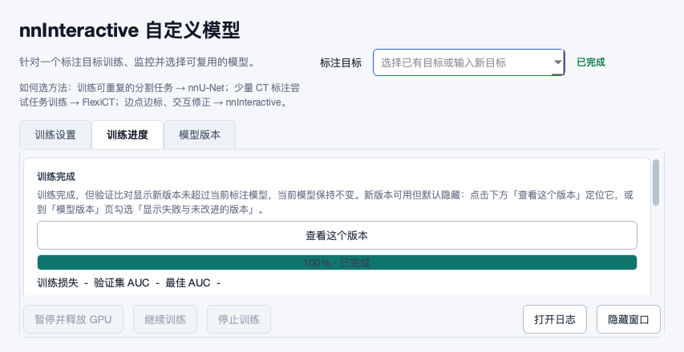

# nnInteractive 高优先级修复与外部 nnU-Net 模型调查

日期：2026-10-31。实施版本：`33e738fca65526156791e03b5acf999f9d9928b3`；基线：`1b5def7ff031a1bf4eee35e04078478b3f8856ad`，此前被审源码：`09d5948988c4efd481ddb15d162551c644aebaef`。本轮按用户明确授权修改产品代码；此前自动审查的报告/证据交付范围已由该授权扩展。

## 结论与交付范围

已修复前轮四项 P1、两项 P2，并补修模型导入的非受限 Pickle 加载及旧 S11 完成提示裁切/重叠问题。修复没有通过关闭缓存来回避复用：可确认输入相同的自有图像 worker 仍可跨入口复用；不能确认或输入变化时重新准备，仍有在途结果时保留现场。新增图像内容核对会产生内存读取成本，本轮没有测量真实 Windows/GPU 加速倍数。

外部完整 nnU-Net v2 模型可以跨机器推理，不需要重新训练；目标环境、模型结构和输入契约必须兼容。当前标注者入口仅支持本工具导出的模型包，原生训练目录/官方 ZIP 尚未一键接通。此次完成[调查与产品设计](2026-10-31-nnunet-external-model-design.md)，没有把待实施入口描述为已交付功能。设计优先支持单通道、非级联的兼容 v2 模型，再扩展多期/多通道绑定。[官方跨机器使用说明](https://github.com/MIC-DKFZ/nnUNet/blob/288572bae134bb65932074f7f06d3dfa07b198dc/documentation/how-to/run-inference.md)

结构化结果见[JSON](2026-10-31-nninteractive-fixes-external-nnunet.json)，源码摘要、回归记录、真实 Qt 截图与可编辑流程图见[证据目录](2026-10-31-fixes-evidence/README.md)。前轮反例及其源码身份保留于[旧报告](2026-10-31-09d5948-revalidation.md)，不覆盖旧证据。

## 问题逐项闭环

以下“已解决”限定为源码与所列隔离验证，不代表真实 Mimics/GPU 全流程已验收。六个前轮问题沿用原 ID，不重复累计为新缺陷。

### NI01 · P1 · 已解决于隔离验证：旧图像输入被复用

场景是同 GUID/同尺寸的 Image 经处理或配准后，仍接续旧的预处理输入。根因是 cache key 与进程存活无法证明图像版本；影响是提示和输出可能使用旧图像或映射，旧报告没有执行临床错误预测。

修改位于 `runtime_py35/nninteractive_mimics.py::_live_image_identity`、`_image_worker_input_identity`、`_get_or_start_image_worker` 和 `_handle_async_result`。签入当前项目、Image GUID、尺寸/类型、流式内容摘要、live affine、强度元数据与 HU/GV 参数、实际源路径修订、模型元数据/权重修订及输入配置；源路径包含搬迁解析后的路径。结果应用前再次核对图像输入身份。live affine 优先于导入时缓存的 affine；单例轴不能自行假设 1 mm，无法从 API 证明时拒绝该输入。不可观测的网络源修订不授权旧源图 worker 复用。

验收由 `tests/test_worker_cache_safety.py::WorkerSafety` 覆盖：模块重载后未变输入仍命中；同 GUID 改内容/网格/权重失效；在途结果不被退役；JSON 持久化往返后未变输入能越过校验，变化输入到不了 Mask 写入；单例轴保留可测的 5 mm 间距或拒绝未知网格。修改理由是医学影像输入版本必须包括字节及物理解释。模型和源文件修订使用文件系统身份/时间等信息，并非每次对所有权重做全量密码学重读；不可声称抵抗恶意本地文件篡改。

### NI02 · P1 · 已解决于隔离验证：跨入口忙碌检查遗漏

场景是 A 图像还在预测，入口重载后在 B 图像或另一模型上再次启动。先前先查空的内存注册表、后收养磁盘 worker，可能放行新 worker 并触发容量恢复重启。

修改位于 `nninteractive_mimics.py::_run_with_config` 和 `nninteractive_bridge.py::_BridgeSessionContext`。在忙碌检查、草稿选择及预热之前收养可证明归属的 worker；桥接自动管理本地服务器时，增加覆盖图像会话寿命的文件租约，另一客户端仍持有旧会话时不改写记录、不因容量不足重启它。初始化失败关闭已创建的远程 session 并释放租约，正常/异常关闭也释放租约。

验收包括真实入口的“磁盘 running A → 活动 B”合成反例：不选择目标 Mask、不预热；以及实际文件租约的两个独立 context 争用、初始化失败后的释放和重试。服务器/GPU 由测试隔离，没有实际触发容量满或重启。应在目标机器继续验证双 Mimics 实例与服务异常恢复。

### NI03 · P1 · 已解决于隔离验证：裸 PID 变成终止权限

场景是残留记录中的 PID 被其他进程复用，或记录属于另一 Mimics 实例。先前只凭 PID 存活收养，再把裸 PID 交给异步终止函数，可能伤及非本轮 worker。

新增 `runtime_py35/nninteractive_worker_identity.py`，在同一 Mimics 解释器寿命内保存父会话 token 和真实子进程句柄，入口模块重载不会丢失。磁盘记录须与初始化记录的 token/父进程身份相符，并核对子进程创建标记或保留的真实 Popen 句柄。只退役确认归属的 worker；不确定记录不会成为终止授权。`runtime_common.terminate_process_async` 接受预期创建标记，在后台终止/强制终止前重查，拒绝当前进程自身。

验收覆盖外来 owner、模拟 PID 复用、创建标记不可读且无句柄、以及终止检查之间身份发生变化。真实信号/taskkill 被记录器拦截，没有杀无关进程，也没有声称模拟到了 Windows 内核的真实 PID 复用。目标机器还需验证句柄与创建时间 API。

### PV01 · P1 · 已解决于真实合成材料化：物理语义未进入训练缓存键

场景是 raw 和标签不变，但 GV→源值参数、尺寸/类型或物理网格修正后，再准备 nnU-Net/FlexiCT 训练。先前 raw SHA 相同即命中，导致旧物理值继续进入训练准备；旧证据实际复现 slope 1→2 仍返回 `[0,1,…,7]`。

修改位于 `tools/nnunet_pipeline.py::project_image_content_signature`、`_materialize_case` 和 `_restore_project_buffer_intensity`。命中前核对当前 raw 文件大小/摘要，签入 shape、dtype/字节序、当前与目标 affine、模态、恢复依据、斜率/截距/零值容差及契约版本；旧签名自然失效。有限值、非零斜率和非奇异网格均校验；不再将斜率零误当缺省一。调用方传来的旧 raw-only 签名不能跳过新校验。

验收使用真实 NIfTI 材料化/读取：同语义命中，斜率改二失效且输出 `[0,2,…,14]`，改零值容差也失效，原始字节改变时旧缓存不能掩盖错误。相关 nnU-Net 与 FlexiCT 集成回归覆盖公共调用路径。没有运行训练或测量模型精度。

### NI04 · P2 · 已解决于隔离验证：坏清单阻断收养

场景是某残留 JSON 可解析，但创建时间不是数字，同时目录里有合法 worker。修改 `nninteractive_mimics.py::_adopt_disk_image_workers`，逐条隔离解析/字段转换，检查有限时间、正整数三维 shape、必需输入记录及可验证进程归属，坏项跳过而合法项仍能收养。合成混存反例和既有磁盘收养流程均通过；不把任意 JSON 能读写当作完整流程验收。

### UND01 · P2 · 已解决于真实命名/发现器验证：正常回执被误判为归档

场景是合法病例名含 `.previous-`。修改 `runtime_py35/import_undo_mimics.py::find_latest_receipt`：先核对生产者给该病例生成的正常文件名，再识别末尾的十六进制归档摘要格式，兼容旧短摘要。这样正常病例名即便以类似摘要结尾也不会被跳过，真正历史回执即使时间更晚也不会遮蔽当前回执。

验收包括实际生产者生成的 `kidney.previous-0123456789abcdef` 回执、真实 16 位摘要归档，以及既有时钟回拨/短摘要用例。仅检查发现器，没有执行撤销或删除任何 Mimics 对象。

### SEC01 · P1 · 新增并修复：导入校验执行任意 Pickle 全局对象

外部模型需求暴露了 `tools/ai_model_bundle.py::_require_checkpoint_loadable` 的问题：此前校验使用 `torch.load(weights_only=False)`，导入阶段就可能执行包里的反序列化代码。“能加载”不能通过先执行未知代码来证明。PyTorch 文档说明 `weights_only` 限制可构造对象，且不应对未知来源退回不受限加载。[PyTorch 序列化说明](https://docs.pytorch.org/docs/2.15/notes/serialization.html)

现改用 `weights_only=True` 与静态、明确的 NumPy 数值类型允许表，缺 PyTorch 或不兼容类型时不发布模型，不自动扩大允许表或回退。测试用真实 `torch.save` 数值标量/数组检查兼容，并放入一个本会写临时标记的自定义反序列化对象，确认拒绝且标记不存在。模型迁移回归 23 项通过。此结论限于导入校验；没有证明所有模型目录引用的 Python 类、后处理 pickle 或第三方依赖都可信，也不是内存/资源消耗沙箱。

### S11 · P2 · 旧问题本轮补修：完成提示垂直裁切与控件重叠

前轮已修横向溢出，但 macOS Qt 853×440 时详情仍只有 14 px 高。修改 `tools/nninteractive_task_model_center.py::_build_progress_tab`，让长文案按实际宽度维持所需最小高度，并让外层卡片传播布局最小尺寸。截图复查中发现的文字/按钮/进度条重叠也一并修复。更新 Qt 回归直接测量 `heightForWidth` 和相邻控件几何，不只断言字符串或 wordWrap 标志存在。

真实 PySide6 离屏控件在 853×440 时详情高度等于所需高度 35 px，完整显示两行，按钮与进度条不重叠，内容不足时可垂直滚动。另一个长模型 ID 测试改用确实超过 macOS 字体视口宽度的合成值，仍验证复制、键盘选择与完整区分后缀；这是测试夹具修正，不另记产品缺陷。状态/注册表为合成数据，模型、进程及部分依赖使用测试替身，不能当作训练完成的端到端验收。

## 验证范围与限制

实施版本的 17 组相关回归通过；另有 155 项定向 nnInteractive/源图映射/生命周期/GUI 主线程契约测试通过。矩阵不是完整 `fast` 或 `full`，其中 GUI smoke 有 3 项 Windows 专属跳过。新增安全回归 13 项包含真实 raw/NIfTI 缓存、实际文件租约和合成进程身份反例。未运行真实病例、模型训练、真实 GPU 推理、环境修复，也未下载外部模型。

证据逐文件绑定源码摘要；旧失败日志属于中间实现，不能替代最终结果。实现没有测量内容摘要新增耗时，未承诺首轮或后续具体延迟。新增 helper 按 Python 3.5 语法检查通过，但 macOS Python 3.13 的测试不能证明 Mimics 内嵌 Python 的 native 模块兼容、GPU/CUDA/Windows 进程行为或显存回收。

旧 AL01/AL02、S02/S06、T04、AL03/AL04、S01 延续前轮“所选离线契约内已解决”的结论，本轮相关回归未发现回退；没有重新执行临床标注效果验证。V01 仍为部分解决：强制退出/断电恢复需目标环境验证。S11 更新为上述 Qt 布局范围内已解决。其他更早问题不在本轮重新关闭或重复计数。

## 后续目标平台验收

在真实 Windows/Mimics/GPU 中核对同图跨入口复用、配准/强度变化失效、双图/双实例忙碌保护、取消/重试、进程身份不可读、GPU 争用释放、旧会话升级，以及不同 DPI 的长文案/焦点操作。单例轴 API 不允许测量邻位坐标时应明确失败并保留 Mask，不能假造间距。外部模型的官方 CLI 等价推理与病例绑定验收属于[待实施设计](2026-10-31-nnunet-external-model-design.md)的后续工作。
