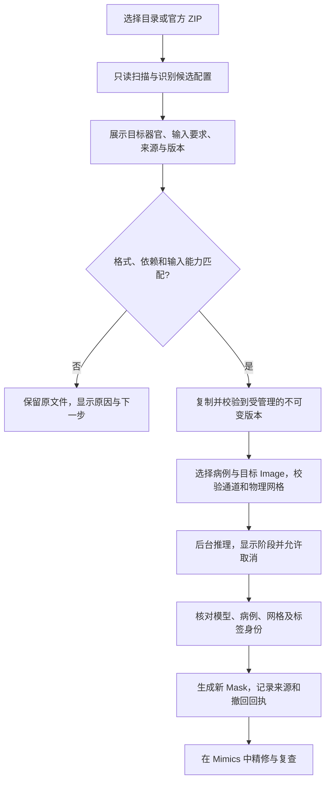

# 外部 nnU-Net 模型进入 Mimics 的设计方案

日期：2026-10-31。代码核对版本：`33e738fca65526156791e03b5acf999f9d9928b3`。本文是兼容性调查与设计。首批实现已落地（commits `927355d` + `0d38a91`）：受限 checkpoint 加载、严格 ZIP 提取、只读扫描与受管理导入（`tools/nnunet_external_model.py`）；模型管理器 UI 原生导入入口与推理配方贯通为后续轮次。已完成的缺陷修复见[修复报告](2026-10-31-nninteractive-fixes-external-nnunet.md)。

## 可以跨电脑使用，但模型不是一个固定网络

别人训练、其他电脑训练或网上发布的完整 nnU-Net v2 模型，在目标机器安装兼容的 nnU-Net 和所需依赖后，可以直接推理，不需要重新训练。官方同时提供模型文件夹推理和模型 ZIP 导出/安装命令。这不要求提供训练病例。[官方推理与模型迁移说明](https://github.com/MIC-DKFZ/nnUNet/blob/288572bae134bb65932074f7f06d3dfa07b198dc/documentation/how-to/run-inference.md)

固定的是结果组织和加载契约；网络结构、预处理、输入通道、配置及标签语义会随任务改变。v2.6.2 的官方预测器读取 `dataset.json`、`plans.json` 和 checkpoint 内的训练器、配置，再重建网络。单独的 `.pth` 通常不足以恢复这一契约。[官方 v2.6.2 预测器](https://github.com/MIC-DKFZ/nnUNet/blob/v2.6.2/nnunetv2/inference/predict_from_raw_data.py)

典型的可迁移目录如下。至少应有一组完整可用的 fold；不要求一定训练五折。`fold_all` 与数字 fold 应明确选择，不能重复混用。用户最好同时取得模型作者的推理说明、适用范围、版本和许可。

```text
Dataset123_Example/
└── nnUNetTrainer__nnUNetPlans__3d_fullres/
    ├── dataset.json
    ├── plans.json
    └── fold_0/
        └── checkpoint_final.pth  或受支持版本的 checkpoint_final.safetensors
```

必须区分版本。v1 已训练模型不能通过 v2 的数据格式转换命令变成 v2 模型，需要 v1 推理环境。当前官方主线 `288572bae134bb65932074f7f06d3dfa07b198dc` 已采用 `.safetensors`，兼容读取旧 `.pth`；旧安装未必能读取新格式。不能把“同属 nnU-Net”当作环境兼容保证。[v1 迁移说明](https://github.com/MIC-DKFZ/nnUNet/blob/288572bae134bb65932074f7f06d3dfa07b198dc/documentation/tldr_migration_guide_from_v1.md)、[官方 checkpoint 实现](https://github.com/MIC-DKFZ/nnUNet/blob/288572bae134bb65932074f7f06d3dfa07b198dc/nnunetv2/utilities/checkpoints.py)

## 当前集成的实际能力

| 环节 | 当前代码 | 对标注者的含义 |
|---|---|---|
| 模型管理器导入 | `tools/model_manager_ui.py` 识别本工具的 `bundle.json`；`tools/ai_model_bundle.py::import_nnunet` 要求 `mimics_model_manifest.json` | 本工具导出的模型包可以跨机器导入；原生目录/官方 ZIP 尚不能直接进入这个入口 |
| 底层推理 | `Action4_Predict.py::easy_predict` 调用官方预测器，接口已有 `use_folds` / `checkpoint_name` | 具备接入外部完整模型的基础；接口存在不等于标注者流程已支持 |
| 常规推理调度 | `tools/nnunet_pipeline.py::run_inference` 提交单个 `input_path`，未传入选定 checkpoint/folds | 需要把导入时解析的推理配置完整贯通，不能只新增文件选择框 |
| 模型可用性 | `nnunet_common.model_usability` 主要检查文件和 `checkpoint_final.pth` | 尚不足以证明外部模型的输入、网络、标签及运行环境相容 |
| 模型目录改名 | `Action4_Predict.py::_read_model_meta` 会从目录三段名推断配置，否则使用默认值 | 管理目录不能让模型含义依赖被重命名的文件夹；应从经验证的模型元信息恢复配置 |
| 权重导入校验 | 本轮改成受限反序列化，允许明确的 NumPy 数值数据类型，不自动信任文件提出的 Python 全局对象 | 降低导入 `.pth` 执行代码的风险；仍不是完整模型安全沙箱或网络兼容验收 |

因此，当前不能向用户承诺“任意下载的 nnU-Net 结果放进来就能在 Mimics 使用”。这是需要补齐的产品能力，并非算法层面必须重新训练。

## 推荐的使用流程

在现有模型管理器保留“导入本工具模型包”，新增独立的“导入 nnU-Net 训练结果”，接受目录或官方 ZIP。标注者不需要手写 manifest、数据集编号或命令行。自动识别只有一个候选模型时直接进入识别结果；存在多个配置时列出器官、输入类型和来源，让用户明确选择，不猜哪个最好。

识别结果页应首先显示“这个模型能做什么、当前能否使用”，随后提供可展开的技术详情。建议摘要为：模型名、分割目标、要求的输入（例如单通道 CT）、来源、大小、兼容状态。完整路径、版本号和模型 ID 可复制，长值换行；阻碍同时给出具体下一步，例如“需要四个配准序列，当前仅选择一个”，避免只有红色“失败”。配置、fold、checkpoint、TTA 和后处理放在高级详情，初始保持发布者的推理配方；速度选项若改变配方，应明确记录并提示结果可能不同。

导入完成后显示“对当前影像预测”和“批量预测”。当前影像预测先展示目标 Image 的名称、病例/期相和将生成的 Mask；默认新建带模型来源的结果，不覆盖人工 Mask。完成后选中生成对象并定位到目标影像，用户可直接在 Mimics 编辑。再次预测须明确新建/替换对象并提供撤回，不能按同名 Mask 猜对象身份。没有打开项目时保留模型并提示先打开影像，不启动推理。



## 首期范围与扩展顺序

| 类型 | 推荐首期行为 | 理由及后续条件 |
|---|---|---|
| 完整 v2 单通道、非级联，标准内置训练器/网络 | 在环境和输入校验通过后支持目录、官方 ZIP；支持已验证的 2D/3D 配置和明确的可用 folds | 最贴近现有单 Image 推理通路；分别验收 2D/3D、数字 fold/`all`，不以文件存在代替验收 |
| 只有一个 checkpoint、缺 plans/dataset | 拒绝，列出缺少文件 | 不允许猜默认网络和标签 |
| `.safetensors` 新格式 | 根据所选运行环境的实际能力放行；当前 PTH 可用性检查需扩展后才算支持 | 不改扩展名冒充兼容；不能自动升级用户环境 |
| v1 模型 | 标为不兼容，说明需要独立 v1 适配器 | 数据转换不能转换已训练模型 |
| 自定义 trainer、architecture、preprocessor、reader | 列出缺失依赖，不自动导入包内 Python 或安装代码 | 自定义训练器必须可导入；管理员准备可信环境后再做独立验证 |
| 多通道/多期 | 首期阻止单 Image 一键使用，后续增加每病例的通道绑定表 | 需要明确 channel 0/1/… 对应的 Image GUID/期相、配准和几何；不能复制同一影像补齐通道 |
| cascade、跨配置 ensemble | 显示所需完整推理链，首期不按单模型执行 | 前级结果、配置组合、概率融合和后处理须形成完整任务图 |
| region-based labels、自定义后处理、超出当前导入数值范围的标签 | 未验证支持前阻止，不能静默降级成普通分类 | 应按模型 LabelManager 的语义解码；保持数值标签和区域顺序 |

多通道的关键是所有通道同病例、配准且几何一致，顺序保持训练契约。一个四序列 MR 模型不能仅凭四个文件都能读就放行；单通道增强 CT 模型也不能把“CT”当作适用所有期相的证据。这一规则来自输入契约，适用范围仍需发布者说明和本地复查。[官方通道与输入格式](https://github.com/MIC-DKFZ/nnUNet/blob/288572bae134bb65932074f7f06d3dfa07b198dc/documentation/reference/dataset-format.md)

自定义代码需单独处理。官方要求推理机器能导入 checkpoint 对应的 trainer；只修改名字并不保证网络等价。新格式只解决 checkpoint 的序列化方式，plans/trainer 仍会引用 Python 类，不能把 `.safetensors` 等同于“整个模型包可信”。[官方自定义训练器迁移说明](https://github.com/MIC-DKFZ/nnUNet/blob/288572bae134bb65932074f7f06d3dfa07b198dc/documentation/how-to/share-models-with-custom-trainers.md)

## 实现应维持的契约

导入分为只读扫描、受限元信息检查、能力判定、复制校验、原子登记几个阶段。扫描器不得为了识别而执行任意 pickle、导入包内代码或运行安装脚本。ZIP 还应限制解压体积/文件数/压缩比例，拒绝越界、链接和名称冲突；复制期间源文件变化则失败回退。取消或中途失败不注册半成品，不修改原目录，重试不能生成重复模型。对相同内容复用版本，对不同内容生成新版本，不原地覆盖正在使用的权重。

模型 manifest 应记录来源/许可说明、文件摘要、格式和环境版本、trainer/plans/configuration、checkpoint/folds、channel_names、数值 labels/regions、reader/preprocessor、后处理与完整推理配方。显示名称与模型 ID 分开；器官中文别名只用于显示，不能重写数值标签。缺少来源说明可以如实标为未知，不冒称已验证。文件完整、可加载、可运行、本地验证通过应为独立状态，外部模型默认“外部预训练／未做本地效果验证”，不伪造本地训练病例数、验证指标，也不自动替换正在使用的任务模型。

作业应绑定模型版本摘要、病例身份、目标 Image GUID、每个通道的输入版本与物理网格；结果返回后再次验证。输入变化、用户切换项目、取消或迟到结果均不能写进当前另一病例。恢复输出到选定参考影像的物理网格，再按原标签 ID 生成对应 Mask。模型初始化、CUDA、重采样和推理放在外部工作进程；Mimics API 与最终对象写入留在主线程的短事务中。界面展示准备、加载、推理、回传和导入阶段，取消保留人工成果；异步重试必须去重。

导入外部模型推理与继续训练是两个能力。缺少原训练集和患者划分时，不能宣称可以无条件“续训”或复现作者指标。主动学习可将外部模型作为已注明来源的预测起点；后续采样、患者去重、冻结验证集和重新训练仍需明确的数据与训练契约，不能伪造为本地已验证模型。

## 验收与落地顺序

先完成元信息扫描器、能力矩阵和受管理版本登记，再接模型管理器的原生导入入口，最后贯通推理配方与 Mimics 结果导入。之后再做多通道病例绑定、级联和高级模型；无需为了首期支持下载大型模型、训练或修改用户环境。

验收应包含另一机器导出的真实完整模型、目录移动/改名、中文长路径、单 fold 与 `fold_all`、2D 与 3D、格式不兼容、缺文件、自定义依赖缺失、取消/断电恢复、并发导入、相同模型去重和恶意 pickle 拒绝。空间验收使用各向异性和斜位合成体，核对非背景位置、左右方向、物理坐标、标签 ID，以及切换病例后迟到结果被拒绝。最后在真实 Windows/Mimics/GPU 上，以同一兼容环境和相同推理配方对比官方命令与插件结果，再由标注者检查新建 Mask、编辑和撤回。这些是未来验收项目，本轮没有执行外部模型的完整推理验收。

## 首次等待与加速的取舍

外部模型同样可能在首次运行时经历进程启动、Python/依赖导入、权重读取、设备初始化、可能的编译和图像预处理。后续只有仍保留相同模型进程/会话以及可验证的输入缓存时，才有机会复用这些步骤；更换病例仍需相应准备。该判断是运行机制分析，本轮没有真实 GPU 延迟测量。

建议先细分计时再优化：导入时做静态校验，把本机模型副本放在可靠本地存储；在用户选定模型后可取消地预加载模型；同图、不同器官复用经过身份验证的图像会话；适当保留模型进程并在其他任务需要显存时释放。不能用减少 fold、关闭 TTA、降低分辨率或跳过物理/强度校验冒充等价加速。本轮新增内容校验会增加 CPU/内存读取成本，换取正确的缓存命中；未宣称具体倍数提升。
